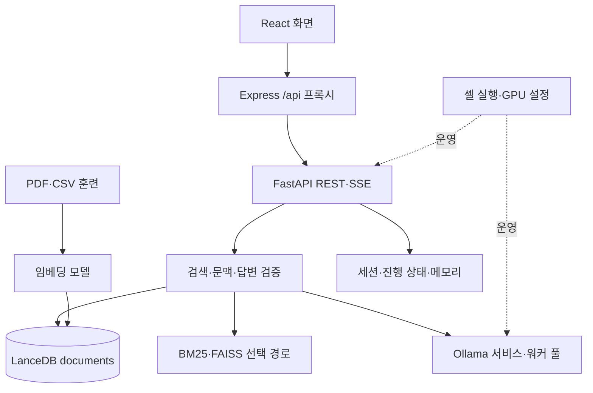
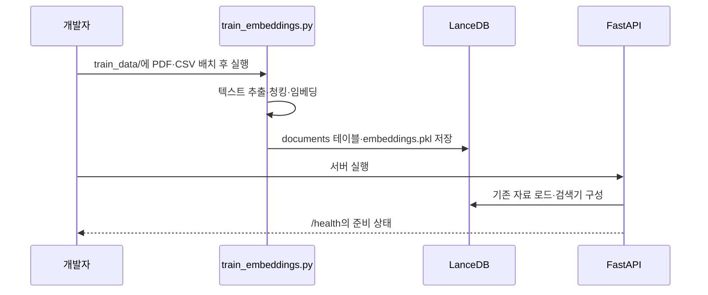
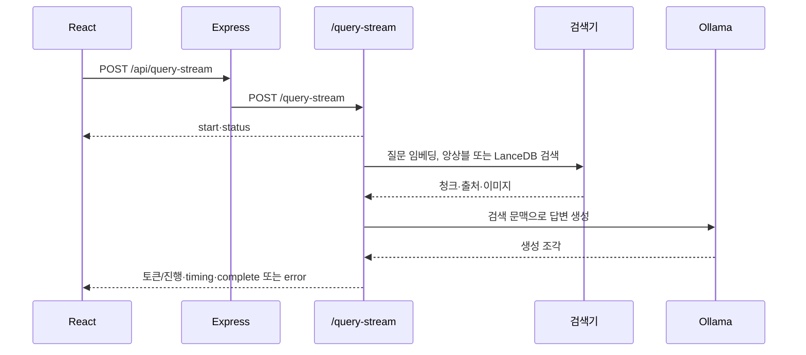

# LogisticsKorea 개발자 가이드 — 바이브코딩 재구현 명세

작성일: 2026-09-18  
기준: `mymeta-inc/LogisticsKorea`, `main`, `5b49a31`  
대상: 스마트 물류·그린 기술 문서 챗봇, 검색 인덱스, Ollama 추론, React 화면과 Express 전달 계층

## 0. 전체 구현 개요 및 상세 아키텍처

### 0.1 무엇을 구현하는 시스템인가

LogisticsKorea는 물류·그린 기술 문서를 한국어 중심으로 검색하고 답하는 웹 챗봇이다. FastAPI가 문서 적재, 검색, SSE 답변과 상태 API를 제공한다. React 화면은 Express 프록시를 통해 API를 호출하고, 검색에는 LanceDB와 선택적인 BM25·FAISS 앙상블을, 생성에는 Ollama 서비스 또는 워커 풀을 쓴다.

| 목적 | 입력 | 처리 | 결과 |
|---|---|---|---|
질문 | 질의, 세션, 언어, 검색 옵션 | 임베딩→검색→문맥 구성→Ollama | SSE 답변, 출처, 이미지, 소요 시간 |
문서 준비 | `train_data/`의 PDF·CSV | 추출→청킹→임베딩→LanceDB | `trained_embeddings/` 자료 |
문서 추가 | PDF·DOCX·XLS/XLSX·TXT·CSV 업로드 | 추출→임베딩→테이블 추가→검색기 재구성 | 처리 청크 수 |
운영 | 상태·메모리·워커 요청 | 준비 상태와 자원 조회, 정리 | JSON 상태 |

### 0.2 구현을 구성하는 여섯 계층



전달 계층은 React·Express·FastAPI, 처리 계층은 `main.py`와 `ensemble_retriever.py`, 근거 계층은 원본 및 LanceDB, 모델 계층은 임베딩과 Ollama, 상태 계층은 프로세스 메모리, 운영 계층은 스크립트와 설정이다. 화면의 접속 성공은 모델과 검색 데이터의 준비 완료를 뜻하지 않는다.

### 0.3 실행 프로세스와 배포 구조

| 프로세스 | 코드 기준 | 역할 |
|---|---|---|
FastAPI | `config.py`의 8001, `main.py` 실행부 | 문서·질의·상태 API |
Express | `express-server.js`의 `PORT` 기본 8009 | React 빌드 서빙, `/api`를 `localhost:8001`로 전달 |
React 개발 서버 | `chatbot-frontend`의 CRA 기본 3000 | 개발 화면, localhost 개발 시 8009 호출 |
Ollama | `ollama_llm_service.py`, `ollama_worker_pool.py` | 생성 모델, 단일 서비스 또는 다중 워커 |

`restart_servers.sh` 등의 출력에는 8080, 문서에는 3000/8009가 혼재한다. 실제 주소는 실행한 명령과 `PORT`, React 개발 서버 설정으로 확인한다. `express-server.js`의 백엔드 주소는 코드에 고정되어 있다.

### 0.4 전체 데이터와 RAG 저장 구조

| 위치 | 역할 | 주의 |
|---|---|---|
`train_data/` | 훈련 입력 PDF·CSV | `.gitignore` 대상, 별도 공급 필요 |
`trained_embeddings/` | `embeddings.pkl` 및 LanceDB `documents` | `.gitignore` 대상, 입력·모델과 버전 일치 필요 |
`document_db/` | 일부 문서·코드에서 언급하는 별도 DB 경로 | 현재 주 로딩 경로인 `trained_embeddings/`와 혼동 금지 |
`main.py` 프로세스 메모리 | 세션 질문 이력, 진행 상태, 사전 로드 목록 | 재시작 시 영속 보장 없음 |
`chatbot-frontend/build/` | Express가 서빙하는 빌드 산출물 | 소스 수정 후 재빌드 |

### 0.5 문서 한 건의 실행 순서



업로드 경로는 `/upload`에서 파일을 읽고 동일한 테이블에 청크를 추가한 다음 앙상블 검색기를 다시 초기화한다. 훈련 스크립트와 온라인 업로드의 청킹·메타데이터 정책이 일치하는지 변경 시 확인한다.

### 0.6 질문 한 건의 실행 순서



### 0.7 모듈 간 인터페이스와 상태 소유권

| 상태 | 생성·소유 | 소비 | 경계 |
|---|---|---|---|
`content`, `source`, `vector`, 선택적 `image` | 훈련·업로드 | LanceDB·검색기·화면 | 벡터 차원과 모델 일치 |
`session_id`·질문 이력 | `main.py`의 `ConversationHistory` | 후속 질문 | 프로세스 내 상태, 24시간 만료 |
워커 상태 | `ollama_worker_pool.py` | SSE·운영 API | 사용 가능 워커 없으면 오류 이벤트 |
`API_BASE_URL` | `chatbot-frontend/src/config.js` | React fetch | 개발/빌드 경로 구분 |

### 0.8 응답·오류·검증의 설계 원칙

검색 근거 없음, 임베딩 미준비, Ollama 미준비, 워커 부족, 업로드 형식 오류를 구별한다. `/health`의 `status: healthy`만 보지 말고 `models_ready`, `initialization_status`, `database.table_ready`, `preloaded_documents.ready`를 함께 확인한다. 현재 코드는 공개 업로드·삭제·훈련·메모리 API와 광범위한 CORS를 두므로 외부 공개 환경의 접근 통제를 따로 설계해야 한다.

### 0.9 재구현 시 시작점과 완료 경계

권장 순서는 **자료 형식→임베딩·LanceDB→검색→Ollama 스트림→FastAPI→Express·React→운영 검증**이다. 검색만 되는 상태와 근거 있는 답변 및 출처·이미지·오류 종료까지 되는 상태를 구별해 인수한다.

## 1. 문서의 목적과 사용법

이 문서는 추적된 코드로 서비스를 이해·수정·재구현할 개발자와 코딩 AI를 위한 명세다. 코드에서 확인한 계약과 환경에 따라 달라지는 모델·자료·배포 주소를 구분한다. 실제 서버, GPU, 원본 자료를 실행 검증한 운영 보증서는 아니다.

## 2. 기준 자료와 재현 범위

### 2.1 보유 자료

기준 커밋에는 Python 서버·검색기·훈련 스크립트, Express 서버, React 소스, 셸 실행 도구, README와 문제 해결 문서가 있다. `main.py`, `train_embeddings.py`, `ensemble_retriever.py`, `ollama_*`, `express-server.js`, `chatbot-frontend/src`를 현재 동작의 우선 출처로 삼는다.

### 2.2 복제본과 운영 환경의 차이

`train_data/`, `trained_embeddings/`, `document_db/`는 Git에서 제외된다. 원본 문서, LanceDB 테이블, Hugging Face 모델 캐시, Ollama 모델 및 서비스 구성이 없으면 코드만으로 원래 답변을 재현할 수 없다. README의 오래된 IP·포트·모델 이름과 스크립트의 출력보다 실행 코드를 먼저 확인한다.

## 3. 제품 기능과 사용자 흐름

### 3.1 문서 기반 채팅

React `App.js`에서 언어를 선택하고 질문하면 `/query-stream`의 SSE를 읽어 답변을 점진적으로 표시한다. 완료 이벤트의 출처와 이미지, 검색·생성 시간을 반영한다. 새 채팅은 화면의 세션 ID를 갱신한다.

### 3.2 문서 적재와 훈련

관리자가 `train_data/`에 PDF·CSV를 두고 `python train_embeddings.py`를 실행한다. `/upload`는 PDF·DOCX·XLS/XLSX·TXT·CSV를 최대 50MB로 받아 즉시 적재한다. `/train`은 별도 프로세스 훈련을 시작하며 응답 메시지대로 서버 재시작 후 새 자료 로드를 확인한다.

### 3.3 검색·이미지·언어

`use_hybrid_search`가 참이고 앙상블 검색기가 준비되면 BM25·FAISS·LanceDB 융합 검색을 쓴다. 그렇지 않으면 LanceDB 벡터 검색을 쓴다. CSV의 이미지 데이터는 검색 결과에 연결될 수 있다. `language`는 답변 언어를 지정하며 UI는 한국어 외 언어도 제공한다.

### 3.4 운영 상태

`/health`, `/preloaded`, `/memory`, `/worker-pool/status`로 서버와 자료·워커 준비를 확인한다. 문서·세션 삭제와 강제 메모리 정리, 훈련 실행은 상태 변경 요청이다.

## 4. 아키텍처와 파일 책임

| 파일/디렉터리 | 책임 |
|---|---|
| `main.py` | FastAPI 앱, 시작 시 백그라운드 초기화, 업로드·질의 SSE·상태·관리 API |
| `train_embeddings.py` | PDF/CSV 탐색·추출·청킹·임베딩, pickle/LanceDB 저장 |
| `ensemble_retriever.py` | BM25, FAISS, LanceDB 검색기와 결과 융합 |
| `clean_rag_system.py` | 별도 LangChain 기반 RAG 구현; 실제 `/query-stream` 흐름은 `main.py` 확인 |
| `ollama_llm_service.py`, `ollama_worker_pool.py` | 단일 Ollama와 다중 워커 생성 |
| `gpu_config.py`, `config.py` | 장치·메모리 관리, 서버 주소 상수 |
| `express-server.js` | React 빌드 서빙과 `/api` JSON/SSE 프록시 |
| `chatbot-frontend/src/App.js`, `config.js`, `i18n.js` | 채팅·SSE UI, API 주소, 다국어 문구 |
| `start_*.sh`, `restart_*.sh`, `tunnel_*.sh` | 서버·모델·터널 운영 보조 |

## 5. 데이터 계약

### 5.1 검색 레코드

LanceDB `documents`의 핵심 열은 `content`(검색 문맥), `source`(출처), `vector`(문서 임베딩)이고 CSV는 `image`를 추가할 수 있다. 일반 업로드의 출처는 `파일명_chunk_번호` 형식이다. `train_embeddings.py`의 pickle 및 테이블 작성과 `main.py`의 로더가 같은 필드·벡터 차원을 사용해야 한다.

### 5.2 요청과 대화 상태

`QueryRequest`는 `query`, `max_tokens=1024`, 선택적 `conversation_id`, `use_hybrid_search=True`, `session_id`, `language='ko'`를 받는다. 최근 질문은 `ConversationHistory`에 최대 10건, 만료 24시간으로 보관한다. 이 기록은 영속 DB나 사용자 인증과 연결된 상태가 아니다.

### 5.3 검색 결과와 답변

융합 결과는 청크 내용과 출처, 검색 방법을 포함한다. 답변의 `sources`는 방법 태그가 붙은 최대 5개 출처로 완료 이벤트에 제공된다. 이미지 데이터는 검색된 레코드에 존재할 때만 전달될 수 있다.

## 6. 문서 검색과 답변 생성

훈련 시 텍스트를 분할하고 Transformer 임베딩을 정규화해 저장한다. 시작 시 `main.py`가 `trained_embeddings/`의 `documents` 테이블 또는 pickle 자료를 읽고 검색기를 구성한다. BM25·FAISS가 설치되지 않거나 자료가 없으면 해당 검색 경로가 비활성화될 수 있다. 질의 시 동일 계열의 임베딩 모델로 벡터를 만든 뒤 상위 검색 결과를 생성 문맥으로 사용한다. 모델 교체 시 기존 벡터의 차원과 의미 공간을 함께 재구축한다.

## 7. 문서 형식과 전처리 규칙

`train_embeddings.py`의 자동 입력은 `train_data/`의 PDF·CSV다. 런타임 `/upload`는 PDF, DOCX, XLS/XLSX, TXT, CSV를 처리한다. PDF 텍스트 추출은 `PyPDF2`, DOCX는 `python-docx`, 표는 pandas 기반 경로를 확인한다. 스캔 PDF에는 별도 OCR 경로가 명시되어 있지 않으므로 텍스트 추출 가능 여부를 먼저 검사한다. CSV의 열·이미지 표현은 `extract_text_from_csv`와 훈련 함수의 양쪽 계약에 맞춘다.

## 8. 채팅 엔진의 정확한 분기

### 8.1 입구와 검색 선택

현재 React의 주요 입구는 `/query-stream`이다. `use_hybrid_search=True`이며 검색기가 존재하면 `ensemble_search`, 그렇지 않으면 `table.search`를 사용한다. 주석 처리된 이전 `/query` 구현을 현재 공개 API로 가정하지 않는다.

### 8.2 문맥과 생성

검색 청크의 내용·출처·선택 이미지로 문맥을 만든다. 워커 풀이 준비되면 풀을 사용하고 실패하면 단일 Ollama 경로를 시도하는 초기화 흐름이 있다. 스트림 사용 시에는 실제 준비 플래그와 워커 가능 여부가 결과를 좌우한다.

### 8.3 런타임 전환

`SKIP_OLLAMA`는 초기화 건너뛰기 옵션이고 워커 수 등은 `main.py`와 `ollama_worker_pool.py`에서 읽는다. `start_multiple_ollama.sh`와 `start_ollama_optimized.sh`는 별도 인스턴스 실행을 돕는다. GPU 메모리와 실행 포트가 모델 크기·동시성의 실제 한계다.

## 9. 검증과 오류 처리

업로드는 확장자·50MB·추출된 유효 텍스트·임베딩·테이블 쓰기를 순서대로 검사한다. 문서 추가 후 검색기 재구성 실패 시 업로드 응답의 `ensemble_retriever_updated`를 확인한다. 검색 테이블·모델·Ollama가 준비되지 않았을 때 `/health`의 세부 필드와 SSE `error`를 함께 확인한다. 데이터 삭제 API는 개발 검증 전에도 기존 인덱스를 바꿀 수 있다.

## 10. API와 SSE 계약

### 10.1 주요 라우트

| 목적 | 메서드·경로 | 계약 |
|---|---|---|
| 스트리밍 질의 | `POST /query-stream` | `QueryRequest` JSON → SSE |
| 문서 업로드 | `POST /upload` | multipart `file` → 청크 수 JSON |
| 상태 | `GET /health`, `GET /preloaded` | 모델·테이블·자료 상태 |
| 훈련 | `POST /train` | 백그라운드 작업 시작 |
| 세션 | `GET /conversations`, `DELETE /conversations/{conversation_id}` | 메모리 내 상태 조회·삭제 |
| 운영 | `GET /memory`, `GET /worker-pool/status` | 자원·워커 상태 |
| 삭제 | `DELETE /documents`, `DELETE /conversations` | 현재 자료·대화 상태 변경 |

### 10.2 요청·응답

```json
{"query":"스마트 물류 플랫폼을 설명해줘","session_id":"example-1","language":"ko","use_hybrid_search":true}
```

직접 FastAPI 호출은 `/query-stream`, Express를 거치면 `/api/query-stream`이다. `/health`는 HTTP 성공과 모델 준비를 별도 값으로 표현한다.

### 10.3 SSE 프레임

각 프레임은 `data: {JSON}\n\n`이다. 코드의 `type`에는 `start`, `status`, `timing`, 생성 중 메시지, `complete`, `error`가 있다. `complete`에 `sources`, `images`, `timing`이 들어간다. React는 `fetch`의 본문 스트림을 읽으며 프레임 경계가 네트워크 청크 경계와 다를 수 있으므로 버퍼를 유지해야 한다. Express는 `/query-stream`의 본문을 파이프로 전달하고 버퍼링 방지 헤더를 설정한다.

### 10.4 인증과 공개 설정

현재 확인한 API 경로에는 계정 인증 의존성이 없다. `main.py`와 Express 모두 넓은 CORS를 허용한다. 외부 공개 배포에는 업로드·훈련·삭제·디버그·메모리 API의 권한 및 요청 제한을 별도로 구현·검증한다.

## 11. LLM, 모델 관리와 동시성

질의 임베딩은 Transformer와 PyTorch를 사용하고 답변 생성은 Ollama가 맡는다. 워커 풀의 상태·헬스 체크 API와 단일 서비스 폴백을 따로 확인한다. 초기화는 서버 시작 후 백그라운드에서 진행되므로 첫 `/health`가 `in_progress`일 수 있다. `gpu_config.py`의 메모리 정리와 여러 Ollama 프로세스의 GPU 점유를 함께 관찰한다.

## 12. UI 재구현 계약

React 화면은 입력·새 채팅·언어 전환, 연결 상태, 진행 메시지, 점진적 답변, 출처와 이미지 뷰어를 제공한다. `config.js`는 로컬 개발 화면에서 `http://localhost:8009`, 빌드 화면에서 상대 경로 `/api`를 쓴다. Express로 서빙할 때 `npm run build`가 선행되어야 한다. 세션 ID와 완료/오류 이벤트에서 로딩 상태가 일관되게 갱신되어야 한다.

## 13. 별도 기능과 보조 도구

### 13.1 운영·터널

`restart_servers.sh`, `start_with_training.sh`, `start_express_server.sh`는 여러 프로세스를 관리한다. 터널 스크립트와 방화벽 문서는 특정 배포 환경에 의존한다. 출력에 남은 공인 IP는 현재 운영 주소의 근거로 사용하지 않는다.

### 13.2 점검·검색 보정

`check_dependencies.py`, `check_lancedb.py`, `fix_embedding_dimensions.py`는 의존성과 벡터 차원을 점검한다. `requirements_compatible.txt`는 대체 설치 목록이다. 데이터 변경 도구는 실제 인덱스 복사본에서 먼저 확인한다.

## 14. 누락 자산 복원 설계

### 14.1 원본과 모델 준비

서비스 소유자가 제공하는 PDF·CSV를 `train_data/`에 놓고 사용한 임베딩 모델 이름·버전, Ollama 모델 태그와 워커 포트를 기록한다. 외부에서 받은 pickle은 신뢰된 출처에서만 로드한다.

### 14.2 인덱스 재구축

`python train_embeddings.py`가 만든 `trained_embeddings/embeddings.pkl`과 LanceDB `documents`를 확인한다. 훈련 실패 시 기존 자료를 덮어쓰지 않도록 별도 환경에서 재생성한 뒤 교체한다. 업로드 자료는 훈련 입력에 자동으로 보존되는 원본 목록이 아니므로 재구축 범위를 별도 기록한다.

### 14.3 재구축 판정

`/health`의 `models_ready`, `database.table_ready`, 문서 수와 `/preloaded`의 목록을 확인하고 대표 질문에서 출처가 실제 원본과 맞는지 확인한다. 검색 인덱스만 복원하고 Ollama 모델을 준비하지 않은 상태는 완료가 아니다.

## 15. 설치와 실행

Ubuntu와 GPU/Ollama 환경을 전제로 한 기존 셸 스크립트가 있다. 다음은 저장소 루트에서의 수동 실행 예시다. 패키지 설치와 모델 내려받기는 네트워크·장치별 조정이 필요하다.

```bash
python -m venv .venv
source .venv/bin/activate
pip install -r requirements.txt
npm ci
cd chatbot-frontend && npm ci && npm run build && cd ..
# 별도로 Ollama 모델/서비스와 train_data/ 원본을 준비
python train_embeddings.py
python main.py                    # FastAPI: 8001
# 다른 터미널에서
npm start                         # Express: 기본 8009
```

`curl http://localhost:8001/health`, `curl http://localhost:8009/api/health`로 양쪽 경로를 확인한다. 개발 화면은 `cd chatbot-frontend && npm start`로 실행할 수 있으며 포트 3000에서 Express 8009를 호출한다. 기존 `restart_servers.sh`는 프로세스 종료·재시작과 패키지 설치를 수행할 수 있으므로 운영 환경의 현재 프로세스를 확인한 뒤 사용한다.

## 16. 인수 기준과 검증 계획

### 16.1 단계별 합격 조건

1. 자료: `documents` 테이블에 기대한 청크 수와 출처가 있다.
2. 모델: `/health`의 임베딩·Ollama·테이블 준비 값이 참이다.
3. API: 대표 질문의 SSE가 `start`부터 `complete`까지 도달하고 출처가 있다.
4. 화면: 새 채팅, 언어 선택, 오류 종료, 이미지 표시가 동작한다.
5. 운영: 모델 미준비와 워커 부족을 화면과 로그에서 구별할 수 있다.

### 16.2 필수 재현 시나리오

PDF/CSV 훈련 후 질의, 일반 문서 업로드 후 즉시 재질의, `use_hybrid_search` 양쪽 경로, 빈/없는 자료, Ollama 중단, 여러 동시 질문, 세션 갱신, React 빌드와 Express 프록시를 확인한다. 공개 배포라면 관리 API 접근 통제도 인수 조건에 넣는다.

### 16.3 이 문서의 검증 범위

파일·API·설정의 정적 검토로 작성했다. 의존성 설치, GPU 모델 실행, 실제 문서 적재 및 E2E 요청은 수행하지 않았다. 실행 환경의 재현 여부는 위 시나리오로 별도 확인해야 한다.

## 17. 바이브코딩에 바로 사용할 프롬프트

### 17.1 시작 프롬프트

> 이 가이드와 현재 저장소 코드를 기준으로 스마트 물류 문서 챗봇을 수정하라. 먼저 `main.py`의 실제 API, `train_embeddings.py`의 저장 형식, `ensemble_retriever.py`의 검색 분기, React의 SSE 처리를 확인하라. 변경 시 원본·인덱스·모델 버전의 관계와 준비 상태·오류 종료를 유지하고 실행 가능한 검증 절차를 제시하라.

### 17.2 단계별 후속 프롬프트

1. “`trained_embeddings/` 레코드 스키마와 현재 로더·검색기의 일치 여부를 검토하고 최소 변경으로 수정해줘.”
2. “`/query-stream`의 모든 종료 경로와 React SSE 파서를 함께 검토하고 중단·오류·완료 상태를 검증해줘.”
3. “Express `/api` 프록시의 상태 코드·헤더·본문 전달을 검토하고 업로드 및 SSE 회귀 시나리오를 확인해줘.”

## 18. 현재 구현의 알려진 차이와 유지보수 원칙

README·셸 로그의 주소가 `config.py`, Express 기본 8009, React 개발 기본 3000과 어긋날 수 있다. `clean_rag_system.py`의 별도 구현을 현재 `/query-stream` 호출 경로와 동일시하지 않는다. `main.py`의 `/query` 관련 코드에는 주석 처리된 구간이 있으므로 라우트 목록은 활성 데코레이터를 기준으로 한다. 데이터 경로와 임베딩 모델을 바꿀 때 원본·pickle·LanceDB·검색기 초기화를 한 변경 단위로 다룬다.

## 19. 참조 자료와 복원 순서

1. 현재 계약: `main.py`, `train_embeddings.py`, `ensemble_retriever.py`, `ollama_llm_service.py`, `ollama_worker_pool.py`.
2. 화면/전달: `express-server.js`, `chatbot-frontend/src/App.js`, `config.js`, `i18n.js`.
3. 실행 보조: `requirements.txt`, 양쪽 `package.json`, `start_with_training.sh`, `restart_servers.sh`.
4. 설명 보조: `README.md`, `README_COMPREHENSIVE.md`, `PROJECT_STRUCTURE.md`, `EXPRESS_SERVER_GUIDE.md`.

## 20. 자동 생성 참조 색인 및 검증 기록

### 20.1 주요 라우트 색인

활성 FastAPI 데코레이터 기준: `POST /upload`, `POST /query-stream`, `GET /health`, `GET /preloaded`, `POST /train`, `GET /conversations`, `DELETE /conversations`, `DELETE /conversations/{conversation_id}`, `DELETE /documents`, `GET /memory`, `POST /memory/cleanup`, `POST /memory/force-cleanup`, `GET /worker-pool/status`, `POST /worker-pool/health-check`, `GET /query/progress/{query_id}`, `GET /query/status`, `POST /preload`, `GET /api/debug/image/{row_index}`.

### 20.2 핵심 자료 색인

`QueryRequest`, `ChatResponse`, `ConversationHistory`: `main.py`. `RetrievalResult`, `BM25Retriever`, `FAISSRetriever`, `LanceDBRetriever`, `EnsembleRetriever`: `ensemble_retriever.py`. `PDFEmbeddingTrainer`: `train_embeddings.py`.

### 20.3 검증 기록

기준 커밋 `5b49a31`의 추적 파일, 라우트 데코레이터, 요청 모델, 훈련·검색·프록시 및 React 호출 경로를 읽어 작성했다. 실행 검증은 수행하지 않았다. 이후 코드 변경 시 이 색인과 0~16장의 계약을 함께 갱신한다.
