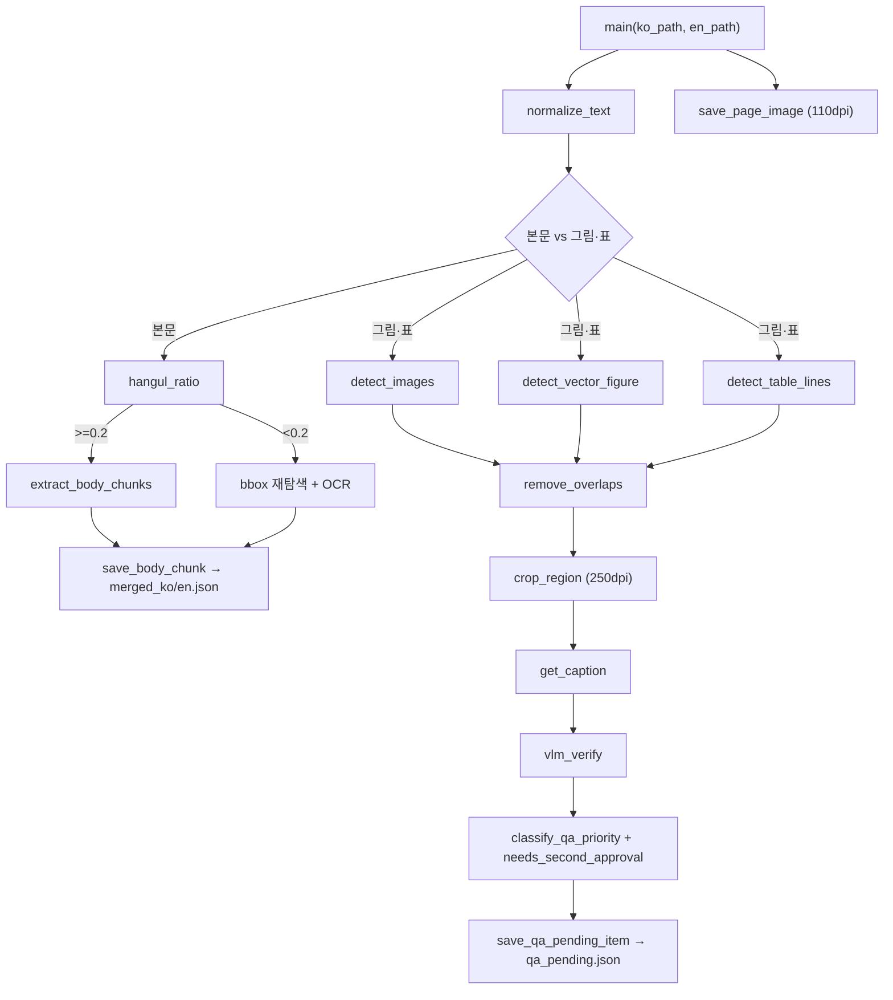

# 삼광 설비 챗봇 — 매뉴얼 코드 설계도

> **GUIDE_12 — GUIDE_9·10·11의 "매뉴얼" 설계를 함수·모듈 단위로 한 단계 더 쪼갠 문서.**

1. **범위**: 매뉴얼(PDF) 챗봇 관련 모듈·함수만 다룬다. 엑셀(작업지시서·고장수리내역)·다국어·프로덕션 신규 요청은 다루지 않는다.
2. **이 문서는 코드가 아니다** — 실제 Python 코드 한 줄도 없다. 함수 이름·입출력·호출 순서만 정리한 **설계도**다.
3. **표기 규칙**: 각 함수 설명 끝에 `[확정]` / `[제안]`을 붙인다.
   - `[확정]` = GUIDE_9·10에 **이름 그대로** 이미 나온 것(`is_followup`, `call_gitc`, `page_align.py`의 `mark` 등) — 함수명을 바꾸면 안 된다는 뜻은 아니고, 그 역할·계약이 이미 확정됐다는 뜻
   - `[제안]` = 이번에 설계 로직을 함수 단위로 쪼갠 것 — 실제 구현할 때 이름·경계는 바뀔 수 있다. 로직 자체(순서·기준값)는 9·10에서 확정된 걸 그대로 따른다
4. **기준**: 이 문서와 GUIDE_9·10·11이 다른 말을 하면 GUIDE_9·10이 맞다.

## 0. 모듈 구성

매뉴얼 관련 모듈은 4개다.

```
rebuild_originals.py   — PDF 2권 → 청킹(본문/그림·표) → merged_ko/en.json, qa_pending.json
page_align.py           — 원본↔번역본 쪽 정렬 → poc_parsing/.cache/page_align.json
index_to_pgvector.py    — merged_ko/en.json(+엑셀) → manual_chunks 테이블 (매뉴얼 관련 부분만 여기 서술)
search_api.py           — FastAPI: 질의 라우팅, QA 승인 라우트 (매뉴얼 관련 부분만 여기 서술)
```

## 1. `rebuild_originals.py`



| 함수 | 입력 → 출력 | 역할 |
|---|---|---|
| `main(ko_path, en_path)` | PDF 경로 2개 → - | 전체 파이프라인 진입점 `[제안]` |
| `normalize_text(raw) -> str` | 원문 텍스트 → 정규화 텍스트 | NFKC·`・`→`·`·머리말/꼬리말/쪽번호/빈 간지 제거, 표지·색인 페이지 제외 `[확정 로직, 함수 분리는 제안]`(0.3절) |
| `restore_korean_linebreaks(text) -> str` | 텍스트 → 텍스트 | 줄 끝 한글-한글 이어짐 복원 + 띄어쓰기 교정(`kiwipiepy` 등) `[확정 로직/제안 함수명]`(0.3절) |
| `hangul_ratio(text) -> float` | 텍스트 → 0~1 | 완성형 한글 음절(AC00~D7A3) 비율 계산 `[제안]`(0.6절 계산법) |
| `extract_body_chunks(page, lang) -> list[Chunk]` | 페이지 → 청크 목록 | 비율 20% 이상이면 그대로, 미만이면 bbox 위치 재탐색 + OCR `[확정 로직/제안 함수명]`(0.6절) |
| `detect_images(page) -> list[BBox]` | 페이지 → bbox 목록 | `page.get_images()`, 가로·세로 80pt 이상 `[확정]`(0.6절) |
| `detect_vector_figure(page) -> list[BBox]` | 페이지 → bbox 목록 | `page.get_drawings()`, 드로잉 40개 이상 모인 영역 `[확정]`(0.6절, ⑬번 위험 해결책) |
| `detect_table_lines(page) -> list[BBox]` | 페이지 → bbox 목록 | `page.get_drawings()`로 가로선 4개+세로선 2개 이상 영역, 겹치는 선은 합침 `[제안]`(0.6절, "표 쪽은 제안"이라고 명시됨) |
| `remove_overlaps(candidates) -> list[BBoxCandidate]` | 후보 목록 → 정리된 목록 | 겹침 검사·빈 영역 버림, 인접 영역 병합 오탐 방지(GUIDE_10 ⑯) `[확정 로직/제안 함수명]` |
| `crop_region(page, bbox) -> Image` | 페이지, bbox → 이미지 | 250dpi, `pt × 3.47`로 크롭 `[확정]`(0.6절) |
| `get_caption(region, page_text) -> str` | 영역 → 캡션 문자열 | 원문 문장 매칭 → `ocr_easyocr` → `ocr_paddleocr` → `vlm_read` 순 폴백 `[확정 순서/제안 함수명]`(0.0·0.6절) |
| `vlm_read(image) -> str` | 이미지 → 텍스트 | "보이는 대로만 옮겨라" 프롬프트로 VLM 호출, 추측·보완 금지 `[확정 제약/제안 함수명]`(GUIDE_10 ⑥) |
| `vlm_verify(image, caption) -> bool` | 이미지, 캡션 → 일치 여부 | 캡션-그림 1차 검증 `[확정 역할/제안 함수명]`(0.6절) |
| `classify_qa_priority(region, vlm_ok) -> str` | - → note 문자열 | 우선순위: VLM불일치→과다캡처→페이지전체→비어있음→머리글시작→기능혼입→너무긴문장 `[확정 순서]`(0.2절) |
| `needs_second_approval(caption) -> bool` | 캡션 → bool | 경고·주의·위험 문구 포함 여부 판정 `[확정 규칙/제안 함수명]` |
| `save_qa_pending_item(item)` | item → - | `qa_pending.json`에 추가(`chunk_id`/`bbox`/`image_path`/`caption`/`note`/`review_status`) `[확정 스키마]`(0.2절) |
| `save_body_chunk(chunk)` | chunk → - | `merged_ko.json`/`merged_en.json`에 추가(검수 단계 없음) `[확정]`(0.2절) |
| `save_page_image(page, dpi=110)` | 페이지 → - | 페이지 전체 이미지 저장(250dpi 크롭과 다른 렌더링, 섞지 않음) `[확정]`(GUIDE_10 ②) |

**구현 시 주의 — `crop_region`과 `vlm_read`/`vlm_verify` 사이에 bbox 값을 넘기지 않는다.** `crop_region`이 끝나면 bbox의 역할은 완전히 끝난다 — `vlm_read`·`vlm_verify` 함수 시그니처에 bbox 좌표나 탐지 기준(80×80pt·드로잉40개 등)을 파라미터로 넣지 않는다. 두 함수는 `crop_region`이 반환한 **이미지 객체 하나만** 받는다(근거는 GUIDE_9 0.0절 "VLM에서 bbox가 무관한 이유").

## 2. QA 승인 — `search_api.py` 내 라우트

| 함수(라우트 핸들러) | 입력 → 출력 | 역할 |
|---|---|---|
| `GET /qa` | - → HTML | bbox 검수 화면 `[확정 계약]`(1.1절) |
| `list_pending_qa()` (`GET /qa/pending`) | - → `qa_pending.json` 배열 | 승인 대기 그림·표 전체 반환 `[확정 계약]` |
| `review_qa(chunk_id, verdict, corrected_text, reviewer)` (`POST /qa/review`) | verdict `approved`\|`rejected` → `{chunk_id, review_status}` | 승인·반려 처리. verdict 잘못되면 400, 없는 chunk_id면 404 `[확정 계약]`(1.1절) |
| `count_approvals(chunk_id) -> int` | chunk_id → 승인 횟수 | 안전 문구 항목의 2차 승인 누적 추적 `[제안]`(0.6절 "2차 승인" 규칙 구현용) |
| `promote_to_merged(chunk_id, corrected_text)` | - | 승인 확정된 항목을 `merged_ko/en.json`에 반영. **이 함수가 끝나야** `manual_chunks`에 반영 준비가 됨(`index_to_pgvector.py`는 별도 실행 필요, GUIDE_10 ④) `[확정 흐름/제안 함수명]` |

## 3. `index_to_pgvector.py` (매뉴얼 관련 부분)

| 함수 | 입력 → 출력 | 역할 |
|---|---|---|
| `load_merged_chunks(lang) -> list[dict]` | `ko`\|`en` → 청크 목록 | `merged_ko.json`/`merged_en.json` 읽기 `[제안]` |
| `build_chunk_id(lang, docno, page, chunk_type, seq) -> str` | - → `chunk_id` | `{lang}_{docno}_p{page}_{type}_{seq}` 형식(`docno`=문서번호 뒤 5자리) `[확정 포맷]`(0.2절) |
| `embed_text(text) -> vector` | 텍스트 → 1024차원 벡터 | `bge-m3`, `normalize_embeddings=True` `[확정]`(0.2절) |
| `truncate_and_reload(chunks)` | 청크 목록 → - | `manual_chunks` TRUNCATE 후 전체 교체 적재 `[확정]`(1.3절) |

(엑셀 청크 적재 부분은 GUIDE_9 1.2·1.3절 참고 — 이 문서 범위 아님)

## 4. `search_api.py` — 질의 처리(매뉴얼 관련)


**판정 함수 4개**

| 함수 | 입력 → 출력 | 역할 |
|---|---|---|
| `is_followup(prior_query) -> bool` | `prior_query` → bool | 없으면 새 검색. "다른"·"또 다른"·"그래서"·"알려줘" 등 새 주제어 있으면 새 검색 `[확정]`(0.5절) |
| `choose_document_type(query, prior_doc_type) -> str` | 질문, 직전 종류 → `manual`\|`repair_log`\|`work_standard` | 이어 묻기면 직전 유지. 새 질의면 키워드 분기("고장/수리"→repair_log, "점검/정기"→work_standard, 그 외→manual) `[확정]`(0.5절) |
| `choose_lang(query, prior_lang) -> "ko"\|"en"` | 질문, 직전 언어 → 언어 | 이어 묻기면 직전 책 유지. "MANUAL GUIDE"·"메모리"·"소프트키"→en, "취급설명서"·"공구경"→ko `[확정]`(0.5절, 매뉴얼 전용) |
| `requested_kind(query, prior_kind) -> "figure"\|"table"\|None` | 질문 → 종류 | "표를 보여줘"→표, "그림도"→그림. 다른 책 추천 금지 `[확정]`(0.5절) |

**검색·생성**

| 함수 | 입력 → 출력 | 역할 |
|---|---|---|
| `embed_query(text) -> vector` | 질문 → 벡터 | `bge-m3`로 질의 임베딩(색인과 같은 모델) `[제안]` |
| `search_candidates(query_vec, lang, kind=None, top_k=24) -> list[Chunk]` | - → 후보 청크 | SQL `WHERE` 문서 필터 + `ORDER BY embedding <=>` 코사인 거리, 후보 24개 `[확정 수치/제안 함수명]`(0.5절) |
| `rank_manual(candidates, query) -> list[Chunk]` | 후보 24개 → 상위 3개 | 문서종류·질의어 포함 여부로 보강 재순위 `[확정 이름]`(0.5절) |
| `build_prompt(chunks, query) -> str` | 청크들, 질문 → 프롬프트 | RAG 프롬프트 조립 `[확정 이름]`(0.5절) |
| `call_gitc(prompt, temperature=0.2, timeout=60) -> str` | 프롬프트 → 생성 텍스트 | GITC `hyperclovax-seed-32b` 호출. 요청 형식은 AI팀 스펙 **확인 필요** `[확정 이름/스펙 미확정]`(0.0·0.5절) |
| `polish_answer(raw) -> str` | 생성 텍스트 → 다듬은 답 | 후처리(발췌·쪽번호 표기 금지 등 규칙 적용) `[확정 이름]`(0.5절) |
| `compute_offers(answer_chunk) -> dict` | 답으로 쓴 청크 → `{figure:[], table:[]}` | 같은 `page`에 있는 그림·표를 "같은 주제"로 붙임. 없으면 빈 채로 둠(지어내지 않음) `[제안]`(1.1절) |

**라우트 핸들러**

| 함수(라우트) | 역할 |
|---|---|
| `GET /` | 정적 화면(`index.html`) `[확정]` |
| `handle_ask(request) -> AskResponse` (`POST /ask`) | 판정 4함수 → 검색 → 생성 → `{answer, sources, model_used, offers}` 반환 `[확정 계약/제안 함수명]` |
| `handle_search(request) -> list[SearchResultItem]` (`POST /search`) | 근거 카드 배열 반환(`top_k` 기본 3, 1~20 허용) `[확정 계약/제안 함수명]` |
| `serve_manual_pdf(name)` (`GET /manuals/{name}.pdf`) | `name` ∈ `manual_1_ko`/`manual_1_en`(원본), `manual_2_ko`/`manual_2_en`(번역, 입고 후). 없는 이름이면 404 `[확정 계약]` |

## 5. `page_align.py`

| 함수 | 입력 → 출력 | 역할 |
|---|---|---|
| `align_pages(original_pdf, translation_pdf) -> list[dict]` | PDF 2개 → 정렬 목록 | 원본↔번역본 쪽 짝짓기. **쪽 번호가 같다고 가정하지 않음**(문서에 따라 범위가 달라 어긋날 수 있음, ⑰번) `[확정 제약/제안 함수명]` |
| `save_cache(entries)` | 정렬 목록 → - | `poc_parsing/.cache/page_align.json`에 저장. 필드는 `page`(원본 쪽수)·`text`(번역 쪽 문장)·`has_graphic` `[확정]`(1.1절) |
| `mark(translation_page_html, original_page_num)` | - | 번역 페이지 오른쪽 위에 "원본 p.N" 표시 `[확정 이름]`(0.2절에 `page_align.py`의 `mark`로 명시됨) |

## 6. 데이터 모양 (확정, 9번 0.2·0.6절 그대로)

```
Chunk (merged_ko/en.json 원소)
  chunk_id, doc_type='manual', chunk_type, lang, page, text, metadata{image_path?, caption?, table_html?}

BBoxCandidate (qa_pending.json 원소)
  chunk_id, bbox=[x0,y0,x1,y1](pt), image_path, caption, note, review_status

AskResponse (POST /ask 응답)
  answer, sources=[page,...], model_used, offers={figure:[], table:[]}

SearchResultItem (POST /search 응답 원소)
  chunk_id, chunk_type, page, lang, text_preview, source_anchor, image_path?, table_html?
```

## 7. 아직 함수 단위로 못 쪼갠 것

- `call_gitc`의 실제 HTTP 요청 형식(헤더·body) — AI 팀 스펙 받기 전엔 함수 내부를 못 채움
- `vlm_read`가 호출하는 실제 서비스(엔드포인트) — VLM이 GITC 기능인지 별도 서비스인지에 따라 클라이언트 코드가 달라짐
- `detect_table_lines`의 선 판정 세부 구현(기울기 임계값 등) — "제안" 수준이라 584건과 대조해봐야 정확도를 알 수 있음
