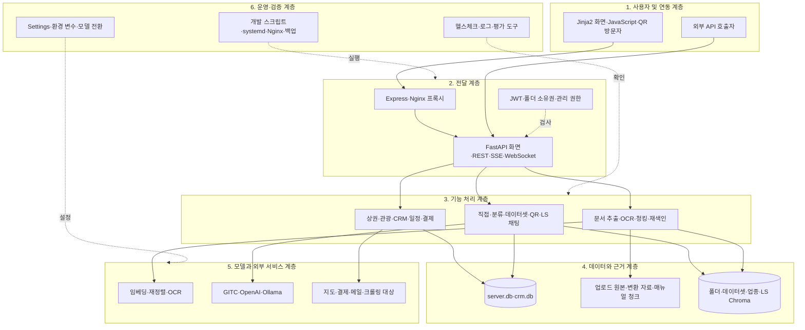
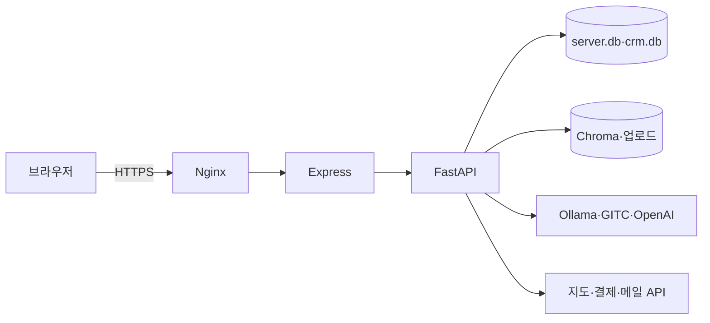
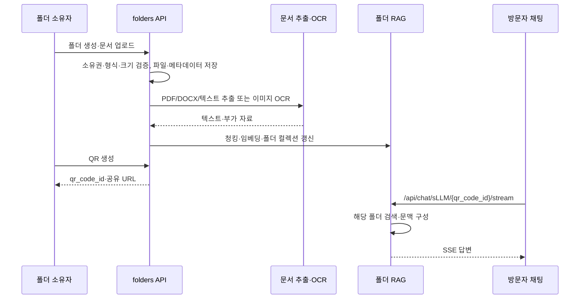
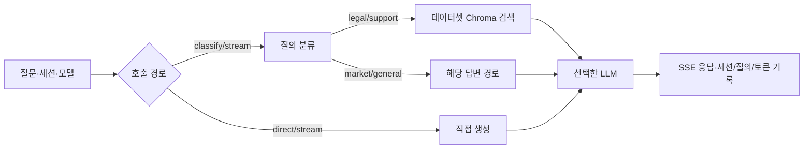

# mysbiz 개발자 가이드 — 바이브코딩 재구현 명세

작성일: 2026-09-18  
기준: `mymeta-inc/mysbiz`, `main`, `f616318`  
대상: 장부장, 김비서(MysLLM), LS 매뉴얼 챗봇, CRM, 상권·관광 서비스와 운영 구성

## 0. 전체 구현 개요 및 상세 아키텍처

### 0.1 무엇을 구현하는 시스템인가

mysbiz는 소상공인용 웹 애플리케이션이다. 계정과 구독을 기반으로 일반·지원사업·법률 채팅, 상권 분석, 관광 경로, 문서별 QR 비서, CRM과 일정 관리를 제공한다. FastAPI가 화면과 API를 제공하고 Express가 브라우저 요청을 프록시한다. AI 기능은 문서 검색, 분류, OCR, 생성 모델 호출을 조합한다.

핵심은 하나의 챗봇을 만드는 일이 아니다. 장부장 채팅과 사용자 문서에만 답하는 김비서, 별도 매뉴얼을 찾는 LS 챗봇은 서로 다른 자료와 권한 경계를 가진다. 문서 원본·메타데이터·벡터 인덱스의 일치, 스트리밍 응답과 대화 저장, GPU 모델 전환, CRM의 별도 DB까지 함께 구현해야 현재 동작을 재현할 수 있다.

| 사용 목적 | 입력 | 내부 처리 | 사용자에게 제공하는 결과 |
|---|---|---|---|
| 장부장 채팅 | 질문, 모델, 세션 | 직접 생성 또는 분류→데이터셋 검색→생성 | SSE 답변, 기록, 토큰·질의 로그 |
| 김비서 | 폴더 문서, QR 링크, 방문자 질문 | 추출·OCR→청킹·임베딩→폴더 범위 검색→생성 | 폴더 전용 답변과 공유 채팅 |
| LS 매뉴얼 | 제품 질문 | 전용 매뉴얼 청크·Chroma 검색→재정렬→생성 | 근거 기반 답변 |
| 상권·관광 | 위치, 업종, 경유지 | 외부 지도·공공 정보, 크롤링, 요약 | 지도, 경로, 분석 보고서 |
| CRM·일정 | 예약·고객·판매 파일, 프로젝트·작업 | 별도 CRM DB 저장·분석, 권한 확인 | 목록, 집계, 보고서, 일정 |
| 운영 | 사용자·구독·결제·모델 설정 | 인증·권한·결제 확인·서비스 전환 | 관리자 화면 및 상태 |

외부 지도, 결제, OAuth, SMTP, 모델 API와 운영 데이터는 저장소 코드만으로 재현되지 않는다. 또한 세 채팅 경로가 하나의 검색 컬렉션을 공유하는 구조가 아니다. 일부 구형 안내 문서는 다른 포트와 LanceDB 구성을 설명하므로 실제 실행 계약은 현재 코드와 환경 변수를 우선한다.

### 0.2 구현을 구성하는 여섯 계층



위 그림은 논리적 의존 관계다. 실제 요청은 인증·권한 검사를 거쳐 해당 서비스와 저장소를 사용한다. 브라우저의 axios 인증 처리는 `app/static/js/auth.js`에 있고 FastAPI 라우터는 `app/main.py`에서 결합한다. 일부 화면, 일정·CRM·상권 API는 이 파일에 직접 구현되어 있다.

전달 계층은 HTTP·SSE·WebSocket과 접근 검사를 맡고, 기능 계층은 각 요청의 처리 순서를 맡는다. 데이터 계층은 사용자와 폴더별 근거를 분리하며 모델 계층은 생성과 OCR을 수행한다. `app/routers/ls_chat.py`의 별도 매뉴얼 자료를 김비서 폴더 자료와 합치거나, 화면에서 서버의 소유권 검사를 대신하면 답변 근거와 접근 범위가 달라진다.

### 0.3 실행 프로세스와 배포 구조



| 프로세스 | 코드 기본값 | 개발 스크립트 | 역할 |
|---|---|---|---|
| FastAPI | `run.py`: `UVICORN_PORT` 기본 8001 | `dev-start.sh`: 8010 | 화면, 인증, API, SSE, WebSocket |
| Express | `express-server/server.js`: `PORT` 기본 3002, `FASTAPI_TARGET` 기본 `127.0.0.1:8007` | 3010→8010 | API·화면 프록시, SSE 버퍼링 방지 |
| Nginx | `deploy/nginx/` | 해당 없음 | 공개 HTTPS 역방향 프록시 |
| Ollama/외부 LLM | `app/config.py` 및 서비스별 설정 | 별도 준비 | 텍스트 생성과 일부 OCR |

Express와 FastAPI의 **코드 기본 포트는 서로 맞지 않는다**. 두 프로세스를 수동 실행할 때 `FASTAPI_TARGET`을 실행 중인 FastAPI 주소로 지정한다. 배포 스크립트와 systemd 파일은 별도 포트를 지정할 수 있으므로 각 환경의 최종 값을 확인한다. `app/main.py`는 가져오는 시점에 테이블 생성과 일부 SQLite 컬럼 보강을 수행한다. 따라서 새 환경의 첫 실행은 읽기 전용 검사가 아니다.

### 0.4 전체 데이터와 RAG 저장 구조

| 저장소 | 책임 | 주요 소유 코드 |
|---|---|---|
| `server.db` (`DATABASE_URL`) | 사용자, 폴더, 문서 메타데이터, 채팅, 일정, 로그 | `app/models.py`, `app/database.py` |
| `crm.db` (`CRM_DATABASE_URL`) | 예약, 고객, 판매·승인, 상품, 직원 | `app/crm_models.py`, `app/crm_database.py` |
| `./vector_db` | 폴더 문서 Chroma 컬렉션·임베딩 | `app/services/rag_service.py` |
| `./vector_db_datasets` | `dataset_legal`, `dataset_support` | `app/services/dataset_rag_service.py` |
| `./vector_db_category_search` | 업종 검색 | `app/services/category_search_service.py` |
| 업로드·OCR 결과 | 원본 파일, 변환 PDF, OCR 텍스트·구조 | `app/routers/folders.py`, `ocr.py` |
| LS 외부 자료 | 설정한 매뉴얼 청크 JSON과 벡터 컬렉션 | `app/routers/ls_chat.py` |

현재 `rag_service.py`와 데이터셋 서비스는 Chroma `PersistentClient`를 쓴다. 과거 LanceDB 가이드를 현재 모든 경로의 구현으로 간주하지 않는다. 운영 DB, 인덱스, 사용자 업로드, 인증 비밀, 모델 가중치는 코드와 구별해서 백업·복원한다.

### 0.5 김비서 문서 한 건의 실행 순서



HWP/HWPX는 LibreOffice를 이용해 PDF로 변환한 뒤 처리하며 변환 PDF는 내부용 사이드카로 구분한다. 이미지 OCR의 `_ocr.txt`와 `_ocr.json`도 원본과의 관계에 따라 목록에서 숨기는 규칙이 있다. 삭제·재학습에서는 DB 행과 벡터 데이터, 실제 파일의 일관성을 확인해야 한다.

### 0.6 장부장 질문 한 건의 실행 순서



`LLM_BACKEND=legacy`는 기존 OpenAI/Ollama 경로, `gitc`는 OpenAI 호환 GITC 경로다. 지원사업·법률 RAG의 모델 선택에는 `gpt-oss-120b`와 `exaone3.5:latest` 전환 코드가 있다. EXAONE 준비는 `systemctl`로 LS용 Ollama와 장부장용 인스턴스를 조정하므로 Linux 서비스 권한과 GPU 점유 상태를 전제로 한다.

### 0.7 모듈 간 인터페이스와 상태 소유권

| 상태·계약 | 생성·소유 | 소비 | 주의점 |
|---|---|---|---|
| 사용자·토큰 | auth 라우터, `app/auth.py` | 보호된 화면/API | access·refresh와 기업/관리자 권한 분리 |
| Folder·Document·QR | folders 라우터 | sLLM 채팅·대시보드 | 소유자와 폴더 ID를 함께 검증 |
| Chat·세션·질의 로그 | chat 라우터 | 기록 화면·통계 | 직접 채팅과 QR 채팅의 로그 경로 구분 |
| Chroma 컬렉션 | 각 RAG 서비스 | 검색·재색인·삭제 | 컬렉션과 파일/DB의 수명 일치 |
| CRM 행 | main·CRM 라우터 | CRM 화면·김비서 | `crm.db`와 일반 DB 분리 |
| 모델/런타임 | config·chat_model_switch | 채팅·LS | 서비스 전환이 다른 요청에 미치는 영향 검증 |

### 0.8 응답·오류·검증의 설계 원칙

SSE를 통과시키는 Express 설정과 장시간 OCR·학습 요청의 프록시 제한을 유지한다. 인증 실패, 권한 거부, 문서 처리 실패, 모델 미준비, 검색 결과 없음, 외부 API 실패를 한 종류의 빈 답변으로 합치지 않는다. QR 방문자 경로의 공개 범위와 폴더 소유자 관리 권한은 구별한다. 프로덕션 비밀은 `app/config.py`의 예시 기본값에 의존하지 않고 환경에서 제공한다.

### 0.9 재구현 시 시작점과 완료 경계

권장 순서는 **DB/인증→폴더·문서 저장→추출·OCR·벡터 검색→채팅 스트림→CRM·일정·상권→외부 결제·지도·운영 배포**다. 웹 화면만 뜨는 단계와 실제 검색·생성·외부 연동이 작동하는 단계를 구분해 검증한다.

## 1. 문서의 목적과 사용법

이 문서는 현재 추적된 코드로 mysbiz를 이해하고 다시 구현하거나 수정할 개발자와 코딩 AI를 위한 명세다. 파일 책임, 데이터 경계, 주요 요청 순서, 설치 조건, 검증 기준을 한곳에 둔다. 특정 환경의 접속 비밀·운영 DB 값·모델 응답을 보장하는 문서는 아니다. **확인**은 코드에서 확인한 사항, **환경 의존**은 외부 자산이나 운영 설정이 필요한 사항이다.

## 2. 기준 자료와 재현 범위

### 2.1 보유 자료

기준 커밋의 Python 앱, Jinja2 템플릿, Express 프록시, 셸 배포 스크립트, SQL, 데이터 전처리 도구, README·설치/기능 문서가 있다. `app/main.py`, `app/routers`, `app/services`, `app/models.py`, `app/crm_models.py`를 구현의 일차 출처로 삼는다. `README.md`, `DEVELOPMENT.md`, `SETUP_GUIDE.md`, `GUIDELINE/`은 운영 의도와 절차를 이해하는 보조 자료다.

### 2.2 복제본과 운영 환경의 차이

저장소에 추적된 `node_modules`, 벡터 디렉터리와 백업 파일이 있더라도 이를 최신 운영 상태나 안전한 복원점으로 가정하지 않는다. `.env`, 실제 OAuth/지도/결제/API 키, 운영용 SQLite와 업로드, LS 매뉴얼 컬렉션·모델은 별도로 확인한다. `requirements.txt`에는 CPU PyTorch 설명과 GPU Paddle/OCR 패키지가 함께 있으므로 대상 머신에 맞춰 설치 경로를 검증한다.

## 3. 제품 기능과 사용자 흐름

### 3.1 장부장과 데이터셋 질의

일반 직접 채팅은 `/api/chat/direct/stream` 및 `/direct/stream_v2`, 분류 채팅은 `/api/chat/classify/stream`, 지원사업·법률 자료 질의는 `/api/chat/dataset/{category}/stream`을 사용한다. 분류 경로는 법률·지원사업·상권·일반 질문을 갈라 처리하며 `query_logs`와 세션 기록을 남긴다. `dataset_rag_service.py`는 카테고리별 컬렉션을 사용한다.

### 3.2 김비서와 QR 공유

소유자가 `/mysllm`에서 폴더를 만들고 문서를 업로드·재색인한다. `/api/folders/{user_identifier}/{folder_id}/generate-qr`가 공유 식별자를 준비하고 방문자는 `/chat/sLLM/{qr_code_id}`에서 질문한다. 언어는 요청값 `ko`/`en`이 있으면 이를, 없으면 폴더 기본값을 쓴다. 사전 질문, 환영 문구, 문서 미리보기와 재학습도 폴더 계약에 포함된다.

### 3.3 상권·관광·CRM·일정

`/api/market-analysis/*`는 크롤링·질의·요약·표·PDF 경로를 제공한다. `/api/tourism-route/*`와 `/api/directions`는 지도·경로 관련 외부 정보를 조회한다. `/api/crm/*`는 예약 등 업무 데이터를 다루고 상품 파일 업로드·분석을 제공한다. `/api/schedule/*`는 프로젝트/작업과 참여자를 다룬다. 외부 데이터의 응답 형태와 한도는 실제 제공자 설정에서 확인해야 한다.

### 3.4 인증·결제·운영

`/api/auth/*`는 등록, 로그인, 갱신, 계정 정보, 이메일 확인·비밀번호 재설정·소셜 로그인을 담당한다. `/api/payments/confirm`은 결제 확인, `/api/admin/*`와 `/admin/api/*`는 서로 다른 관리자 경로다. 서버 내부 권한 검사를 우회하는 화면 숨김만으로 접근을 제한하지 않는다.

## 4. 아키텍처와 파일 책임

| 파일/디렉터리 | 책임 |
|---|---|
| `app/main.py` | 앱 생성, 미들웨어·정적 경로, 라우터 결합, 화면·일정·CRM·상권 API, 시작 시 DB 보강 |
| `app/config.py` | `.env`를 읽는 Pydantic Settings와 외부 서비스 설정 |
| `app/database.py`, `app/crm_database.py` | 일반/CRM 세션과 엔진 |
| `app/models.py`, `app/crm_models.py`, `app/schemas.py` | 영속 모델과 요청·응답 계약 |
| `app/routers/` | 인증, 폴더, 채팅, OCR, 결제, LS, 기업, 관광, CRM 제품·채팅 |
| `app/services/` | RAG, 분류, LLM 어댑터, 모델 전환, OCR, 크롤링, TTS |
| `app/utils/` | 문서 추출·청킹, HWP 변환, 주소·언어·QR·시간대 처리 |
| `app/templates/`, `app/static/` | Jinja2 HTML과 브라우저 자산 |
| `express-server/server.js` | API·WebSocket 프록시, SSE 헤더, 환경 파일 읽기 |
| `deploy/`, `dev-start.sh`, `restart_sbiz.sh` | Nginx/systemd/백업 및 개발·배포 실행 |

## 5. 데이터 계약

### 5.1 사용자·폴더·문서

`User`는 계정·권한·구독 식별의 기준이다. `Folder`는 소유자, QR 식별자, 기본 언어, 비서 이름, 환영 문구, 청킹 모드와 OCR 허용 여부를 묶는다. `Document`는 폴더 소속 파일과 인덱싱 상태를 기록한다. 응답은 `app/schemas.py`의 `FolderResponse`, `DocumentResponse`를 기준으로 확인한다. 파일을 교체하면 문서 행만 바꾸지 말고 검색 인덱스도 갱신한다.

### 5.2 채팅·로그·일정

`Chat`, `ChatSessionState`, `QueryLog`, `MysllmQueryLog`는 서로 다른 대화와 로그 목적을 가진다. `ScheduleProject`·`TaskItem` 및 참여자 모델은 프로젝트 소유자와 기업 코드를 다룬다. 직접 채팅의 세션 생성·메시지 저장·이름 변경·삭제 API를 하나의 대화 수명주기로 묶어 테스트한다.

### 5.3 CRM과 검색 인덱스

`crm.db`의 예약·고객·판매 상태·판매 이력·카드 승인·직원·서비스 상품 모델은 `server.db`와 분리되어 있다. Chroma는 DB 모델을 대신하는 원본 문서 저장소가 아니다. 인덱스 재구축 시 원본 파일, 청크 정책, 임베딩 모델과 폴더/카테고리 식별이 일치해야 한다.

## 6. 문서 검색과 답변 생성

폴더 문서는 `document_processor.py`에서 추출하고 `chunking.py` 또는 폴더 청킹 정책으로 분할한 후 `rag_service.py`에서 임베딩·적재한다. 검색은 현재 폴더의 문맥만 답변에 넘겨야 한다. 법률·지원사업은 별도 Chroma 디렉터리의 `dataset_legal`·`dataset_support`로 분리한다. 업종은 또 다른 검색 인덱스를 사용한다. LS 매뉴얼은 `ls_chat.py`의 청크 JSON과 컬렉션 설정을 요구하므로 김비서 자료와 섞지 않는다.

## 7. 문서 형식과 OCR 규칙

업로드 허용 확장자는 `app/config.py`의 `ALLOWED_FILE_TYPES`를 확인한다. PDF, DOC/DOCX, TXT, CSV, HWP/HWPX, PNG/JPEG 처리 방법은 다르다. HWP 변환에는 `SOFFICE_BIN`과 타임아웃이 필요하다. OCR 엔진은 `OCR_ENGINE` 기본 `qwen3_vl`이고 GPU 요구·하이브리드·표 구조화 옵션이 있다. `/api/ocr/status`, `/engines`, `/prepare-image`, `/preview`, `/warmup`은 가용성과 미리보기를 구분한다. OCR 문장과 표 JSON은 인식 결과이므로 원본 이미지 검토를 대체하지 않는다.

## 8. 채팅 엔진의 정확한 분기

### 8.1 입구와 모델 이름

API 요청의 `model`과 서버의 `LLM_BACKEND`는 다른 선택이다. `LLM_BACKEND`는 GITC/legacy 구현 경로를 고르고 지원사업·법률의 모델값은 `normalize_chat_model`에서 `gpt-oss-120b` 또는 `exaone3.5:latest`로 정규화한다. 직접 채팅, 분류 채팅, 폴더 채팅, LS 채팅은 각자 라우트를 유지한다.

### 8.2 검색과 생성

분류 결과가 법률·지원사업이면 해당 데이터셋 검색 결과를 모델에 전달한다. 김비서는 QR의 폴더를 찾은 뒤 폴더 기본 언어와 문서 문맥을 적용한다. 답변 생성 실패와 검색 근거 부족을 구분하고, SSE 종료 시 클라이언트의 로딩 상태와 저장 상태가 정리되도록 한다.

### 8.3 런타임 전환

`chat_model_switch.py`는 EXAONE 선택 시 Linux `systemctl`로 LS Ollama와 장부장 Ollama 인스턴스를 전환·워밍업한다. 서비스 이름과 포트는 파일의 상수다. 다른 OS 또는 해당 systemd 단위가 없는 환경에서 모델 선택 UI만 복제해도 추론은 준비되지 않는다. 동시 요청·취소·실패 때 다른 기능의 GPU 사용에 미치는 영향을 통합 검증한다.

## 9. 검증과 오류 처리

입력은 확장자/파일 크기, 폴더 소유권, QR 유효성, 구독/관리 권한, 외부 API 자격증명을 경계마다 검증한다. 인덱스 재생성·문서 삭제·CRM 대량 저장은 DB와 파일·인덱스 중 일부만 성공했을 때 복구 경로를 확인한다. `app/main.py`의 시작 시 `ALTER TABLE` 보강은 예외를 삼키는 부분이 있어 운영 마이그레이션 성공을 별도 스키마 검사로 확인한다.

## 10. API와 SSE 계약

### 10.1 주요 라우트

| 영역 | 주요 경로 | 위치 |
|---|---|---|
| 인증 | `/api/auth/register`, `/login`, `/refresh`, `/me`, `/social/{provider}/*` | `routers/auth.py` |
| 폴더 | `/api/folders`, `/{user_identifier}/{folder_id}/documents`, `/reindex`, `/generate-qr` | `routers/folders.py` |
| 채팅 | `/api/chat/direct/stream`, `/classify/stream`, `/sLLM/{qr_code_id}/stream`, `/dataset/{category}/stream` | `routers/chat.py` |
| OCR | `/api/ocr/status`, `/prepare-image`, `/preview` | `routers/ocr.py` |
| LS | `/ls`, `/ls/chat`, `/ls/models` | `routers/ls_chat.py` |
| CRM | `/api/crm/*`, `/api/crm/products/*` | `main.py`, `routers/crm_*.py` |
| 일정·상권 | `/api/schedule/*`, `/api/market-analysis/*` | `main.py` |
| 운영 | `/health`, `/api/admin/*`, `/admin/api/*` | `main.py`, `routers/admin.py` |

### 10.2 요청·응답

Pydantic 스키마가 있는 경로는 `app/schemas.py`를 계약으로 사용한다. `ChatRequest`의 필드와 폴더/세션/모델 값은 호출 경로마다 요구 조건이 다르므로 한 공통 JSON으로 가정하지 않는다. `include_in_schema=False`인 다수 라우트는 Swagger `/docs`에 표시되지 않으며 코드의 데코레이터가 전체 경로 색인이다.

### 10.3 SSE와 WebSocket

Express는 `text/event-stream` 응답에 `X-Accel-Buffering: no`를 설정하고 `/ws`를 별도로 프록시한다. FastAPI의 `/ws/user-count`와 `/api/ws/user-count`는 사용자 수 연결 경로다. 프록시 변경 시 토큰 스트림이 끝에 한꺼번에 전달되지 않는지, 연결 종료 시 서버 자원이 해제되는지 확인한다.

### 10.4 인증과 공개 범위

Bearer 인증, refresh, 소셜 OAuth, 관리자 인증과 공개 QR 접근은 별도 흐름이다. 템플릿의 링크 접근 가능성만 보고 API 권한을 추정하지 않는다. `/uploads` 정적 마운트와 QR 공개 URL은 배포 환경에서 접근 범위를 점검한다.

## 11. LLM, 모델 관리와 동시성

`app/services/gitc_llm_client.py`, `llm_client.py`, `chat_model_switch.py`가 원격/로컬 호출 경계를 이룬다. OCR 모델의 GPU 설정은 채팅 백엔드와 별도다. `OLLAMA_URLS`는 쉼표로 구분한 다중 인스턴스이며 미지정 fallback 의도와 기본값을 함께 확인한다. 프로세스 내 싱글톤 데이터셋 서비스와 모델 전환 잠금만으로 여러 복제본의 전역 조정이 되지 않으므로 다중 worker 배포에는 공유 상태·GPU 잠금 검토가 필요하다.

## 12. UI 재구현 계약

`index.html`에서 기능으로 이동하고 `dashboard.html`은 김비서 폴더·학습·공유를, `chat.html`은 QR 채팅을, `market_analysis*.html`은 지도와 보고서를, `crm*.html`은 업무 데이터를 표시한다. `auth.js`의 access 토큰 갱신과 실패 후 이동, SSE 읽기, 업로드 진행·OCR 미리보기, 모델 선택 후 준비 상태가 서버 계약과 연결되어야 한다. 구 `/dashboard`와 `/chat/QR/{id}`의 리다이렉트도 유지한다.

## 13. 별도 기능과 보조 도구

### 13.1 CRM·결제·지도

CRM Excel 전처리는 `crm_products.py`와 `crm_products_excel.py`, 결제는 `payments.py`, 관광 경로는 `tourism_route.py`에 있다. 외부 결제 검증과 지도 키 없이 화면만 검증한 것을 결제/경로 완료로 보고하지 않는다.

### 13.2 전처리·평가·배포

`build_dataset_vectordb.py`, `scripts/crawl_sbiz24.py`, `scripts/eval_rag_compare.py`, `scripts/debug_chroma.py`는 색인·수집·평가에 사용한다. `deploy/backup/`, `deploy/logrotate/`, `deploy/nginx/`, `deploy/systemd/`는 운영 절차의 출발점이며 실제 서버 경로와 권한을 맞춰야 한다.

## 14. 누락 자산 복원 설계

### 14.1 환경 변수 준비

루트 `.env`를 코드의 `Settings` 필드에 맞춰 작성한다. 최소한 DB 경로, `SECRET_KEY`, `LLM_BACKEND`, 선택한 LLM의 URL/키, `BASE_URL`, 필요한 OAuth·SMTP·지도·결제 키를 결정한다. 예시 키나 코드 기본 비밀을 운영 자격증명으로 사용하지 않는다. Express의 `FASTAPI_TARGET`은 FastAPI 포트와 일치시킨다.

### 14.2 원본과 인덱스 복원

DB 백업과 업로드 원본을 먼저 복원하고 폴더 ID·소유자·QR 식별 관계를 확인한다. 그다음 임베딩 모델을 고정해 폴더와 데이터셋 컬렉션을 다시 구축한다. 운영 인덱스만 복사하고 원본 문서나 메타데이터가 빠지면 삭제·재학습이 불완전하다. LS 경로는 별도 매뉴얼 JSON·컬렉션 설정을 준비한다.

### 14.3 재구축 판정

각 폴더에 문서 수, 추출 텍스트, 색인 상태, 컬렉션 검색 결과, QR 질의의 출처가 대응해야 한다. legal/support는 각각의 컬렉션에서 검색한다. 복원 결과는 데이터 무결성, 검색 실행, 모델 답변과 외부 연동을 분리해 보고한다.

## 15. 설치와 실행

Python 3.11 이상과 Node.js를 준비한다. 서버 대상 시스템에서 `requirements.txt`의 GPU OCR 패키지와 CUDA/Paddle 버전을 확인한 뒤 가상환경에 설치한다. 예시는 Linux 개발 스크립트 기준이다.

```bash
python3 -m venv .venv
source .venv/bin/activate
pip install -r requirements.txt
cd express-server && npm install && cd ..
# 프로젝트 루트에 .env 구성 후
./dev-start.sh
```

개발 접속은 `DEVELOPMENT.md` 기준 Express `http://localhost:3010`, FastAPI `http://localhost:8010`, `/docs`, `/health`다. 수동 실행은 `UVICORN_PORT=8010 python run.py`와 `FASTAPI_TARGET=http://127.0.0.1:8010 PORT=3010 npm --prefix express-server start`처럼 두 주소를 명시한다. 개발 스크립트는 Bash/Linux용이며 Windows에서는 별도의 실행 환경과 OCR/`systemctl` 제약을 고려한다.

## 16. 인수 기준과 검증 계획

### 16.1 단계별 합격 조건

| 단계 | 확인 항목 |
|---|---|
| 기본 실행 | `/health`, 화면, Express→FastAPI 프록시, DB 스키마 |
| 계정 | 등록·로그인·refresh·권한 거부·로그아웃 |
| 문서 | 업로드·추출/OCR·재색인·삭제 후 검색 결과 일치 |
| 채팅 | 직접/분류/데이터셋/QR SSE, 세션 기록, 언어·근거 범위 |
| 업무 | CRM 분리 DB, 일정 권한, 상권·관광 외부 응답 |
| 운영 | 모델 전환·실패 복구, 결제 확인, Nginx/WebSocket/SSE, 백업 복원 |

### 16.2 필수 재현 시나리오

서로 다른 두 사용자의 폴더를 만들고 한 폴더의 문장이 다른 QR 답변에 유입되지 않는지 확인한다. PDF와 HWP, 이미지 표를 각각 업로드해 원문·사이드카·색인 상태를 대조한다. 검색 근거가 없는 질문, OAuth/지도/모델 장애, 중단된 SSE, CRM 대량 저장 오류를 각각 테스트한다. 모델 전환 후 LS와 장부장 양쪽의 준비 상태를 확인한다.

### 16.3 이 문서의 검증 범위

이 문서는 기준 커밋의 파일·설정·라우트 선언과 기존 개발 문서를 정적으로 대조해 작성했다. 서버 실행, 외부 자격증명, GPU 모델 로드, 결제 호출, 실제 질의 품질은 이 문서 작성 과정에서 검증하지 않았다.

## 17. 바이브코딩에 바로 사용할 프롬프트

### 17.1 시작 프롬프트

> 이 문서와 기준 저장소의 `app/main.py`, `app/routers`, `app/services`, `app/models.py`, `app/crm_models.py`를 읽고 mysbiz를 단계별로 구현하라. 각 단계마다 실제 파일과 스키마를 근거로 API·데이터 수명주기를 정리하고, 구현·테스트·누락된 외부 자산을 구분하라. 사용자별 문서 격리와 SSE를 우선 유지하라. 운영 키나 데이터 값을 추측해 넣지 마라.

### 17.2 단계별 후속 프롬프트

1. 일반 DB/CRM DB, 인증·권한, 폴더와 문서 모델을 먼저 구현하고 접근 격리 테스트를 작성하라.
2. 문서 형식별 추출/OCR·청킹·Chroma 재색인과 삭제 경로를 구현하고 파일/DB/벡터 일관성을 확인하라.
3. 직접·분류·데이터셋·QR 채팅을 각각 연결하고 SSE 이벤트, 세션 저장, 근거 범위를 검증하라.
4. LS 매뉴얼, 상권·관광, CRM·일정, 결제·관리자 UI를 외부 설정 경계별로 연결하라.
5. 개발과 배포의 포트·비밀·백업·모델 전환을 실제 환경에서 확인하고 16절 시나리오를 실행하라.

## 18. 현재 구현의 알려진 차이와 유지보수 원칙

`run.py`와 Express의 기본 포트가 서로 맞지 않고 개발·배포 스크립트가 별도 값을 지정한다. 일부 옛 가이드의 LanceDB/포트 설명은 현재 Chroma 코드와 다르다. `app/main.py`의 시작 시 DDL과 `systemctl` 모델 전환은 환경 의존도가 높다. ORM 변경은 추적 가능한 마이그레이션으로 옮기고, 설정·라우트·데이터 계약 변경 시 이 문서의 해당 표와 시나리오를 함께 갱신한다.

## 19. 참조 자료와 복원 순서

이 Markdown에는 바이너리·DB·소스 ZIP을 내장하지 않는다. 기준 소스는 Git 커밋 `f616318`로 추적하고 실제 운영 자산은 승인된 백업에서 복원한다. 순서는 **코드 checkout→환경 설정→DB·업로드 복원→검색 인덱스 검증/재구축→모델·외부 API 준비→통합 검증**이다.

## 20. 자동 생성 참조 색인 및 검증 기록

### 20.1 주요 라우터 색인

`auth`, `folders`, `ocr`, `chat`, `business_registration`, `payments`, `admin`, `corporate`, `tourism_route`, `crm_products`, `crm_chat`, `ls_chat`를 `app/main.py`가 등록한다. 직접 등록한 화면·일정·상권 경로는 `app/main.py`의 데코레이터를 확인한다.

### 20.2 영속 모델 색인

일반 DB는 `User`, `Folder`, `Document`, `Chat`, `ChatSessionState`, 질의 로그, 일정 프로젝트·작업과 참여자 모델이다. CRM DB는 `CrmReservation`, `CrmCustomer`, `CrmSalesStatus`, `CrmSalesHistory`, `CrmCardApproval`, `CrmStaff`, `CrmServiceProduct`다.

### 20.3 검증 기록

2026-09-18: `git status`, 기준 커밋, Markdown 기준 문서의 장 구성, `main.py` 등록 라우트, 라우터 데코레이터, DB 모델, RAG 경로, 실행 코드와 개발 안내의 포트를 정적으로 확인했다. 이 색인은 코드 변경 후 자동 갱신되지 않는다.
