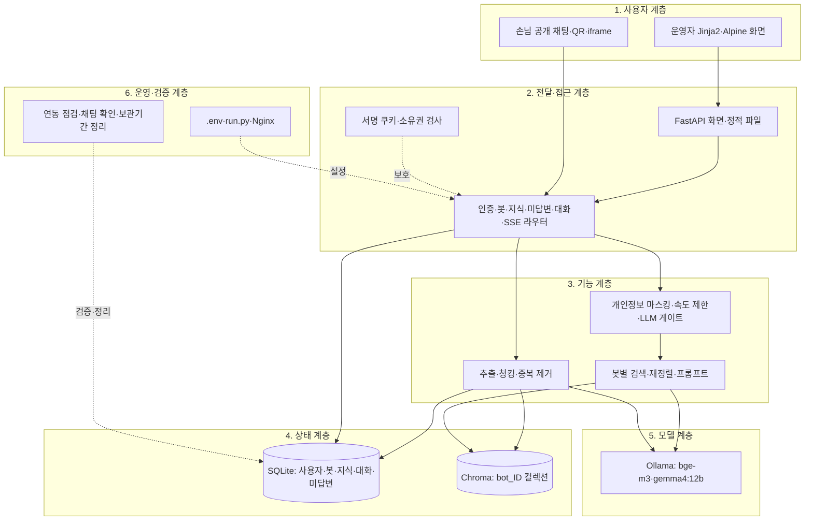
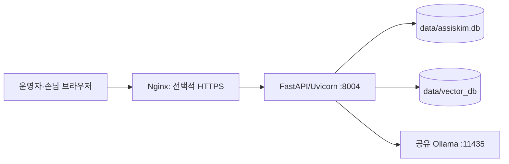
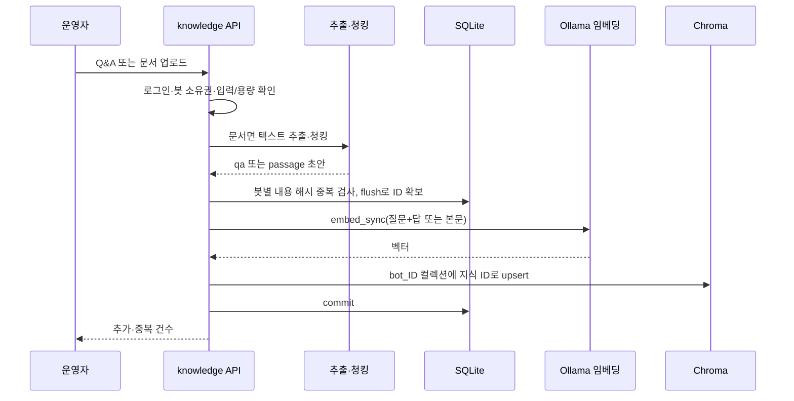
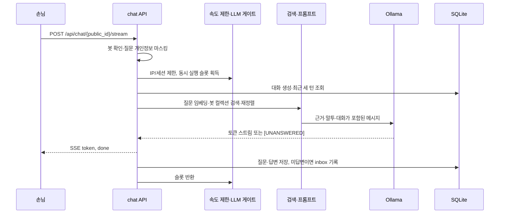

# 김비서 개발자 가이드 — 바이브코딩 재구현 명세

작성일: 2026-09-18  
기준: `mymeta-inc/secretary_Kim`, `main`, `8eed86fb618158c2bbb7a0f583ce70ab69f5e7e0`의 파일 스냅샷  
대상: 운영자용 봇 관리, 문서·Q&A 지식, 공개 QR 채팅, 미답변함, 대화 기록과 배포

## 0. 전체 구현 개요 및 상세 아키텍처

### 0.1 무엇을 구현하는 시스템인가

김비서는 기업·기관·매장 운영자가 자신의 안내 챗봇을 만들고 공개 링크나 QR로 손님에게 제공하는 독립 FastAPI 앱이다. 운영자는 업종별 시작 질문에 답하고 Q&A나 문서를 추가한다. 손님의 질문에 근거가 없으면 모델의 `[UNANSWERED]` 표식을 서버가 대체 문구로 바꾸고, 그 질문을 미답변함에 모은다. 운영자의 한 줄 답변은 즉시 검색 가능한 지식이 된다.

| 사용 목적 | 입력 | 내부 처리 | 결과 |
|---|---|---|---|
| 봇 만들기 | 이름, 업종, 말투, 외형 | 소유자 연결, 공개 ID 발급, 업종 질문을 미답변함에 적재 | 관리 화면과 공개 URL |
| 지식 등록 | Q&A 또는 PDF·DOCX·TXT·CSV·MD | 추출·청킹·중복 제거→SQLite와 Chroma 적재 | 검색 가능한 봇별 지식 |
| 공개 채팅 | 공개 ID, 세션 ID, 질문 | 마스킹·속도 제한→임베딩 검색·재정렬→Ollama 생성 | SSE 답변, 대화 기록, 미답변 판정 |
| 운영자 개선 | 미답변 질문과 한 줄 답 | 지식 생성·벡터 적재, 질문 상태 변경 | 다음 손님에게 적용할 근거 |
| 공유·운영 | 공개 링크, QR, 보관기간 | QR PNG 생성, Nginx SSE 프록시, 대화 정리 | 배포 가능한 채팅 링크 |

이 앱은 장부장과 계정·DB·벡터 저장소를 공유하지 않는다. README의 운영 설명대로 같은 서버의 Ollama만 공유한다. 현재 코드에 결제, OCR, HWP, 다국어, 카카오 채널은 없다.

### 0.2 구현을 구성하는 여섯 계층



운영자 API는 `current_user`와 `get_owned_bot`으로 보호한다. 공개 채팅 API는 로그인 없이 `public_id`로 봇을 찾는다. 화면에서 탭이나 버튼을 감추는 것만으로 권한을 구현하지 않는다.

### 0.3 실행 프로세스와 배포 구조



`run.py`는 `0.0.0.0`에서 `settings.PORT`(기본 8004)로 Uvicorn을 실행하고 회전 로그를 `logs/app.log`에 쓴다. `app/main.py`를 가져올 때 테이블 생성과 기존 SQLite 컬럼 보강을 수행한다. `/health`는 `{"ok": true, "ollama": bool}`을 반환하므로 HTTP 성공만으로 모델 준비를 단정하지 않는다. `restart.sh`는 `/root/miniconda3`의 `assiskim` 환경과 `/home/teddy/assiskim/run.py`를 전제로 한 Linux 운영 스크립트다. `deploy/nginx-assiskim.conf`는 도메인·인증서 자리표시자가 남은 비활성 예시다.

### 0.4 전체 데이터와 RAG 저장 구조

| 저장소 | 내용 | 책임 코드 |
|---|---|---|
| `data/assiskim.db` | 사용자, 봇, 지식, 대화·메시지, 미답변함 | `models.py`, `database.py` |
| `data/vector_db` | 봇마다 `bot_{id}` Chroma 컬렉션, 지식 ID·본문·메타데이터·임베딩 | `services/vector_store.py` |
| `data/uploads` | 설정에 경로는 있지만 현 업로드 라우트는 원본을 저장하지 않음 | `config.py`, `routers/knowledge.py` |
| `.env` | URL·비밀키·DB·모델·제한값 | `config.py` |
| `logs/` | 서버 출력과 회전 로그 | `run.py`, `restart.sh` |

업로드 원본은 요청 메모리에서 추출한 뒤 버린다. DB에는 `source_ref`로 파일명만 남는다. 원본을 다시 추출해 인덱스를 복구해야 한다면 별도 백업이 필요하다. `data/`, `.env`, `logs/`는 `.gitignore` 대상이며 ZIP 스냅샷에 들어 있지 않다.

### 0.5 문서와 Q&A 한 건의 실행 순서



SQLite와 Chroma에 걸친 원자적 트랜잭션은 없다. 임베딩·벡터 오류 시 불일치를 점검하고 복구해야 한다. 업로드 라우트는 동기 함수이므로 FastAPI 스레드풀에서 추출과 동기 임베딩을 수행한다.

### 0.6 공개 질문 한 건의 실행 순서



### 0.7 모듈 간 인터페이스와 상태 소유권

| 계약 | 생성·소유 | 소비 | 유지할 경계 |
|---|---|---|---|
| 서명된 `assiskim_session` 쿠키 | `auth.py`, 인증 라우터 | 운영자 화면/API | 서버에서 사용자 조회, 봇 소유권 별도 확인 |
| `Bot.public_id` | 봇 생성 API | 손님 채팅·QR | 공개 ID만으로 관리자 API 접근 불가 |
| `KnowledgeItem.id` | 지식 서비스 | Chroma 문서 ID | 삭제·재구축 시 두 저장소 일치 |
| `Conversation.session_id` | 손님 브라우저 `sessionStorage` | 공개 채팅·기록 | 봇별 묶음, 서버가 클라이언트 값을 신뢰하지 않음 |
| `InboxItem.question_key` | 미답변 서비스 | 중복 질문 집계·운영자 답변 | 봇별 유일성, 해결 뒤 재질문 시 재개방 |
| 모델·트래픽 상태 | Ollama 클라이언트·프로세스 내부 게이트 | 공개 채팅 | 다중 프로세스 간 제한 공유 없음 |

### 0.8 응답·오류·검증의 설계 원칙

미답변은 모델 표식을 대체 문구로 바꾸고 `unanswered=true`로 저장한다. 모델 장애는 별도 안내와 `error=true` 토큰으로 보낸다. 속도·정원 초과는 스트림 전에 HTTP 429와 `Retry-After`를 반환한다. SSE 프록시는 버퍼링을 꺼야 하고, 브라우저가 중단하거나 예외가 나면 LLM 슬롯을 돌려줘야 한다. 개인정보 마스킹은 정규식에 맞는 전화번호·이메일·주민번호·카드번호만 다루므로 일반적인 개인정보 보호를 완전히 보장하지 않는다.

### 0.9 재구현 시 시작점과 완료 경계

권장 순서는 **설정·DB·쿠키 인증 → 봇과 소유권 → 지식·봇별 검색 → 공개 SSE 채팅 → 미답변 학습·대화 기록 → 외형·QR → 운영·보관기간**이다. 화면 표시, 실제 Ollama 생성, DB와 벡터의 동기 상태를 각각 검증한다.

## 1. 문서의 목적과 사용법

이 문서는 현재 파일 스냅샷을 수정하거나 다시 구현할 개발자와 코딩 AI를 위한 명세다. **확인**은 코드에서 읽은 계약, **환경 의존**은 Ollama·도메인·운영 데이터 등 저장소 밖의 준비가 필요한 사항이다. 기준 스냅샷은 ZIP으로 받아 Git 이력이 로컬에 없으므로 후속 변경은 원격 커밋과 별도 비교한다.

## 2. 기준 자료와 재현 범위

### 2.1 보유 자료

`app/`의 FastAPI·Jinja2·CSS 코드, `run.py`, Linux 스크립트, Nginx 예시와 README를 확인했다. 기준 커밋은 GitHub 저장소 화면의 `8eed86f`이며 로컬은 파일 스냅샷이다. 현재 프로젝트에는 자동 테스트 디렉터리나 마이그레이션 도구가 없다.

### 2.2 복제본과 운영 환경의 차이

운영 `.env`, 사용자 DB, Chroma 인덱스, 업로드 원본, 로그, SSL 인증서, Ollama 모델·서비스 단위는 포함되지 않는다. `SECRET_KEY`의 코드 기본값은 개발용이며 운영에서는 반드시 교체해야 한다. SQLite와 Chroma가 비어 있어도 화면이 뜰 수 있으나 기존 봇의 지식과 대화가 복원된 것은 아니다.

## 3. 제품 기능과 사용자 흐름

### 3.1 가입·봇 생성과 업종 시작 질문

`/`에서 이메일·비밀번호로 가입하거나 로그인한다. `/bots`에서 업종, 이름, 말투, 소개와 외형을 선택해 봇을 만든다. `industries.py`의 카페·미용·병원·교육·운동·숙박·공공·쇼핑·직접 설정 템플릿은 질문만 미답변함에 넣으며 자동 답변을 만들지 않는다. 운영자가 답해야 실제 지식이 된다.

### 3.2 지식과 운영자 개선

`/bots/{id}`는 미답변, 지식, 대화, 공유, 설정 탭을 제공한다. 직접 Q&A는 선택적으로 추천 질문으로 고정할 수 있다. 문서는 텍스트를 추출·분할해 `passage`로 저장한다. 미답변함 답변은 `source=inbox`인 Q&A가 되고, 무시한 항목은 상태만 바뀐다.

### 3.3 손님 공개 채팅과 공유

`/c/{public_id}`는 로그인 없는 손님 화면이다. 같은 탭의 `sessionStorage`에 봇별 세션 ID를 두고 `fetch`의 스트림 리더로 SSE를 읽는다. 설정 API는 인사말, 소개, 최대 네 개의 고정 질문, 아바타·색상·고지 문구를 제공한다. 운영자는 QR PNG를 저장하고 공개 URL 또는 iframe 코드를 복사한다.

### 3.4 기록과 보관

공개 질문은 답변과 함께 SQLite에 남고 운영자는 최근 대화 목록 100건과 각 메시지를 볼 수 있다. 보관기간 정리 스크립트는 `Conversation.last_at`을 기준으로 기본 90일 초과 대화·메시지를 삭제한다. 미답변함은 삭제하지 않는다.

## 4. 아키텍처와 파일 책임

| 파일/디렉터리 | 책임 |
|---|---|
| `app/main.py` | FastAPI 앱, 테이블 생성·컬럼 보강, 라우터·화면·정적 파일, 헬스체크 |
| `app/config.py`, `app/database.py`, `app/models.py` | 환경 설정, SQLite 세션·최소 스키마 보강, 영속 모델과 화면 기본값 |
| `app/auth.py`, `app/routers/auth.py` | bcrypt, 서명 세션 쿠키, 등록·로그인·로그아웃 |
| `app/routers/bots.py` | 소유 봇 CRUD, 업종 시작 질문, QR·직렬화 |
| `app/routers/knowledge.py`, `inbox.py`, `conversations.py` | 지식 관리·검색, 미답변 처리, 대화 조회 |
| `app/routers/chat.py` | 공개 설정, 속도 제한, 검색·생성, SSE와 기록 |
| `app/services/extractor.py`, `knowledge.py`, `vector_store.py`, `retriever.py` | 추출·청킹, 해시 중복 제거, 봇별 Chroma, 검색·재정렬 |
| `app/services/prompt.py`, `ollama_client.py`, `traffic_guard.py`, `privacy.py` | 근거 프롬프트, 임베딩·생성, 동시성·속도 제한, 마스킹 |
| `app/services/industries.py`, `inbox.py` | 업종별 질문, 미답변 묶음 |
| `app/templates/`, `app/static/` | 서버 렌더링 화면, Alpine 동작, 스타일 |
| `scripts/`, `run.py`, `restart.sh`, `stop.sh`, `deploy/` | 연동 점검, 실행·정리, 배포 예시 |

## 5. 데이터 계약

### 5.1 사용자·봇

`User`는 정규화된 고유 이메일, bcrypt 해시, 표시 이름을 가진다. `Bot`은 `owner_id`, 12자리 무작위 hex `public_id`, 이름, 말투, 대체 문구, 업종, 색상, 아바타, 인사말, 하단 고지를 가진다. 색상은 `#RRGGBB`, 아바타는 허용 목록으로 제한한다. `serialize`의 `chat_url`은 `BASE_URL`에 의존하므로 배포 주소를 정확히 설정한다.

### 5.2 지식·검색 인덱스

`KnowledgeItem`의 `type=qa|passage`, `source=manual|inbox|upload`, `question`, `body`, `source_ref`, `pinned`, `content_hash`를 유지한다. `(bot_id, content_hash)`는 유일하고 해시는 정규화한 형식·질문·본문의 SHA-256 앞 32자리다. Q&A 임베딩 텍스트는 `질문\n답변`, 문서는 본문이다. Chroma의 ID는 DB 지식 ID 문자열이며 컬렉션은 `bot_{id}`다.

### 5.3 대화·미답변함

`Conversation`은 `(bot_id, session_id)`가 유일하고 `last_at`이 정리 기준이다. `Message`는 역할, 마스킹된 내용, 선택적 `retrieval_score`, `unanswered`를 저장한다. `InboxItem`은 봇별 정규화된 `question_key`가 유일하고 상태는 `open|resolved|ignored`, 출처는 `customer|template`이다. 해결된 질문을 다시 물어 미답변이면 상태가 다시 `open`이 된다. `ensure_schema()`는 기존 `bots`의 외형 컬럼과 `inbox_items.origin`만 보강하는 최소 SQLite 변경이며 일반 마이그레이션 시스템이 아니다.

## 6. 문서 검색과 답변 생성

`extractor.py`는 PDF 텍스트, DOCX 문단·표, CSV의 `열이름: 값`, 일반 텍스트를 읽는다. `CHUNK_SIZE=1000`, `CHUNK_OVERLAP=200` 기본값으로 문단·문장 경계를 우선해 청킹한다. 검색은 질문을 `EMBED_MODEL`로 임베딩하고 봇 컬렉션에서 기본 20개를 가져와 코사인 점수 0.65와 키워드 겹침 0.35로 재정렬한다. 질문 단어가 겹치는 Q&A에 0.10을 더하고 기본 상위 네 개를 프롬프트에 넣는다. `retrieval_score`는 최상위 **재정렬 점수**이며 미답변을 결정하는 임계값이 아니다. 검색 결과가 없어도 모델에는 `(참고할 내용이 없습니다)`가 전달되며 센티널 규칙을 적용한다.

## 7. 문서 형식과 OCR 규칙

허용 확장자는 `.pdf`, `.docx`, `.txt`, `.csv`, `.md`이고 기본 최대 업로드는 20MB다. PDF는 `pypdf`가 추출 가능한 텍스트만 읽는다. 스캔 이미지 PDF, 그림 파일, HWP/HWPX의 OCR·변환은 현재 구현되지 않았다. 추출 결과가 비면 400 오류를 반환한다. CSV는 첫 행을 헤더로 간주한다. 원본 파일은 저장하지 않으므로 동일 파일명으로 여러 번 올리면 `source_ref` 기준 삭제가 같은 이름의 모든 지식에 적용될 수 있다.

## 8. 채팅 엔진의 정확한 분기

### 8.1 입구와 말투

`Ask` JSON은 `session_id`와 `question`을 요구한다. 서버는 질문을 먼저 마스킹하고, 봇별 대화의 최근 세 질문·답변 쌍을 가져온다. `TONE_PRESETS`의 친절·간결·발랄·전문가 지침은 운영자 원문 프롬프트가 아니라 고정 시스템 프롬프트의 슬롯으로 들어간다.

### 8.2 근거·센티널·스트림

시스템 프롬프트는 근거 밖 추측을 금지하고 근거가 없을 때 첫 줄에 `[UNANSWERED]`를 요구한다. 서버는 초기 40자를 임시 보관하며 표식을 발견하면 운영자의 `fallback_message`만 전송하고 미답변으로 기록한다. 표식이 없으면 모은 부분과 이후 토큰을 순서대로 보낸다. 초기 탐색 이후에 나온 표식까지 걸러내는 일반 필터는 아니므로 모델 출력 변형을 검증해야 한다.

### 8.3 모델 장애와 기록

검색용 Ollama 요청이 실패하면 장애 안내 SSE를 보내고 대화를 저장한다. 생성 중 실패해도 `error=true`가 담긴 안내 토큰을 보낸다. 정상 스트림 완료 뒤 사용자·봇 메시지와 `last_at`을 새 DB 세션으로 저장하고, 미답변이면 inbox에 적재한다. 스트림이 일찍 끊기면 이 완료 경로의 기록이 없을 수 있다. 기록 오류는 로깅·롤백하지만 이미 보낸 답변을 취소하지 못한다.

## 9. 검증과 오류 처리

계정·봇 소유권, 빈 입력, 비밀번호 최소 8자, 업로드 크기·형식·추출 가능 여부, 중복 내용을 검증한다. 지식 적재와 삭제는 SQLite/Chroma 두 저장소에 걸쳐 있어 중간 실패 후 `knowledge_items`와 컬렉션의 ID·건수를 비교한다. 공개 채팅의 미답변, 모델 장애, 429, 세션 재사용, 손님 연결 종료를 별도 시나리오로 검증한다. 현재 `get_client_ip`는 `X-Real-IP`를 우선하므로 배포 프록시가 해당 헤더를 신뢰할 수 있게 덮어써야 한다.

## 10. API와 SSE 계약

### 10.1 주요 라우트

| 영역 | 경로와 메서드 | 접근 |
|---|---|---|
| 상태·화면 | `GET /health`, `/`, `/bots`, `/bots/{bot_id}`, `/c/{public_id}` | 관리 화면은 로그인, 공개 화면은 익명 |
| 인증 | `POST /api/auth/register`, `/login`, `/logout` | 등록·로그인은 익명 |
| 봇 | `GET/POST /api/bots`, `PUT/DELETE /api/bots/{bot_id}`, `GET /api/bots/{bot_id}/qr.png` | 본인 |
| 지식 | `GET /api/bots/{bot_id}/knowledge`, `POST /qa`, `/upload`, `GET /search?q=`, `DELETE /{item_id}`, `/source/{source_ref}` | 본인 |
| 미답변 | `GET /api/bots/{bot_id}/inbox`, `POST /{item_id}/answer`, `POST /{item_id}/ignore` | 본인 |
| 대화 | `GET /api/bots/{bot_id}/conversations`, `GET /{conversation_id}` | 본인 |
| 손님 | `GET /api/chat/{public_id}/config`, `POST /api/chat/{public_id}/stream` | 익명 |

### 10.2 REST 요청·응답

인증·봇 설정·Q&A·미답변 답변은 `Form` 필드, 파일은 `multipart/form-data`, 채팅은 JSON을 사용한다. 봇 직렬화에는 `chat_url`, 표시용 업종·말투·색상·인사말이 포함된다. 지식 목록은 `items`와 `vector_count`, 업로드는 `filename`, `added`, `skipped`, `vector_count`, 대화 목록은 최대 100개 요약을 반환한다. 사용자 소유가 아닌 봇은 관리자 API에서 404다.

### 10.3 SSE 프레임

응답은 `text/event-stream`, `Cache-Control: no-cache`, `X-Accel-Buffering: no`다. 각 프레임은 `data: {JSON}\n\n` 형식이며 토큰 `{"token":"..."}`, 완료 `{"done":true,"unanswered":false}`, 모델 장애 `{"token":"...","error":true}`가 있다. 클라이언트는 `fetch` 스트림에서 프레임을 분할해 `token`을 이어 붙인다. HTTP 429는 SSE가 시작되기 전 JSON 오류와 `Retry-After` 헤더로 온다.

### 10.4 인증과 공개 범위

세션 쿠키는 `HttpOnly`, `SameSite=Lax`, 14일 최대 수명이다. 서명은 `itsdangerous.URLSafeSerializer`를 사용하며 서버에 세션 목록을 두지 않는다. 쿠키 설정에 `Secure` 옵션은 현재 명시되지 않았으므로 HTTPS 운영 정책을 검토한다. 손님 공개 링크의 ID를 아는 누구나 채팅할 수 있고, 운영자 API는 쿠키 및 소유권 확인을 거친다.

## 11. LLM, 모델 관리와 동시성

기본 `OLLAMA_URL=http://127.0.0.1:11435`, `CHAT_MODEL=gemma4:12b`, `EMBED_MODEL=bge-m3`, 기대 임베딩 차원 1024다. Ollama `/api/embed`, `/api/chat`, `/api/tags`를 호출한다. 연결·읽기 제한시간·HTTP 오류에는 1·3·6초 간격으로 재시도하는 비스트리밍/임베딩 경로가 있다. 생성 스트림은 오류를 `OllamaUnavailable`로 바꾸지만 재생성하지 않는다. 공개 채팅은 같은 IP·봇·세션에 10초당 한 번, IP에 분당 20번으로 제한하며 동시에 8개 실행, 16개 대기, 대기 제한 10초다. 이 제한은 프로세스 메모리에 있어 여러 Uvicorn 워커나 인스턴스에서 전역 한도를 보장하지 않는다. 장부장의 Ollama 전환이 공유 인스턴스를 멈출 수 있다.

## 12. UI 재구현 계약

`base.html`은 공통 내비게이션과 FormData 요청 헬퍼를 둔다. `login.html`은 가입/로그인 모드를, `bots.html`은 업종·말투를 선택하는 생성 화면을 제공한다. `bot_detail.html`은 `partials/`의 다섯 탭을 쓰며 저장 후 지식·미답변·대화를 다시 조회한다. `chat.html`은 공개 설정을 조회하고 브라우저 탭 단위 세션을 유지하며 SSE 토큰을 표시한다. QR과 iframe은 `BASE_URL`을 사용한다. JS는 CDN이 아닌 `app/static/alpine.min.js`와 로컬 CSS를 참조한다. 외형을 바꿔도 서버의 색상·아바타 검증과 공개 설정 응답을 유지한다.

## 13. 별도 기능과 보조 도구

### 13.1 QR·업종·개인정보

`segno`가 공개 URL을 색상별 PNG QR로 만든다. 업종 템플릿은 운영자가 채울 질문과 기본 소개·말투·이모지를 제공한다. `privacy.mask`는 정규식 매칭 문자열만 치환하며 업로드 문서의 민감 정보까지 자동 마스킹하지 않는다.

### 13.2 점검·정리·배포

`scripts/check_ollama.py`는 모델 건강 상태·임베딩 차원·스트림을 확인한다. `scripts/try_chat.py`는 공개 ID와 세션 ID로 여러 질문을 보내 미답변 판정을 출력한다. `scripts/cleanup_conversations.py`는 오래된 대화를 삭제한다. 배포 Nginx는 `proxy_buffering off`, `proxy_cache off`, 읽기 제한 300초, `X-Real-IP`를 설정한다.

## 14. 누락 자산 복원 설계

### 14.1 환경 변수 준비

프로젝트 루트 `.env`에 최소한 `SECRET_KEY`, `BASE_URL`, 필요 시 `PORT`, `DATABASE_URL`, `VECTOR_DB_PATH`, `OLLAMA_URL`, `CHAT_MODEL`, `EMBED_MODEL`을 준비한다. `DATA_DIR` 자체는 설정 필드가 아니고 `config.py`의 고정 경로다. 실제 키나 운영 주소를 저장소 문서에 기록하지 않는다.

### 14.2 DB와 인덱스 복원

완전한 복원에는 같은 시점의 SQLite와 Chroma가 필요하다. DB만 있으면 봇·지식·대화 행은 보이지만 검색 인덱스가 비거나 오래될 수 있다. 원본 파일을 저장하지 않으므로 업로드를 재추출할 수 없지만 `KnowledgeItem.embed_text`에서 남아 있는 텍스트를 다시 임베딩해 컬렉션을 구축하는 도구를 별도 작성할 수 있다. 이때 봇별 ID, 임베딩 모델·차원, 메타데이터를 유지한다.

### 14.3 재구축 판정

봇마다 `knowledge_items` 건수와 Chroma `bot_{id}`의 ID 집합을 비교하고, 검색 API에서 Q&A와 문서 근거가 나오는지 확인한다. 삭제된 봇의 컬렉션, 누락된 지식, 중복된 파일명과 임베딩 모델 변경을 별도로 점검한다. 운영 데이터 복원 전에는 백업 사본에서 연습한다.

## 15. 설치와 실행

Python 환경에서 `pip install -r requirements.txt` 후 `.env`를 구성하고 쓰기 가능한 `data/` 디렉터리를 준비한다. `python run.py`로 시작해 `/health`의 `ollama` 값을 확인한다. Ollama에는 설정한 채팅·임베딩 모델이 준비되어야 한다. Linux 운영 스크립트는 하드코딩된 Conda·프로젝트 경로와 `fuser`에 의존하므로 다른 머신에서는 `python run.py`를 우선하고 스크립트 경로를 조정한다.

```bash
python -m venv .venv
# 운영체제에 맞게 .venv 활성화
pip install -r requirements.txt
python run.py
python scripts/check_ollama.py
```

`app.main` import가 SQLite 테이블·컬럼에 쓰기를 수행한다. 운영 DB를 연결한 채 단순 import로 상태를 점검하지 않는다.

## 16. 인수 기준과 검증 계획

### 16.1 단계별 합격 조건

| 단계 | 합격 조건 |
|---|---|
| 기동 | `/health`가 정상이고 Ollama 연결·임베딩 차원이 맞음 |
| 인증 | 가입·로그인·로그아웃, 타인 봇 API 404 |
| 지식 | Q&A·문서 등록과 중복 건너뛰기, 봇별 검색 격리, 삭제 시 DB/벡터 일치 |
| 채팅 | 근거 답변 SSE, 근거 없음 대체 문구·미답변함, 장애 안내, 429 |
| 운영 | 한 줄 답변 후 같은 질문 재검색, 대화 조회, QR URL·SSE 프록시, 보관기간 정리 |

### 16.2 필수 재현 시나리오

서로 다른 두 운영자가 각자 봇을 만들고 동일한 질문에 다른 지식을 등록한다. 공개 링크에서 각 봇의 답만 나오는지 확인한다. 근거 없는 질문은 fallback과 inbox에 남고, 운영자가 답한 뒤 재질문 시 새 지식이 사용되는지 확인한다. 같은 세션의 빠른 재요청과 IP 상한, Ollama 중단·복구, 스트림 중단 후 슬롯 반환, 업로드 20MB 초과·스캔 PDF, 보관기간 경과 데이터의 정리를 확인한다. 속도 제한 시나리오는 테스트용 clock/게이트로 독립 검증하는 편이 빠르다.

### 16.3 이 문서의 검증 범위

현재 파일을 정적으로 읽어 구조와 계약을 확인했다. 실제 Ollama 호출, DB·Chroma 복원, 서버 기동, 브라우저 종단 간 테스트는 실행하지 않았다. 따라서 운영 환경의 성능·모델 답변 품질과 배포 성공을 이 문서가 증명하지 않는다.

## 17. 바이브코딩에 바로 사용할 프롬프트

### 17.1 시작 프롬프트

> 이 저장소의 `docs/DEVELOPER_GUIDE.md`와 실제 `app/` 코드를 읽고 김비서의 한 기능을 수정해 주세요. 관리자 쿠키·봇 소유권과 공개 `public_id` 경계를 유지하고, SQLite `KnowledgeItem`과 봇별 Chroma ID를 함께 다루세요. 채팅 변경은 SSE의 token/done/error, `[UNANSWERED]`, 429, 슬롯 반환을 검증하세요. 문서와 코드가 다르면 코드를 근거로 차이를 보고하고 관련 문서를 갱신하세요.

### 17.2 단계별 후속 프롬프트

1. “운영자 봇의 생성·변경·삭제 경로와 다른 사용자의 접근 거부를 파일·함수 단위로 추적해 주세요.”
2. “업로드 한 건의 추출·청킹·중복 제거·DB/Chroma 적재를 따라가고 실패 시 불일치 복구를 설계해 주세요.”
3. “공개 채팅의 마스킹·제한·검색·SSE·미답변 기록과 연결 종료 시 슬롯 반환을 검증해 주세요.”
4. “운영 DB와 Chroma 사본으로 지식 ID 일치와 오래된 대화 정리를 점검해 주세요.”

## 18. 현재 구현의 알려진 차이와 유지보수 원칙

`UPLOAD_DIR`은 설정되어 있으나 원본 파일은 저장되지 않는다. `EMBED_DIM`은 점검 스크립트의 기대값이고 API 적재 시 차원을 명시적으로 검증하지 않는다. `restart.sh`·`stop.sh`는 특정 Linux 서버 경로·프로세스와 포트를 전제로 하므로 개발 PC에서 그대로 실행하지 않는다. 앱 시작 시 보강하는 SQLite 컬럼은 제한적이어서 이후 스키마 변경은 별도 마이그레이션이 필요하다. 속도 제한과 LLM 정원은 인스턴스별 메모리 상태다. 검색 점수는 표시·기록에 사용하지만 미답변 임계값으로 쓰지 않는다. 유지보수 시 README의 설계 의도와 실제 코드의 처리 순서를 구별한다.

## 19. 참조 자료와 복원 순서

일차 출처는 `app/main.py`, `app/routers/`, `app/services/`, `app/models.py`, `app/config.py`다. `README.md`와 `deploy/`는 제품 의도와 운영 계획을 확인하는 자료다. 새 환경에서는 설정과 모델 → DB·벡터 데이터 → 연동 점검 → 지식 검색 → 공개 SSE → QR·프록시 → 정리 작업 순으로 검증한다. 참고 형식은 `C:/Projects/mysbiz/docs/DEVELOPER_GUIDE.md`와 `C:/Projects/LSE/docs/DEVELOPER_GUIDE.md`의 번호 체계·표·다이어그램·인수 기준을 따른다.

## 20. 자동 생성 참조 색인 및 검증 기록

### 20.1 주요 라우터 색인

| 라우터 | 접두 경로 | 핵심 함수 |
|---|---|---|
| `auth.py` | `/api/auth` | `register`, `login`, `logout` |
| `bots.py` | `/api/bots` | `create_bot`, `update_bot`, `bot_qr`, `delete_bot` |
| `knowledge.py` | `/api/bots/{bot_id}/knowledge` | `add_qa`, `upload_document`, `search_knowledge`, 삭제 함수 |
| `inbox.py` | `/api/bots/{bot_id}/inbox` | `answer_inbox`, `ignore_inbox` |
| `conversations.py` | `/api/bots/{bot_id}/conversations` | 목록·상세 조회 |
| `chat.py` | `/api/chat` | `chat_config`, `chat_stream`, `_persist` |

### 20.2 영속 모델 색인

`User → Bot → {KnowledgeItem, Conversation → Message, InboxItem}`. 봇과 사용자/지식/대화/미답변 관계에는 ORM의 `delete-orphan`이 있고, 벡터 컬렉션은 `delete_bot`에서 별도로 삭제한다. SQLite 관계 삭제와 Chroma 삭제 순서의 실패 가능성을 검증한다.

### 20.3 검증 기록

기준 스냅샷의 Python·HTML·CSS·셸·README·요구사항 파일을 읽고 라우트·모델·설정값을 대조했다. 파일 스냅샷에는 `.git`과 운영 `data/`가 없다. 이 문서는 코드 실행 결과를 포함하지 않는다.
