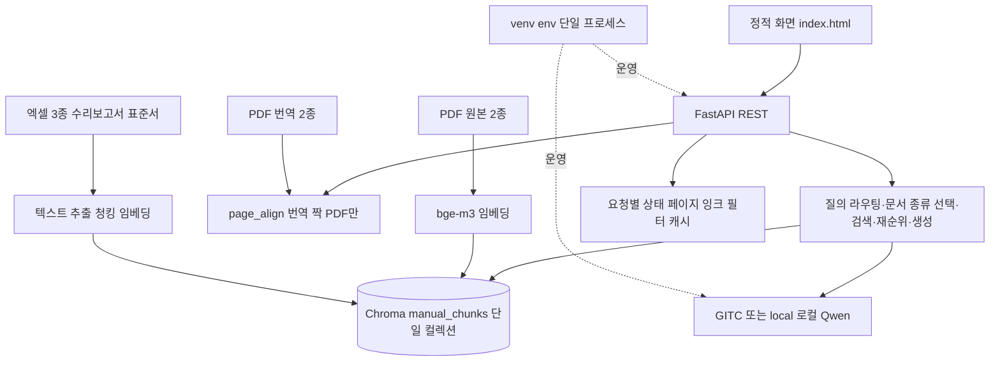
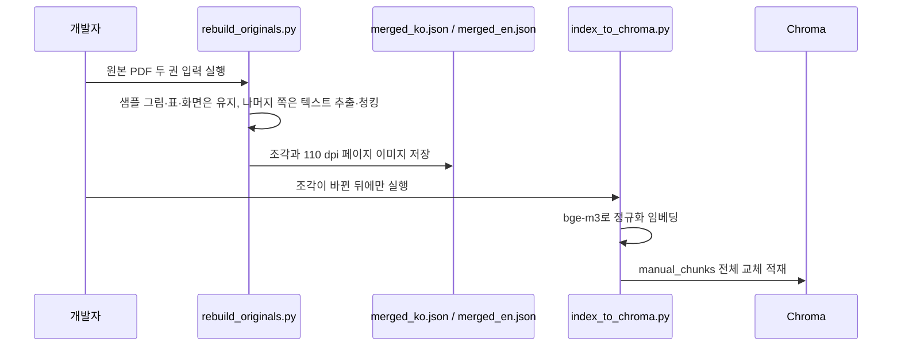
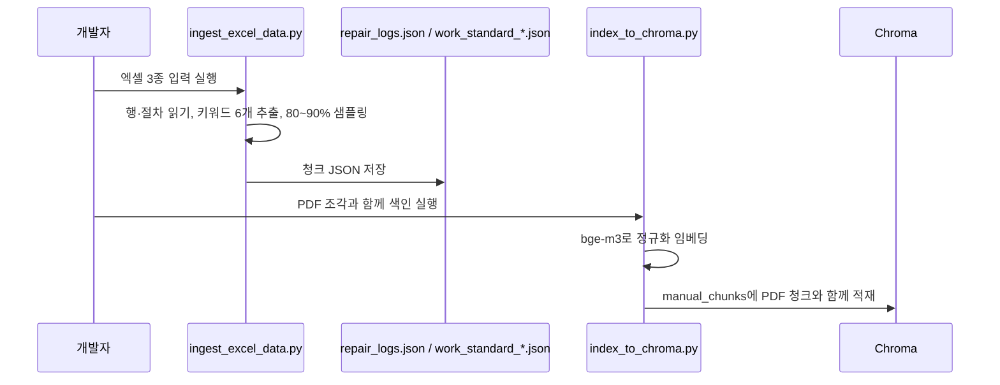
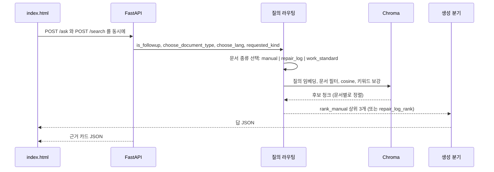

# 삼광 설비 챗봇 개발자 가이드 — 바이브코딩 재구현 명세

작성일: 2026-10-01  
기준: `/home/ohsem/chatbot/poc_parsing` 현재 코드 (FANUC 매뉴얼 구조 기반)  
대상: 삼광 FANUC 매뉴얼 2종 + 설비 수리 보고서 + 작업표준서 통합 챗봇, Chroma 벡터 DB, bge-m3 임베딩, GITC 추론, 정적 화면과 FastAPI 전달 계층

이 문서는 현장 작업자용 설비 문제 해결 챗봇을 구현하는 명세다. 기존 FANUC 매뉴얼 챗봇 아키텍처(POC 파싱)를 기반으로 PDF 매뉴얼, 엑셀 설비 수리 이력, 작업표준서를 하나의 벡터 DB에 통합한다.

## 0. 전체 구현 개요 및 상세 아키텍처

### 0.1 무엇을 구현하는 시스템인가

한 질문으로 다음을 처리한다:
1. **FANUC 매뉴얼** 원본 2종에서 구성·사양·동작 찾기 (번역 2종은 언어 전환 버튼용, 검색 대상 아님)
2. **설비 수리 보고서** (엑셀)에서 고장 이력·조치 찾기
3. **작업표준서** (엑셀)에서 점검·정비 절차 찾기

FastAPI가 PDF와 엑셀 청크를 Chroma (bge-m3)에 색인하고, GITC가 설명만 생성한다. 보여주기 질의는 GITC를 부르지 않는다.

| 목적 | 입력 | 처리 | 결과 |
|---|---|---|---|
| 질문 | 질의, 직전 질의 | 질의 라우팅→임베딩 검색→재순위→생성 분기 | JSON 답변, 출처 쪽, 관련 그림·표 |
| 근거 | 같은 질의 | 같은 검색 후 카드 항목으로 변환 | 페이지 이미지, 미리보기, 번역 짝 |
| 색인 준비 | 원본 PDF 두 권 (번역 2권은 비색인) | 추출→청킹→임베딩→Chroma | `manual_chunks` 2,348개 |
| 언어 전환 | 이미 찾은 원본 파일 쪽 | 번역 PDF의 원본 쪽 표시로 짝 조회 | 번역 글과 번역 파일 쪽. 재검색 없음 |

### 0.2 구현을 구성하는 계층 구조



화면(`index.html`) → FastAPI → 라우팅·검색·생성(`search_api.py`) → Chroma + GITC. 시작 로그에서 모델 device, 컬렉션 개수, 번역 짝, `LLM: API gitc`를 확인한다.

### 0.3 실행 프로세스와 배포 구조

| 프로세스 | 코드 기준 | 역할 |
|---|---|---|
| FastAPI | `search_api.py` 실행부, local(로컬) 8155 포트 | 화면·PDF·검색·답변 |
| 임베딩 | 시작 시 `SentenceTransformer("BAAI/bge-m3")` | 질의 벡터. 청크 벡터는 이미 Chroma에 있음 |
| 생성 | `call_gitc`. 키가 없을 때만 local(로컬) Qwen | 설명 답 한 갈래 |
| 페이지 정렬 | `page_align.load` | 번역 짝 캐시 |

포트 8155, 컬렉션 `manual_chunks`는 `search_api.py`와 `index_to_chroma.py`에 고정이다. 같은 포트에 중복 기동 불가.

### 0.4 전체 데이터와 RAG 저장 구조

**PDF 매뉴얼 (색인 대상: 2,348 청크)**

| 위치 | 역할 | 특징 |
|---|---|---|
| `data/samkwang/manual_1_en.pdf` | MANUAL GUIDE i 영어 원본 (B-63874EN-2). 검색 대상 | 558쪽, 텍스트·그림·표·화면 포함 |
| `data/samkwang/manual_1_ko.pdf` | 취급설명서 한글 원본 (B-64484KO-2). 검색 대상 | 402쪽, 보호 암호 가능 |
| `data/samkwang/manual_2_en.pdf` | manual_1_ko의 영어 번역 (지원 문서) | 색인 안 함. 언어 전환 버튼에서만 사용 |
| `data/samkwang/manual_2_ko.pdf` | manual_1_en의 한글 번역 (지원 문서) | 색인 안 함. 언어 전환 버튼에서만 사용 |
| `poc_parsing/merged_ko.json` | 한글 원본 청크 (manual_1_ko) | 753개. text, table, figure |
| `poc_parsing/merged_en.json` | 영어 원본 청크 (manual_1_en) | 1,595개. text, table, figure, ui_screen |
| `poc_parsing/chroma_db` | `manual_chunks`, cosine, 2,348+ 벡터 | PDF 청크 임베딩 |

**엑셀 데이터 (신규, 색인 대상: 예상 400~800 청크)**

| 위치 | 역할 | 처리 |
|---|---|---|
| `data/samkwang/설비 수리 보고서.xlsx` | 설비별 고장 이력, 수리 내역 (131.3MB) | 행 → 청크 (날짜/설비/증상/조치/키워드) |
| `data/samkwang/M3 TN4 DECO 작업표준서_251104.xlsx` | MCT 계열 일일/정기 점검·정비 | 절차 → 청크 (설비명/항목/표준) |
| `data/samkwang/공구 수입검사 작업표준서.xlsx` | 공구 입수 검사 기준 | 항목 → 청크 (기준/판정) |

**보조 파일**

| 위치 | 역할 | 재구축 조건 |
|---|---|---|
| `poc_parsing/images/pages/ko`, `en` | PDF 원본 페이지 PNG, 110 dpi | PDF 수정 시 |
| `poc_parsing/images/pages/m1en`, `m2ko` | PDF 번역 페이지 PNG | PDF 수정 또는 없는 쪽 요청 시 생성 |
| `poc_parsing/.cache/page_align.json` | 한글↔영어 파일 쪽 매핑 | 번역 PDF 수정 시 |
| 프로세스 메모리 | 페이지 잉크 판정, 캐시, 로드된 모델 | 재시작 시 초기화 |

엑셀 청크는 `doc_type`으로 구분하고, 질의 라우팅에서 문서 종류를 선택한다.

### 0.5 색인 준비 순서 (PDF)



번역 PDF 정렬과 엑셀 처리는 이 후단에서 따로 실행한다.

### 0.5b 색인 준비 순서 (엑셀)



PDF와 같은 패턴이다: `ingest_excel_data.py`가 엑셀을 읽어 `repair_logs.json`(수리 보고서), `work_standard_*.json`(작업표준서)을 만들고, 같은 `index_to_chroma.py`가 PDF 청크와 함께 `manual_chunks`에 적재한다. `repair_chunks` 같은 별도 컬렉션은 쓰지 않는다. 상세 처리 로직은 10.3절 참고.

### 0.6 질문 한 건의 실행 순서



문서 종류는 질의 키워드로 자동 감지하거나 사용자가 선택한다.

### 0.7 모듈 간 인터페이스와 상태 소유권

**PDF 경로**

| 상태 | 생성·소유 | 소비 | 경계 |
|---|---|---|---|
| 청크 본문, `lang`, `page`, `chunk_type`, 벡터 | `rebuild_originals.py` → `index_to_chroma.py` | Chroma, 검색, 화면 | 벡터 차원은 `bge-m3`와 일치 |
| `prior_query` | 브라우저의 직전 사용자 문장 (필수, 없으면 실패) | `is_followup`, 책/문서 락 | 서버 세션 저장소 없음, 브라우저만 추적 |
| 번역 짝 `page`, `text`, `has_graphic` | `page_align.py` | `to_item` | 파일 쪽 번호 일치를 짝으로 쓰지 않음 |
| 선택 API | 시작 시 `selected_api` | `call_llm` | `GITC_API_KEY`가 있으면 GITC 고정 |
| 페이지 잉크 캐시 | `page_image_has_content` | 카드 이미지 생략 여부 | 프로세스 안, 재시작 시 초기화 |

**엑셀 경로 (신규)**

| 상태 | 생성·소유 | 소비 | 경계 |
|---|---|---|---|
| 엑셀 청크, 메타데이터, `doc_type`, 벡터 | `ingest_excel_data.py` → `index_to_chroma.py` | Chroma, 검색, 화면 | bge-m3 임베딩, doc_type으로 필터 |
| 키워드 필터 선택 | 브라우저 UI (document_type, keywords) | `search_by_type` | 선택사항, 없으면 자동 감지 |
| 필터 캐시 | `get_filter_options` 시작 시 | UI 드롭다운 렌더 | 엑셀 행 메타데이터에서 추출 |
| 샘플링 비율 | `ingest_excel_data.py` 상수 (0.85) | 색인 시점 | 검색은 전체 원본 이력 참조 |

### 0.8 응답·오류·검증의 설계 원칙

앞의 셋 (매뉴얼/종류/직전 질의 없음)은 HTTP 200, 뒤의 둘 (API/생성 실패)은 HTTP 500이다. 답에 `발췌`, 쪽 번호 없음 (카드만). 인증 없음.

### 0.9 재구현 순서

PDF 청킹(0.5절) + 엑셀 청킹(0.5b절, 10장) → 통합 Chroma 색인 → (PDF만) 페이지 정렬 → 라우팅 → 재순위 → 생성 → 화면. 색인까지는 PDF/엑셀이 따로 가고, 그 이후는 같은 파이프라인을 공유한다.

## 1. 문서의 목적과 사용법

현재 코드 이해·수정·재구현을 위한 명세. 함수 이름 변경 금지. 동작 변경 시 4장(파일)과 6장(용어)부터 고친다.

## 2. 기준 자료와 재현 범위

기준 구현: `search_api.py`, `page_align.py`, `rebuild_originals.py`, `ingest_excel_data.py`, `index_to_chroma.py`, `static/index.html`, PDF 4권, 엑셀 3종, `merged_*.json`, `repair_logs.json`, `chroma_db`, `.env`.

재현: PDF, 엑셀, 청크 JSON, Chroma, bge-m3, GITC 키 필요. 키 값은 출력하지 않는다.

## 3. 제품 기능과 사용자 흐름

### 3.1 통합 문서 기반 채팅

`/ask` → 말풍선, `/search` → 근거 패널 (동시). 문서 종류 자동 감지 또는 사용자 선택.

**예시:** 
- 매뉴얼: "공구경보정은?" "G41과 G42 차이?" 
- 설비: "MCT-3 최근 고장?" "스핀들 진동 수리 사례?"

### 3.2 문서 적재와 색인

**PDF:** 관리자가 원본 PDF를 `data/samkwang/`에 두고 `rebuild_originals.py`로 조각을 만든 뒤, 조각이 바뀌었을 때만 `index_to_chroma.py`를 실행한다.

**엑셀:** 관리자가 엑셀을 `data/samkwang/`에 두고 `ingest_excel_data.py`로 청크와 키워드를 뽑은 뒤, 동일 `index_to_chroma.py`로 통합 색인한다.

실행 중 업로드 API, 온라인 재학습 API, 문서 삭제 API는 없다. 엑셀 파일이 변경되면 항상 `ingest_excel_data.py`를 먼저 실행하고 `index_to_chroma.py`를 실행한다.

### 3.3 검색·이미지·언어

**PDF:** 검색은 사용자 선택 또는 자동 감지로 한 책만 본다. `ko`는 취급설명서 원본(manual_1_ko)만, `en`은 MANUAL GUIDE i 원본(manual_1_en)만 검색 대상이다. 번역본(manual_2_en, manual_2_ko)은 색인하지 않고, 언어 버튼을 눌렀을 때만 페이지 짝으로 보여준다. 근거 카드는 청크 종류에 따라 페이지 이미지, 표 HTML, 그림 자르기를 붙인다. 언어 버튼은 짝이 있을 때만 번역 글과 번역 파일 쪽을 보여 주고, 그림·화면은 번역 쪽에 실도판이 있을 때만 이미지를 바꾼다. 현재 캐시의 실도판 수는 0이다.

**엑셀:** 검색 결과는 구조화 필드 (date, equipment, symptom, remedy 등)를 표시한다. 이미지는 제공하지 않는다. 언어 버튼은 없다 (메타데이터만 표시).

### 3.4 이어 묻기와 세션 관리

**문제:** 사용자가 “공구경보정이 뭐야?” → “표를 보여줘”라고 하면 다른 표를 띄울 수 있음.

**원인:** `prior_query` 미전달 또는 책 잠금 재적용 미흡.

**해결:**
1. 브라우저가 매 요청마다 직전 질의를 `prior_query`로 전송 (필수)
2. `is_followup` 감지: “표”, “그림”, “다시”, “조금” 등 새 주제 키워드 없으면 True
3. True일 때: 직전 책·청크만 필터링, 다른 책 차단
4. 새 주제 키워드 있으면 새 검색 시작

**결과:**
- “공구경보정?” (first) → ko 매뉴얼 검색 + 근거 표 추천
- “표를 보여줄래?” (follow-up) → 같은 ko 매뉴얼의 표만, 다른 책 무시

## 4. 아키텍처와 파일 책임

데이터 파일(PDF, 엑셀, 청크 JSON, Chroma)의 위치·개수는 0.4절을 따른다. 여기서는 **코드 파일이 각각 뭘 하는지**만 다룬다.

| 파일 | 책임 |
|---|---|
| `poc_parsing/search_api.py` | FastAPI, 라우팅·검색·생성, `/ask` `/search` `/` PDF 서빙 |
| `poc_parsing/page_align.py` | PDF 번역 짝 생성·캐시 (원본 쪽 표시) |
| `poc_parsing/rebuild_originals.py` | PDF 텍스트 청킹, 샘플 그림·표 유지, 110 dpi 렌더 |
| `poc_parsing/ingest_excel_data.py` (신규) | 엑셀 청킹, 키워드 6개 추출, 80~90% 샘플링 |
| `poc_parsing/index_to_chroma.py` | PDF + 엑셀 청크 임베딩, Chroma 색인 적재 (전체 교체) |
| `poc_parsing/static/index.html` | 대화 UI, 근거 패널, 언어/문서 종류 전환, 필터 |
| `chatbot/.env` | `GITC_API_KEY`, `GITC_BASE_URL`, `GITC_MODEL` |

**미사용 (이전 실험):** `run_docling.py`, `normalize.py`, `ingest_full_manuals.py` — 현재 파이프라인 아님. `.env`의 포트 8787, 컬렉션 `fanuc_manuals`도 실제 설정과 다름 (8155, `manual_chunks` 사용).

## 5. 데이터 계약

### 5.1 검색 레코드 — PDF 청크

청크 필드는 `doc_id`, `doc_type`, `lang`, `chunk_id`, `chunk_type`, `page`, `section_path`, `text`, `table`, `figure`, `ui_screen`, `source_anchor`, `note`다. 
- `doc_id`: 문서 식별자. `manual_1_en`, `manual_1_ko` (색인 대상은 원본 2종뿐. `manual_2_en`, `manual_2_ko`는 색인하지 않고 언어 전환 버튼에서만 쓴다)
- `doc_type`: `manual` (고정)
- `chunk_id`는 `{lang}_p{쪽:04d}_c{순번:02d}`이고 중복이면 색인 적재가 멈춘다. 
- `page`는 PDF 뷰어에 치는 파일 쪽이지 인쇄 하단 쪽 번호가 아니다. 
- `section_path`는 현재 빈 배열이라 장 제목 필터로 쓸 수 없다.

Chroma에 넣는 검색 문장은 종류마다 다르다. `text`는 `text`, `table`은 HTML 태그를 뺀 글, `figure`와 `ui_screen`은 `note`와 본문이다. 빈 그림 캡션을 추측해 채우지 않는다. 메타데이터의 중첩 객체는 JSON 문자열이고 `image_path`만 평탄화한다. 거리 공간은 `hnsw:space=cosine`이다.

### 5.1b 검색 레코드 — 엑셀 청크 (신규)

엑셀 행 청크는 다음 필드를 갖는다:
- `doc_id`: `repair_report_{수집 연도}` 또는 `work_standard_MCT` 등 (예: `repair_report_2026`)
- `doc_type`: `repair_log` 또는 `work_standard`
- `chunk_id`: `{doc_type}_{row_id}`. 예: `repair_log_r00245`
- `chunk_type`: `repair_entry` (수리 보고서) 또는 `procedure` (작업표준서)
- `text`: 고장 내용 또는 절차를 한 문단으로 정제한 글 (검색용)
- 구조화 필드:
  - **수리 보고서**: `date`, `equipment`, `symptom`, `remedy`, `duration_days`, `keywords` (배열, 6개), `responsible_person`
  - **작업표준서**: `equipment`, `procedure_name`, `frequency`, `standard_items` (배열)
- `source_anchor`: 행 번호 또는 절차 ID

**`keywords` 배열과 `equipment`/`responsible_person`의 관계 (중복 저장):** `keywords` 6개는 설비명·증상·조치·부위·우선도·담당자를 **전부 텍스트로** 담아 키워드 보강 검색(6장)에 쓴다. 그중 설비명과 담당자는 **하드 필터·화면 표시용으로 `equipment`, `responsible_person` 필드에도 그대로 중복 저장**한다 — `keywords`는 "글자가 포함되는지" 검색용, `equipment`는 "정확히 같은지"(`==`) 비교용으로 역할이 다르다. 10.1절에 필드별 상세를 둔다.

엑셀 청크의 검색 문장은 `text` (정제된 글) + `keywords` (6개 키워드)를 결합한다. 날짜 범위 필터 (80~90% 샘플링)는 색인 시 적용한다.

### 5.2 요청과 대화 상태

`SearchIn`: `query`, `top_k=3`, `prior_query`, `document_type=""`, `keywords=[]` (선택).
`AskIn`: `query`, `prior_query`, `document_type=""` (선택).

`document_type=""` 시 자동 감지: "고장/수리" → repair_log, "점검/정기" → work_standard, 기본 → manual.
서버 대화 저장 없음. 이어 묻기는 브라우저 `prior_query`만 사용.

### 5.3 검색 결과와 답변

`/ask`는 `answer`, `sources`, `model_used`, `offers`, `document_type_used`를 반환한다. 
- `sources`: 문서별로 구분 (PDF 파일 쪽 또는 엑셀 행 번호), 말풍선에 그리지 않는다. 
- `model_used`: 
  - `manual` (보여 주기·근거 고정 답)
  - `gitc:{모델명}` (생성)
  - `repair_log_summary` (엑셀 기반 구조화 응답)
- `offers`: PDF는 `figure`·`table` 배열, 엑셀은 빈 객체 또는 `related_repairs` 배열
- `document_type_used`: 실제 검색한 문서 종류 (예: `repair_log`, `manual`)

**PDF 항목** (`/search`):
- 기본: `chunk_id`, `chunk_type`, `page`, `lang`, `text_preview`, `source_anchor`
- 선택: `image_path`, `table_html`, `page_image`, `manual_name`, `pair_page`, `pair_page_image`, `pair_text`, `pair_lang`

**엑셀 항목** (`/search`, 신규):
- 기본: `chunk_id`, `chunk_type`, `doc_type`, `text_preview`, `source_anchor`
- 메타: `date`, `equipment`, `symptom`, `remedy`, `keywords` (수리 보고서) 또는 `procedure_name`, `frequency`, `standard_items` (작업표준서)
- 선택: `page_image` (없음 - 엑셀은 이미지 미지원)

## 6. 로직·파이프라인 용어와 검색·답변 생성

아래 단어만 쓰고, 같은 뜻에 다른 이름을 붙이지 않는다.

**공통 용어**

| 용어 | 이 시스템에서의 뜻 | 코드 |
|---|---|---|
| 코퍼스 | 검색에 넣는 원본 청크 전체. PDF 원본 2종 + 엑셀 3종 | `merged_ko.json`, `merged_en.json`, `repair_logs.json`, `work_standard_*.json` |
| 청크 | 검색과 생성의 최소 단위 | `chunk_type` = text, table, figure, ui_screen (PDF) 또는 repair_entry, procedure, standard (엑셀) |
| 청킹 | 글을 단위별로 나누는 일. PDF: 800자까지 묶음, 엑셀: 행/절차별 추출 | `pack_texts`, `split_overlong` (PDF) 또는 `chunk_repair_logs` (엑셀) |
| 임베딩 | `bge-m3`가 문장을 정규화 벡터로 바꾸는 일 | `SentenceTransformer.encode` |
| 벡터 검색 | 질의 벡터와 청크 벡터의 코사인 거리로 후보를 가져오는 일 | `retrieve_raw`, `filter_by_doc_type` |
| 키워드 보강 | 특정 단어·코드·번호가 글자에 있는 청크를 후보에 더하는 일 | `exact_mentions`, `blob_has` (PDF) 또는 `keyword_match` (엑셀) |
| 재순위 | 유사도에 추가 점수를 더해 상위 `top_k`만 남기는 일 | `rank_manual` (PDF) 또는 `rank_by_type` (엑셀) |
| 질의 라우팅 | 검색 전에 문서 종류, 언어, 청크 종류, 이어 묻기를 정하는 일 | `choose_document_type`, `choose_lang`, `requested_kind`, `is_followup` |

**PDF 전용 용어**

| 용어 | 이 시스템에서의 뜻 | 코드 |
|---|---|---|
| 파일 쪽 | PDF 뷰어에 입력하는 쪽 | 카드 `PDF N`, 메타데이터 `page` |
| 원본 쪽 표시 | 번역 페이지 오른쪽 위의 `original p.N` 또는 `원본 p.N` | `page_align.py`의 `mark` |
| 페이지 정렬 | 파일 쪽이 같은 페이지를 짝으로 보지 않고, 원본 쪽 표시로 번역 파일 쪽을 찾는 일 | `pair_for` |
| 책 잠금 | 한 질의는 `ko` 또는 `en` 중 한 책만 본다 | `with_lang` |

**엑셀 전용 용어**

| 용어 | 이 시스템에서의 뜻 | 코드 |
|---|---|---|
| 행 청크 | 엑셀의 한 행을 청크로 변환한 것 | `doc_type=repair_entry`, 메타데이터: date, equipment, symptom, remedy |
| 키워드 필터 | 엑셀 행에서 추출할 핵심 단어 6개 | 설비명, 증상 카테고리, 조치 종류, 담당자, 부위, 우선도 등 |
| 이력 샘플링 | 연간 이력 중 80~90%만 선택하여 색인 | `sampling_ratio=0.85` |
| 구조화 필드 | 엑셀 행의 메타데이터 (날짜, 설비, 증상 등) | `metadata={'date': ..., 'equipment': ..., 'symptom': ...}` |

**공통 분기 용어**

| 용어 | 이 시스템에서의 뜻 | 코드 |
|---|---|---|
| 보여 주기 질의 | 보여·표시·보고 싶이 있고 종류가 정해진 질의. 생성 모델을 부르지 않는다 | `wants_excerpt` |
| 근거 고정 답 | 검색 결과만으로 정해 둔 언어를 내는 경로 | `delete_confirm_answer` (PDF 전용) 또는 `template_answer` (엑셀) |
| 생성 | 검색 청크만 컨텍스트로 넣고 모델이 언어를 쓰는 일 | `build_prompt`, `call_gitc` |
| RAG | 검색 청크 밖을 보지 않고 생성하게 하는 구조. 검색이 비면 생성하지 않는다 | `/ask`의 설명 분기 |
| 후처리 | 생성문의 불필요한 부분을 지우는 일 | `polish_answer` |
| 근거 카드 | 말풍선 밖 오른쪽 패널 | `/search`의 `to_item`, `to_repair_item` |
| 관련 제안 | 같은 주제의 관련 항목이 있을 때만 제안 | `related_offers` (PDF) 또는 `related_repairs` (엑셀) |
| 이어 묻기 | 새 주제어 없이 같은 책·종류만 재검색. 책 전환 금지. `prior_query` 필수 | `is_followup`, 책/종류 락 |

한 질문의 파이프라인은 다음 한 줄이다.

**질의 라우팅 (문서 선택) → 임베딩 검색 (필터 포함) → 키워드 보강 → 재순위 → 생성 분기 → 후처리 → 근거 카드**

생성 분기의 세 갈래는 **보여 주기**, **근거 고정 답**, **RAG 생성**이다. GITC는 RAG 생성에만 들어간다. 엑셀 청크는 이미지 없이 구조화 필드만 사용한다.

검색 점수는 `1 - distance`에 추가 점수를 더한다. PDF는 코드·번호·단어·종류 점수, 엑셀은 키워드·필터·날짜 근접도를 사용한다.

## 7. 문서 형식과 전처리 규칙

**PDF:** PyMuPDF `get_text("text")`. 청킹: 빈 줄 제거, 800자 묶음, 2000자 이상 문장 부호 분할.

**엑셀:** 행 읽기, 키워드 6개 추출, 텍스트 정제, 80~90% 샘플링.

## 8. 채팅 엔진의 정확한 분기

### 8.1 입구와 검색 선택

`POST /ask`, `POST /search` 순서 (고정):

1. **`is_followup` 감지** (신규 강화)
   - `prior_query` 필수 (없으면 실패)
   - 새 주제어 감지: "다른", "또 다른", "그래서", "알려줘" 등 있으면 새 검색
   - 없으면 직전 책·종류·청크만 필터링 (다른 책 차단)

2. **`choose_document_type`** (신규)
   - 이어 묻기 중: 직전 문서 유지 (책 전환 금지)
   - 새 질의: "고장/수리" → repair_log, "점검/정기" → work_standard, 기본 → manual

3. **`choose_lang`** (PDF 매뉴얼만)
   - 이어 묻기 중: 직전 책만 (ko 또는 en, 전환 금지)
   - 새 질의: 키워드로 자동 감지 (MANUAL GUIDE, 메모리, 소프트키 → en / 취급설명서, 공구경 → ko)

4. **`requested_kind`** (이어 묻기 강화)
   - "표를 보여줘" (이어 묻기) → 직전 책의 표만
   - "그림도" (이어 묻기) → 직전 책의 그림만
   - 다른 책의 표 추천 금지

**검색:**
- PDF: 후보 24개 → 키워드·종류 보강 → rank_manual 상위 3개
- 엑셀: doc_type 필터 → keyword_filter → rank_by_type 상위 3개

### 8.2 분기

1. 이어 묻기 + 직전 질의 없음 → `NOT_FOUND`
2. 보여주기 + 청크 있음 → `KIND_FOUND` / 없음 → `KIND_MISSING`
3. 청크 없음 → `NOT_FOUND`
4. RAG: `build_prompt` (청크만) → `call_llm` → `polish_answer`

금지: 두 책 혼합, 없는 순서·숫자·표, 가짜 설명, `발췌`, 쪽 번호.

### 8.3 런타임 전환

`GITC_API_KEY`가 있으면 GITC(`hyperclovax-seed-32b`, temperature 0.2, 제한 시간 60초)를 쓰고, 없으면 local(로컬) `Qwen/Qwen2.5-1.5B-Instruct` 4bit로 대체한다. `GITC_BASE_URL` 또는 `GITC_MODEL`이 비어 있으면 시작 로그로 알리고, 실제 설명 질문에서 500이 난다.

## 9. 검증과 오류 처리

색인 적재는 청크 개수, `chunk_id` 중복, 임베딩 행 수를 순서대로 검사하고 개수가 다르면 종료한다. 질의 쪽은 아래를 섞지 않는다.

| 상황 | HTTP | 본문 |
|---|---|---|
| 매뉴얼에서 못 찾음 | 200 | `NOT_FOUND` 또는 `KIND_MISSING` |
| 엑셀에서 못 찾음 | 200 | `NOT_FOUND` 또는 `FILTER_MISMATCH` |
| 보여 주기 성공, 삭제 확인 성공 | 200 | `model_used=manual` |
| 엑셀 구조화 응답 | 200 | `model_used=repair_log_summary` + 메타데이터 |
| GITC 호출 실패 | 500 | `LLM 호출 실패` |
| 생성문이 비음 | 500 | `LLM 응답이 비었습니다` |
| 없는 PDF 이름 | 404 | 매뉴얼 없음 |

페이지 이미지: 잉크 2% 미만 카드 제외. 번역 짝: 본문 40자 미만이면 제외. 도판: 80×80 pt 이상 또는 드로잉 40개 이상.

**이어 묻기 검증:** 
- prior_query 전달 ✓
- 책 전환 금지 ✓ ("공구경?" ko → "표?" ko 유지)
- 다른 책 결과 차단 ✓

## 10. 엑셀 데이터 처리 설계

### 10.1 설비 수리 보고서 (repair_logs.json) 처리 파이프라인

**입력:** `data/samkwang/설비 수리 보고서.xlsx` (131.3MB, 행 수 예상 5,000~10,000)

**⚠️ 선행 작업 필수: 실제 열 이름 확인.** 이 절의 `날짜`, `설비명`, `고장증상`, `조치내용`은 가정한 이름이다. 코드 작성 전 반드시 `pd.read_excel(...).columns`로 실제 헤더를 확인하고, 다르면 10.3절 코드의 `row['...']` 키를 맞춰 고친다. 시트가 여러 개면 어느 시트를 쓸지도 이때 정한다.

**처리:**

1. pandas로 읽기, 실제 열 이름 확인(위 경고 참고), 필수 열 확인, 빈 행 제거, 80~90% 샘플링
2. 텍스트 정제 (1000자 기준), 키워드 6개 추출

**키워드 6개 추출 방법 (사전 기반, 1차 구현 기준):**
- **설비명**: 셀 값을 그대로 사용 (예: `MCT-3`, `DECO#1`). 별도 추출 로직 없음. `keywords[0]`에 넣는 동시에 `equipment` 필드에도 그대로 저장한다 (하드 필터용, 5.1b절 참고).
- **증상 카테고리**: 고정 사전과 `in` 매칭. 예: `{"진동","과열","정밀도","에러","정지","누유","소음"}` 중 고장증상 텍스트에 포함된 단어
- **조치 종류**: 고정 사전 매칭. 예: `{"교체","청소","보정","수리","조정","소프트"}` 중 조치내용 텍스트에 포함된 단어
- **부위**: 고정 사전 매칭. 예: `{"베어링","스핀들","모터","냉각","유압","전장","제어반"}`
- **우선도**: 엑셀에 전용 열이 있으면 그 값, 없으면 `duration_days` 기준 규칙(1일 이하=긴급, 2~3일=높음, 그 외=보통)으로 산출
- **담당자/팀**: 전용 열이 있으면 그 값, 없으면 생략. `keywords`에 넣는 동시에 `responsible_person` 필드에도 그대로 저장한다 (화면 표시용)
- 사전에 없는 신조어·약어는 1차 구현에서 놓칠 수 있다. 샘플 100행을 눈으로 먼저 확인하고 사전을 보강한다.

**메타데이터:** date, equipment, symptom, remedy, duration_days, keywords[] (6개, 설비명·담당자 포함), responsible_person, text
**색인 문장:** `{equipment} {symptom} {remedy}` + keywords

**출력:** `poc_parsing/repair_logs.json` (청크 JSON, 예상 400~600개)

### 10.2 작업표준서 (work_standard_*.json) 처리

**입력:** 
- `M3 TN4 DECO 작업표준서_251104.xlsx`
- `공구 수입검사 작업표준서.xlsx`

**⚠️ 선행 작업 필수:** 두 파일의 실제 시트 구성과 열 이름을 먼저 연다. 표 형식(셀 병합, 다단 헤더 등)이 수리 보고서와 다를 수 있어 10.1절과 같은 pandas 단순 읽기가 안 통할 수 있다.

**처리:**
- 각 시트 또는 표를 절차 단위로 청크화
- 메타데이터: 설비, 절차명, 빈도(일일/주간/월간/년간), 표준항목(배열)
- 검색용 문장: `{설비} {절차명} {빈도} {표준항목.join(' ')}`

**출력:** `poc_parsing/work_standard_mct.json`, `poc_parsing/work_standard_tools.json`

### 10.3 색인 및 Chroma 적재

**`ingest_excel_data.py` — 엑셀 행을 청크로 변환 (`chunk_repair_logs`)**

| 단계 | 처리 내용 |
|---|---|
| 1. 읽기 | `pd.read_excel(xlsx_path)`로 엑셀 전체 로드 |
| 2. 샘플링 | `df.sample(frac=sampling_ratio)` — 기본 85%만 추림 |
| 3. 행 → 청크 변환 | 샘플링된 각 행을 아래 필드 매핑대로 청크 딕셔너리로 변환 |
| 4. 저장 | `output_json`(예: `repair_logs.json`)에 청크 배열로 저장 |

**청크 필드 매핑 (행 → 청크)**

| 청크 필드 | 값 | 출처 |
|---|---|---|
| `chunk_id` | `repair_log_r{행 번호:05d}` | 행 인덱스 |
| `doc_type` | `"repair_log"` | 고정값 |
| `date` | 행의 날짜 | `날짜` 열 |
| `equipment` | 행의 설비명 | `설비명` 열 |
| `keywords` | 추출된 키워드 6개 | `extract_keywords(고장증상, 조치내용)` — 10.1절 참고 |
| `text` | 검색용 문장 | `{설비명} {고장증상} {조치내용}` 결합 |

**`index_to_chroma.py` — PDF·엑셀 통합 색인 (`index_all_docs`)**

| 단계 | 처리 내용 |
|---|---|
| 1. PDF 청크 로드 | `merged_ko.json` + `merged_en.json` |
| 2. 엑셀 청크 로드 | `repair_logs.json` + `work_standard_*.json` |
| 3. 병합 | 둘을 하나의 청크 목록으로 합침 |
| 4. 임베딩·적재 | bge-m3로 벡터화 후 `manual_chunks` 단일 컬렉션에 저장 |

### 10.4 검색 및 필터링 전략

**원칙: 설비명·날짜 같은 "정확해야 하는 값"은 유사도로 찾지 않는다.**

PDF는 문장 뜻이 비슷하면 맞는 결과지만, 엑셀 수리 이력은 다르다. "MCT-3 고장은?"에서 유사도만 쓰면 MCT-4, MCT-5 이력도 "비슷하다"고 섞여 나올 수 있다. 설비명처럼 정확히 일치해야 하는 값은 **먼저 필수 조건(하드 필터)으로 걸러내고, 그 안에서만** 유사도로 순위를 매긴다.

1. **1단계 — 하드 필터 (정확 일치, 틀리면 탈락):** 질의에서 설비명이 추출되면 `equipment == 'MCT-3'`인 행만 후보로 남긴다. 틀린 설비는 점수와 무관하게 후보에서 제외한다.
2. **2단계 — 유사도 검색 (하드 필터를 통과한 후보 안에서만):** 증상·조치 설명은 벡터 유사도로 순위를 매긴다.
3. **3단계 — 가산점 (순위 조정용, 탈락 기준 아님):** 키워드 일치 +0.5, 최근 날짜 +0.1~0.3. 이 점수는 "어느 게 더 위에 오냐"만 정하지, "들어가냐 마냐"는 정하지 않는다.

**질의에서 설비명을 "추출"하는 방법 (1단계의 전제조건):** 정규식 추측(`MCT-\d+` 등)은 실제 설비명 패턴이 다양해 깨지기 쉬워 쓰지 않는다. 대신 10.6절 `GET /filters`가 캐싱해 둔 `equipment` 목록(실제 존재하는 설비명 전체)을 가져와, 질의 문자열 안에 그 목록의 값 중 하나가 **부분 문자열로 포함되는지** 확인한다. 포함되면 그 값으로 하드 필터를 걸고, 포함된 게 없으면 하드 필터 없이 전체 `repair_log` 범위에서 유사도만으로 검색한다 (2단계로 바로 진행).

**UI 키워드 필터 (6개):** 사용자가 설비명 등을 직접 선택하면(드롭다운, 13장 참고) 추출 과정 없이 그대로 1단계 하드 필터로 쓴다.

### 10.5 응답 포맷

**`/ask`:** answer, sources[], model_used=repair_log_summary, document_type_used, offers.related_repairs[]
**`/search`:** chunk_id, chunk_type, doc_type, date, equipment, symptom, remedy, keywords[], text_preview, source_anchor

### 10.6 `GET /filters` 옵션 추출 (11.1절 라우트의 구현)

서버 시작 시 `repair_logs.json`, `work_standard_*.json`을 읽어 각 구조화 필드의 **고유값 목록**을 한 번만 뽑아 메모리에 캐싱한다. 요청마다 다시 계산하지 않는다.

- `document_types`: 고정값 `["manual", "repair_log", "work_standard"]`
- `equipment`: `repair_logs.json`의 `equipment` 필드 중복 제거 목록 (예: `["MCT-1", "MCT-3", "DECO#1", ...]`)
- `keywords`: 모든 청크의 `keywords` 배열을 합쳐 중복 제거 (너무 많으면 빈도 상위 N개만)

PDF 청크는 `/filters`에 포함하지 않는다 (PDF는 책 선택이지 필드 선택이 아니다). 엑셀 원본이 바뀌어 재색인하면 이 캐시도 서버 재시작으로 갱신된다.

## 11. API 계약

### 11.1 주요 라우트

| 목적 | 메서드·경로 | 계약 |
|---|---|---|
| 화면 | `GET /` | `static/index.html`, `Cache-Control: no-cache` |
| 답 | `POST /ask` | `AskIn` JSON → 답 JSON (문서 종류 지정 선택) |
| 근거 | `POST /search` | `SearchIn` JSON → 항목 배열 (PDF/엑셀 항목 섞임) |
| PDF | `GET /manuals/{name}.pdf` | `manual_1_ko`, `manual_1_en`, `manual_2_en`, `manual_2_ko`, `ko`, `en` |
| 이미지 | `GET /images/...` | `poc_parsing/images` 정적 파일 |
| 필터 (신규) | `GET /filters` | `{"document_types": [...], "keywords": [...], "equipment": [...]}`. 추출 방법은 10.6절 |

스트리밍 프레임은 없다. 답과 근거는 서로 다른 JSON 응답이다.

### 11.2 요청·응답

```json
{"query":"메모리 카드에서 프로그램을 어떻게 넣나요?","prior_query":"","top_k":3}
```

`/ask`에는 `top_k`가 없다. 화면은 두 요청 모두에 직전 사용자 문장을 `prior_query`로 넣는다. 성공한 설명 답의 `model_used`는 `gitc:hyperclovax-seed-32b`다.

### 11.3 화면이 두 응답을 합치는 방식

`submitQuery`가 `Promise.allSettled`로 `/ask`와 `/search`를 동시에 보낸다. 나중에 보낸 질문의 응답이 먼저 도착해도, 요청 번호가 현재 턴과 다르면 버린다. `/ask`만 실패하면 말풍선에 오류를 넣고, `/search`만 실패하면 답은 유지한 채 근거를 비운다. 프레임 버퍼를 유지하는 SSE 파서는 필요 없다.

### 11.4 인증과 공개 설정

확인한 경로에는 계정 인증이 없다. 바인드는 local(로컬) 전용이다. 회사 망에 열었던 전체 공개 설정은 이 시초판의 운영 상태가 아니다. 외부에 열 경우 인증, 질문 횟수 제한, GITC 키 보호를 따로 설계한다.

## 12. LLM, 모델 관리와 동시성

질의 임베딩은 `sentence-transformers`와 PyTorch다. 장치 로그가 `cuda:0`이면 GPU를 쓴다. 청크 임베딩과 질의 임베딩은 같은 `BAAI/bge-m3`이고 `normalize_embeddings=True`다. 모델을 바꾸면 저장된 벡터와 질의 벡터의 공간이 어긋나므로, `index_to_chroma.py`로 컬렉션을 반드시 다시 만든다.

생성은 프로세스 안에서 동기 HTTP다. 워커 풀과 토큰 스트림은 없다. 질문 하나가 `/ask`에서 GITC를 최대 한 번 호출한다. `/search`는 생성 모델을 부르지 않는다. 첫 기동은 임베딩 로드와 컬렉션 open이 끝난 뒤에야 포트를 받는다. 준비 전 헬스 전용 라우트는 없다.

동시 요청은 Uvicorn 기본 처리에 맡긴다. 대화 잠금은 브라우저가 전송 중에 입력을 막는 수준이다. 서버는 턴 번호를 알지 못한다.

## 13. UI 재구현 계약

입력, 뒤로, 예시, 말풍선, 근거, 문서 선택 (탭/필터), 언어 버튼, 관련 제안. 
`PDF N` = 파일 쪽 (인쇄쪽 아님).

**엑셀 키워드 필터 UI (신규):** 문서 종류 탭에서 `repair_log` 또는 `work_standard`를 선택했을 때만 나타나는 드롭다운 6개(설비명·증상·조치·부위·우선도·담당자) — 근거 패널 상단에 둔다. 옵션 목록은 `GET /filters`(10.6절) 응답으로 채운다. 하나 이상 선택하면 `SearchIn.keywords`에 담아 보내고, 서버는 이를 10.4절의 하드 필터로 쓴다. PDF 선택 시에는 숨긴다(PDF는 책 선택이지 필드 선택이 아니다, 10.6절 원칙과 동일).

## 14. 별도 기능과 보조 도구

**번역 짝:** PDF 수정 시 `page_align.py` 다시 스캔. 빈 암호 풀기: `.cache/unlocked_manual_1.pdf`.
**미사용:** Docling, ingest_full_manuals.py, CHROMA_COLLECTION=fanuc_manuals (사용: manual_chunks).

## 15. 누락 자산 복원 설계

### 15.1 원본과 모델 준비

복원 목록은 원본 PDF 두 권, 번역 PDF 두 권, `bge-m3` 캐시 또는 다운로드, GITC 키·베이스 URL·모델 이름이다. 외부에서 받은 Chroma 디렉터리는 청크 파일·모델과 같은 버전일 때만 연다.

### 15.2 인덱스 재구축

조각 JSON을 유지한 채 벡터만 다시 만들 때는 `index_to_chroma.py`만 실행한다. 이 스크립트는 기존 `manual_chunks`를 삭제한다. PDF부터 다시 조각을 만들 때는 `rebuild_originals.py` 다음에 색인 스크립트를 실행한다. 샘플 그림·표 쪽 목록을 바꾸면 그 쪽의 기존 자르기가 빠지거나 글 청크와 겹칠 수 있으므로 별도 사본에서 먼저 확인한다.

### 15.3 재구축 판정

시작 로그가 `count=2348`, `번역 짝: ko 391쪽, en 534쪽`, `LLM: API gitc`인지 본다. 대표 질문에서 취급설명서와 MANUAL GUIDE i가 한 답에 섞이지 않는지, 언어 전환의 `원본 N`이 번역 PDF 오른쪽 위와 같은지 확인한다. 색인만 있고 GITC가 없으면 보여 주기 질의만 되고 설명 질의는 완료가 아니다.

## 16. 설치와 실행

```bash
cd poc_parsing
./venv/bin/python search_api.py  # local(로컬) 8155 포트로 접속
./venv/bin/python index_to_chroma.py  # 청크 JSON 변경 후만 실행
```

보존: PDF, venv, HF 캐시. 금지: 키 전송, 8155 중복 기동.

## 17. 인수 기준과 검증 계획

### 17.1 단계별 합격 조건

**PDF 매뉴얼**
1. 자료: PDF 청크 753 + 1,595의 합 2,348 + 엑셀 청크 (예상 400~800, 0.4절과 동일 기준)의 합이 전체 컬렉션과 일치한다.
2. 라우팅: 공구경 질문은 한글 원본, 메모리 카드 질문은 영어 원본만 나온다. (PDF 문서 선택)
3. 종류: “정지화면의 표”는 표 청크만 나온다. 소프트키 화면을 표로 다시 쓰지 않는다.
4. 그림·표: 자르기가 없는 그림 번호는 그 번호의 글 페이지로 물러나고, 다른 그림으로 대체하지 않는다.
5. **이어 묻기 중 없음:** "공구경보정 표 있어?"처럼 같은 주제에 표가 실제 없으면 `KIND_MISSING`을 반환한다. 범위를 넓혀 다른 주제(정지화면 등)의 표를 대신 가져오지 않는다.

**엑셀 데이터**
6. 설비 수리 보고서: 수리 이력 질문 (고장, 수리, 이력)은 엑셀 근거를 반환한다. 날짜, 설비, 증상, 조치 메타데이터가 있다.
7. 키워드 필터: UI에서 설비명, 증상, 조치 등 6개 키워드 선택 후 필터링이 작동한다.
8. 샘플링: 연간 이력 80~90%만 색인되었으나, 검색 결과는 완전한 원본을 보여 준다.
9. 작업표준서: 점검, 정비 질문은 표준서 항목과 빈도를 반환한다.

**공통 분기**
10. 생성: `model_used` = GITC 또는 `repair_log_summary`. 답에 `발췌`, `p.N` 없음 (PDF만).
11. 보여 주기: `model_used` = `manual`.
12. **이어 묻기 (신규 강화):**
    - `prior_query` 필수 (없으면 `NOT_FOUND`)
    - 직전 책·문서 유지 (책 전환 금지)
    - "표/그림 보여줄래?" → 직전 책의 그 종류만, 다른 책 차단
    - "메모리 카드는?" (새 주제) → 새 검색 (ko→en 전환 가능)
13. 정렬: 번역 카드의 파일 쪽과 `원본 N`. (PDF만. 엑셀은 이미지 없음)
14. 화면: 문서 종류 탭/드롭다운. 예시 버튼. `뒤로` = 턴 비우기.

### 17.2 필수 재현 시나리오

**매뉴얼 시나리오** (기존)
1. “공구경보정은 어떻게 시작하나요?” → ko 원본 회신
2. “표를 보여줄래?” (이어 묻기, ko 유지) → ko의 표만, en 표 무시
3. “조금만 더?” (이어 묻기, ko 유지) → 같은 청크 재설명
4. “메모리 카드는?” (새 질의, 키워드 “메모리” 감지) → en으로 전환, en 청크만
5. “정지화면의 표는?” (en 유지) → en의 표만

**엑셀 시나리오** (신규)
1. “MCT-3이 최근에 고장 난 적 있어?” → 수리 보고서에서 관련 이력 반환 (date, equipment, symptom, remedy 포함)
2. “설비 = MCT-3, 증상 = 진동” 필터 선택 후 다시 검색 → 필터된 결과만 반환
3. “일일 점검 항목은?” → 작업표준서에서 절차·빈도 반환
4. “고장”이라는 단어만으로 → 자동 라우팅: repair_log 우선, 매뉴얼 보조

**기타 경계 케이스**
- 직전 질문 없이 이어 묻기만 보낸 경우 → `NOT_FOUND`
- 매뉴얼과 엑셀 동시 검색 (문서 선택 안 함) → 관련도 순으로 섞인 결과
- GITC를 끈 경우 → 보여 주기와 구조화 응답만 가능 (생성 불가)
- 8155 중복 기동 → 포트 충돌 감지 및 로그

### 17.3 이 문서의 검증 범위

파일, 라우트, 청크 개수, 번역 짝 캐시 개수를 읽어 작성했다. 이 문서를 쓰는 시점에 대표 질문을 GPU에서 다시 호출하지는 않았다. 실행 재현은 17.1로 따로 확인한다.

### 17.4 파라미터 튜닝 전 테스트 질문 세트 (필수)

**원칙: 정답을 모르면 튜닝이 좋아졌는지 나빠졌는지 판단할 수 없다.** 재순위 가중치(코드 적중×1.2, 번호 적중×1.0 등)나 엑셀 필터 점수를 조정하기 전에, 먼저 "질문 + 정답" 세트를 만들어 둔다.

**세트 구성 (최소 20개 권장):**

| 질문 | 기대 결과 | 확인 항목 |
|---|---|---|
| "공구경보정은 어떻게?" | ko 매뉴얼, text 청크 | 책 잠금 |
| "공구경보정 표 있어?" | `KIND_MISSING` | 표 대체 금지 |
| "메모리 카드 넣는 법?" | en 매뉴얼 | 주제 전환 |
| "MCT-3 최근 고장은?" | repair_log, equipment=MCT-3만 | 하드 필터 |
| (이전 실패 사례 계속 추가) | | |

**사용법:**
1. 파라미터(가중치, 필터 조건)를 바꾸기 전에 이 세트를 돌려서 기준 점수를 기록한다 (예: 18/20).
2. 파라미터를 바꾼 뒤 같은 세트를 다시 돌린다.
3. 점수가 내려가면 — 다른 질문에서 깨진 것이므로 — 되돌리거나 원인을 먼저 찾는다.
4. 새로 발견한 오류 사례(예: 엉뚱한 표가 나온 경우)는 세트에 바로 추가해 반복되지 않게 한다.

이 세트 없이 감으로 숫자를 조정하면, 한쪽 질문은 고쳐지고 다른 쪽 질문은 모르게 깨지는 일이 반복된다.

## 18. 참조 자료와 복원 순서

필수 파일 목록은 0.4절(데이터)과 4장(코드)을 그대로 따른다. `chatbot/.env`의 GITC 세 변수는 값을 복사하지 않고 이름만 확인한다.

**복원 순서**

1. PDF 원본 4권, 엑셀 원본 3종 확인 (`data/samkwang/`)
2. 조각 JSON 확인 (`merged_*.json` + `repair_logs.json` + `work_standard_*.json`)
3. 엑셀 청킹 재실행 (데이터 변경 시): `python ingest_excel_data.py`
4. 색인 재적재: `python index_to_chroma.py`
5. `.env`의 GITC 세 변수 확인
6. `search_api.py` 단일 기동: `python search_api.py`
7. 17.1~17.2 검증 질문 실행

## 19. 참조 색인 및 검증 기록

### 19.1 주요 라우트 색인

`GET /`, `POST /ask`, `POST /search`, `GET /manuals/{name}.pdf`, `GET /images`, `GET /filters` (신규).

### 19.2 핵심 자료 색인

**라우팅 및 검색:**
`SearchIn`, `AskIn`, `search_manual`, `search_by_type`, `choose_document_type`, `choose_lang`, `requested_kind`, `is_followup`, `get_filter_options` (`/filters` 캐싱, 10.6절·0.7절) (검색): `search_api.py`.

**재순위 및 생성:**
`rank_manual`, `rank_by_type`, `build_prompt`, `call_gitc`, `polish_answer` (생성): `search_api.py`.

**근거 카드:**
`to_item`, `to_repair_item`, `related_offers`, `related_repairs` (카드): `search_api.py`.

**PDF 보조:**
`pair_for`, `page_align.load` (번역 짝): `page_align.py`. `pack_texts`, `split_overlong` (청킹): `rebuild_originals.py`.

**엑셀 처리:**
`chunk_repair_logs`, `extract_keywords` (청킹, 10.1·10.3절): `ingest_excel_data.py` (신규).

**색인:**
`COLLECTION=manual_chunks` (혼합 색인): `index_to_chroma.py`.

### 19.3 검증 기록

**PDF 측정 (기존):** 청크 ko 753 + en 1,595 = 2,348개. 번역 짝 ko 391 + en 534 = 925개. 실도판 0개. 캐시 버전 3.

이 버전은 아직 코드 구현 전이다. 엑셀 처리 로직(`ingest_excel_data.py`)과 라우팅 개선(`choose_document_type`)은 재구현 단계에서 추가된다. 엑셀 청크 개수는 실제 색인 후 측정해서 이 절에 추가한다. 대표 질문의 신규 실행 검증은 코드 구현 후 진행한다.
