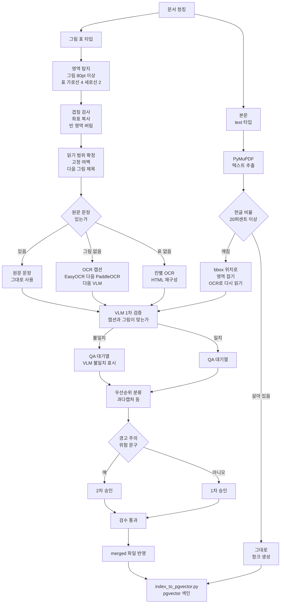
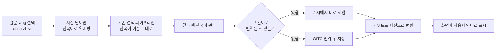

# 삼광 설비 챗봇 개발자 가이드 — 바이브코딩 재구현 명세

## 1. 다국어 처리

## 2. LiteLLM

## 3. 매뉴얼에 들어가는 이미지·표 구현

### 3.1 전체 파이프라인에서 이 문제의 위치

그림·표 처리는 세 단계로 나뉜다. 이 절에서 다루는 건 **3단계**와, 깨진 본문 조각을 OCR로 다시 읽는 처리다. 1·2단계는 DEVELOPER_GUIDE_5 0.4·5.1·8장에 설계가 되어 있다.

| 단계 | 내용 |
|---|---|
| 1. 색인 | PDF 청킹 시 그림·표 청크(`chunk_type=figure/table`)를 만들고, 검수를 통과한 것만 pgvector 테이블에 저장. 이미지는 `image_path`로 보관 |
| 2. 검색 | "그림 보여줘" 질의에 `requested_kind=figure`로 라우팅해 그림 청크를 정확히 찾아옴 |
| 3. 캡션 정확도 | 찾아온 그림·표에 **붙는 설명 텍스트**가 실제 내용과 일치하는지 |

bbox로 잡은 그림·표는 한글·영어 합쳐 **584건**이다. `output/pdf/figure-captions.json`의 361개 추정치와는 탐지 기준이 달라 수치가 다르며, 기준은 아래 3.3.1절의 탐지 기준으로 다시 잡은 값이다.

### 3.2 문제·원인 (실제 PDF 분석으로 재확인)

**처음엔 이렇게 알고 있었음:** 그림을 청크로 가져오는 것까지는 되는데, 붙는 캡션이 그림 내용과 다른 경우가 있다.

**직접 분석해보니 더 근본적인 원인이 확인됨:** 한글 매뉴얼(`원본_B-64484KO-2`, 402쪽) 전체를 텍스트로 뽑아보면, 완성된 한글 음절이 **단 한 글자도 없음** (유니코드 AC00~D7A3 범위 0건 확인). 영어 매뉴얼(`원본_B-63874EN-2`, 558쪽)은 같은 방식으로 뽑으면 완전히 정상임. 영어·숫자·G/M코드는 정상 추출되는 걸 보면, 한글 본문에 쓰인 폰트(CID 폰트)의 유니코드 매핑이 깨진 것으로 보임.

- **청킹을 해도 안 걸러짐:** 페이지당 평균 352자가 "비어있지 않게" 남아있어서 7장의 "빈 줄 제거" 기준을 통과하지만, 그 내용은 한글이 아니라 영어·숫자·기호 파편뿐임. 즉 청크는 정상적으로 만들어지는데 내용이 의미가 없음.
- **그림·표(이미지)는 영향 없음:** 이미지 객체 좌표는 폰트 인코딩과 무관해서 정상 추출됨 — 캡션(텍스트)만 문제.
- **결론:** "그림 캡션만 가끔 틀림"이 아니라 "한글 매뉴얼의 본문·표·캡션 텍스트 추출 전체가 깨짐". bbox로 어떤 텍스트 블록을 골라도 그 블록 자체가 이미 깨져 있어 소용없음.

### 3.3 해결 방법

**통합 규칙 (본문·그림·표 공통):**

1. 문서를 청킹해서 조각을 만든다.
2. 조각마다 글자가 살아 있는지 판정한다. 판정 기준은 아래 3.3.5절에서 정한다.
3. 살아 있으면 텍스트를 그대로 쓴다.
4. 깨졌으면 조각의 위치(bbox)로 영역을 잡고, 그 영역을 OCR로 다시 읽어 대체한다.
5. 그림·표는 bbox로 자른 이미지를 함께 보여준다.
6. 결과를 저장한다. OCR로 채운 조각과 그림·표는 QA를 거친다.

**bbox의 역할**: 그림·표 영역을 잘라서 보여주는 데 쓰고, 깨진 본문 조각은 OCR을 돌릴 영역의 위치를 잡는 데만 쓴다. 본문 글자를 찾는 데는 쓰지 않는다. 깨진 글자라도 위치 정보는 남아 있다는 점은 실제 파일에서 확인이 필요하다.

**최종 결론:** 그림·표의 **위치는 bbox로 파악**하고, 그 위치에서 **OCR로 직접 읽어서 텍스트(캡션·표)를 만든다.** 기존 텍스트 블록 중에서 캡션을 고르던 방식은 쓰지 않는다. 그 방식은 고를 텍스트 블록 자체가 깨져 있어서 성립하지 않았다.

**3.3.1 그림·표 영역 탐지 (bbox)**

- 그림: 80pt 이상인 이미지, 또는 선이 모여 이루어진 도면 영역
- 표: 가로선 4개 이상 + 세로선 2개 이상인 영역
- 250dpi로 재렌더링해서 크롭
- 같은 판정 규칙(3.3.5절)을 영어에도 적용한다. 영어는 텍스트 추출이 정상이라 대부분 그대로 통과하므로 OCR 대상은 거의 없다
- 기존에 설계했던 "텍스트 블록 중에서 캡션 고르기"(캡션 패턴 매칭, 거리 임계값, 방향 제한, 본문 교차검증)는 **폐기** — 고를 대상 자체가 깨져 있어 의미가 없음

**bbox 좌표 → 렌더링 → 크롭, 실제 계산 순서**

1. bbox 좌표는 PDF 안에 pt(포인트, 72pt=1인치) 단위로 이미 들어 있다. 계산이 아니라 읽는 값이다.
2. 페이지를 250dpi로 래스터화(비트맵 렌더링)한다.
3. pt 좌표를 픽셀 좌표로 바꾼다. 배율은 `250 ÷ 72 ≈ 3.47`. `bbox 좌표 × 3.47`이 렌더링된 이미지 위의 실제 픽셀 위치다.
4. 그 픽셀 좌표로 렌더링된 이미지를 자른다 — 이게 `image_path`에 저장되는 PNG가 되거나, OCR·VLM에 넘기는 크롭 이미지가 된다.

이 네 단계는 전부 **색인 시점(배치)**에서만 일어난다 — 3.4절 참고.

**3.3.2 크롭 버그와 수정**

페이지 한 장이 통째로 그림으로 잡히던 원인이 실제로 확인됨: **영역이 겹칠 때 좌표가 뒤집히고, 빈 영역이 페이지 전체로 대체되던 버그**였음. 수정 내용:

- 겹침 검사는 좌표를 복사해서 수행 (원본 좌표를 훼손하지 않음)
- 빈 영역, 페이지 거의 전체를 덮는 영역은 버림
- 읽기 범위(OCR 대상)는 그림 바로 아래부터 **고정 여백·다음 그림·다음 제목 중 가장 가까운 곳까지** — 옆 기능 문단이 캡션에 섞여 들어오지 않도록 하는 경계
- 결과: 그림 두 개가 붙어있는 페이지(예: 위쪽 공구길이보정 도면 + 아래쪽 공구경보정 도면)도 각각 타이트하게 분리되어 크롭됨

**3.3.3 캡션 문장 — OCR이 아니라 매뉴얼 원문**

사용자에게 보이는 문장은 "OCR을 다듬은 글"이 아니라 **그 언어 매뉴얼에 실제로 있는 문장**이다.

- 한글 항목은 한글 취급설명서(`원본_B-64484KO-2`)만, 영어 항목은 영어 MANUAL GUIDE i(`원본_B-63874EN-2`)만 본다 — 서로 다른 언어 매뉴얼을 섞지 않음
- 그림 위·안·바로 아래에 있는 문장이 실제로 있으면 그 문장을 그대로 `note`와 화면 문장에 넣음 — 새로 쓰거나 쉽게 풀어 쓰지 않음
- 문장이 없으면 비워 둠. 기호만 있거나 글자 데이터가 없는 그림은 채우지 않음
- 번역 문장(다른 언어로 써 넣기)은 하지 않음 — 3.9절 보류 사항과 연결
- OCR로 만든 표 HTML은 칸이 깨져서 기본값으로 쓰지 않음 — **매뉴얼 문장이 있으면 그 문장 + 잘린 그림만 보여주고, 문장이 없을 때만 OCR 표 HTML을 보조로 보여줌**

**3.3.4 OCR 결과의 원칙**

매뉴얼에 있는 그대로만 옮긴다는 원칙(0.1·5.1절)을 OCR에도 그대로 적용한다.

- 사전 기반 자동 맞춤법 교정 기능은 끄고 사용 — 애매한 글자를 "그럴듯한 단어"로 바꾸지 않음
- OCR 결과를 LLM으로 다듬는 후처리는 하지 않음 — 문법을 고치거나 문장을 매끄럽게 만드는 것도 원문에 없는 걸 더하는 행위
- 애매하면 교정하지 말고 **신뢰도만 낮게 표시**해서 QA로 넘김
- **VLM(비전 모델)을 "설명 생성"에 쓰는 건 여전히 하지 않음** — 그림을 보고 새로 설명을 만들게 하면 매뉴얼에 없는 내용을 지어낼 위험이 있어 제외. 다만 "보이는 글자를 그대로 옮기는" 용도로는 3.3.6절에서 제한적으로 허용한다

**3.3.5 깨짐 판정 기준 (임시값)**

- 조각 안의 글자(공백 제외) 중 한글 음절(가~힣) 비율을 잰다.
- 비율이 **20% 미만**이면 깨진 것으로 판정하고 OCR로 다시 읽는다. 이 값은 임시값이며, 샘플 검증 후 조정한다.
- 영어 조각은 한글 비율과 무관하게 텍스트 추출 결과를 쓰므로, 이 기준은 한글 조각에만 실질적으로 적용된다.
- 기준값 검증 방법: 판정 결과로 나온 '깨짐' 조각과 '살아 있음' 조각을 각각 일부 골라 원문과 대조한다.

**3.3.6 VLM 보조 — 읽기 폴백과 1차 검증**

bbox는 위치를 찾는 역할을 그대로 유지한다. PDF는 좌표가 파일에 정확히 박혀 있어서, 위치를 찾는 데는 VLM이 필요 없다. VLM은 bbox가 못 하는 두 자리에만 보조로 들어간다.

- **읽기 폴백 (3번째 OCR 대안)**: EasyOCR → PaddleOCR로도 안 읽히면 VLM으로 읽는다. "보이는 글자를 그대로 옮겨라, 추측하거나 보완하지 마라"로 제한한다. 3.3.4절의 OCR 원칙을 그대로 적용한다.
- **1차 검증 (QA 대기열 진입 직전)**: 크롭 이미지와 캡션 후보(원문 매칭 또는 OCR 결과)를 VLM에게 같이 보여주고, "이 캡션이 이 그림을 맞게, 빠짐없이 설명하는가"를 예/아니오로만 판정시킨다. 아니오면 `VLM 불일치` 표시를 붙여 QA 우선순위 맨 앞으로 보낸다. 예여도 검수는 그대로 받는다 — VLM 판정이 최종 승인을 대신하지 않는다.
- **단계적 신뢰 확대**: 처음부터 VLM 판정을 자동 승인에 쓰지 않는다. 사람 판정과 VLM 판정을 같이 기록해 일치율을 쌓고(3.6절 기록 재사용과 같은 방식), 일치율이 높은 유형부터 검수 속도를 줄이는 식으로 점진적으로 넓힌다. 안전 문구가 있는 항목은 VLM 결과와 무관하게 2차 승인을 그대로 유지한다.

**3.3.7 VLM 파싱 방법 — 정확도를 높이는 호출 방식**

VLM을 읽기 폴백이나 1차 검증에 쓸 때, 호출 방식 자체가 정확도를 좌우한다.

- **구조화된 출력으로 강제**: 자유 문장이 아니라 `{"text": "읽은 글자 그대로", "found": true, "confidence": 0.0~1.0}` 같은 고정된 JSON 형식으로만 답하게 한다. 자유 문장으로 두면 설명을 섞어 넣을 여지가 생긴다.
- **금지 행동을 프롬프트에 명시**: "보이는 글자만 그대로 옮겨라", "추측·보완하지 마라", "안 보이면 빈 문자열을 반환해라(억지로 채우지 마라)", "요약하거나 풀어쓰지 마라"를 문장으로 못박는다. 3.3.4절 OCR 원칙과 같은 제약이다.
- **temperature를 0에 가깝게 설정**: 같은 입력엔 같은 출력이 나오도록 결정적으로 호출한다. 값이 높으면 매번 조금씩 다르게 지어내는 경향이 늘어난다.
- **모델이 직접 신뢰도를 보고하게 함**: 위 JSON의 `confidence` 필드로 자가 평가를 받는다. 값이 낮으면 `VLM 불일치`와 같은 방식으로 QA 우선순위를 앞당기는 신호로 쓴다.
- **정답 예시를 프롬프트에 포함 (few-shot)**: 3.6절에서 쌓인 QA 검수 기록 중 사람이 맞다고 확인한 캡션 1~2개를 예시로 넣어, 짧고 정확하게 답하는 기준을 모델에 보여준다.
- **크롭 범위는 3.3.2절 규칙을 그대로 적용**: 너무 넓은 영역을 주면 VLM도 상관없는 글자를 섞어 읽는다. 읽기 범위 규칙은 OCR과 VLM에 공통으로 적용한다.
- **(선택) 이중 호출 비교**: 같은 영역을 두 번 호출해 결과가 같은지 비교한다. 다르면 자동으로 "불확실"로 표시한다. 비용이 늘어나므로 안전 문구가 있는 항목처럼 중요도 높은 경우에만 선택적으로 쓴다.

### 3.4 저장 구조 — pgvector와 이미지의 관계

- 이미지·표 원본 파일은 **pgvector 테이블에 들어가지 않는다** — 크롭된 그림은 PNG 파일로만 저장(`images/ocr/ko/`, `images/ocr/en/`), 표는 재구성된 HTML로 저장(`table_html` 컬럼)
- pgvector 테이블에 들어가는 건 **승인된 캡션·표 텍스트를 bge-m3로 임베딩한 벡터 + 메타데이터(같은 행)**
- 검색 시 (목표 상태): 질문 벡터로 `WHERE` + `ORDER BY embedding <=>` SQL 한 번 → `image_path`/`table_html` 포함한 행을 바로 받음 → 화면 표시. 현재는 승인 전이라 그림·표 질문이 `qa_pending.json`을 직접 읽으며, 전환 작업은 3.8절 3번에 있음
- **OCR과 bbox 계산은 색인 시점(미리, 1회성 배치)에서만 일어남** — 질문이 들어올 때는 이미 만들어진 결과(벡터 + 이미지 파일)만 조회하므로 질문 응답 속도와 무관. 렌더링·크롭·OCR·VLM 호출은 `POST /ask`·`POST /search` 호출 경로에 전혀 나타나지 않는다 — 그 경로는 이미 저장된 결과를 조회만 한다

**현재 실측 수치:**

| 구분 | 위치 | 개수 | 검색 반영 |
|---|---|---|---|
| 한글 본문 | pgvector | 731개 | 승인된 본문만 반영 |
| 영어 본문 | pgvector | 1,595개 | 반영 |
| 본문 합계 | PostgreSQL `manual_chunks` 테이블 | **2,326개** | — |
| 그림·표 (한글+영어) | `qa_pending.json` | **584건** | 전부 미반영 (검수 대기) |

그림·표는 본문 청킹과 별도 경로다 — `chunk_type=figure/table`로 묶이지 않고, bbox로 자른 목록(`qa_pending.json`)에 따로 쌓인다. 승인 전까지는 `merged_ko.json`/`merged_en.json`에 들어가지 않으므로 pgvector 테이블에도 없다.

### 3.5 구현 아키텍처

"청킹"은 문서를 chunk_id가 붙은 단위로 쪼개는 과정이다. 아래 다이어그램의 왼쪽 분기는 본문이다. 텍스트를 뽑고, 살아 있으면 그대로 쓰고, 깨졌으면 OCR로 다시 읽는다. 오른쪽 분기는 그림·표이며 bbox로 영역을 잡고 OCR 또는 매뉴얼 원문을 쓴다. OCR로도 안 읽히면 VLM이 세 번째 대안으로 읽는다(3.3.6절). QA 대기열에 들어가기 전에 VLM이 캡션과 그림이 맞는지 1차로 확인하고, 안 맞으면 우선순위 맨 앞으로 보낸다 — 이 판정이 최종 승인을 대신하지는 않는다. QA는 그림·표와 OCR로 채운 본문 조각에 적용된다. 그대로 살아 있는 본문 조각은 QA 없이 바로 저장된다.

### 3.6 QA — 전수검사와 배포 게이트

사고 예방·교육 목적으로 현장에서 쓰이므로 정확도가 최우선이다. 표본 추출이 아니라 아래 방식으로 간다. 검수 화면은 local(로컬) 8155/qa.

- **전수검사**: 샘플링이 아니라 그림·표 전체(584건)를 검사 대상으로 삼는다. 깨진 본문 조각을 OCR로 채운 것도 같은 대기열에 들어가 검사 대상이 된다(수는 색인 후 집계)
- **우선순위 (앞쪽에 나오는 순서, 실제 구현 기준)**: VLM 불일치 → 과다 캡처 → 페이지 전체 → 비어 있음 → 머리글로 시작 → 다른 기능 혼입 → 너무 긴 문장
- **배포 게이트**: 검수를 통과하지 못한 캡션·표는 서비스에 노출하지 않는다 (틀린 정보보다 "없음"이 낫다는 기존 원칙을 캡션에도 그대로 적용). 승인해도 바로 검색에 들어가지 않고, `index_to_pgvector.py`를 따로 실행해야 반영됨
- **안전 관련 이중 확인**: 본문에 "경고/주의/위험" 문구가 있으면 **두 번 승인**해야 한다. 다른 우선순위 플래그(과다 캡처 등)가 같이 있어도 이 이중 확인 요건은 낮아지지 않는다
- **기록 재사용**: 검수 결과를 JSON으로 쌓아 회귀 테스트 세트로 재사용한다 — 17.4절(파라미터 튜닝 전 테스트 질문 세트)과 같은 방식
- **재검수 주기**: PDF가 바뀌어 재색인할 때는 새로 생기거나 바뀐 그림·표만 다시 검사

**현재 검수 현황:** 584건 전부 `pending`. 문장이 채워진 항목은 567건, 비어 있는 항목은 17건이다. 비어 있는 17건은 매뉴얼에 문장이 없는 그림 14건과 치수만 있는 그림 3건이며, 채우지 않는 게 맞는 처리다. 문장 없는 그림 16건 중 나머지 2건(`ko_p0309_fig_02`·`ko_p0309_fig_03`)은 원래 있던 기호 `A • B (S)`를 그대로 유지한다.

### 3.7 화면 표시

- 대화 화면에서 답마다 따로 빠져 있던 근거 칸을 없애고, 그림·설명·쪽수를 질문 바로 아래(대화 안)에 붙인다 — 11.3절 근거 카드와 별개로, 그림·표는 대화 흐름 안에서 보여줌
- 같은 주제의 그림·표가 여러 장이면 순서대로 쌓는다. 두 번째부터는 "이어서 다른 그림입니다"/"이어서 다른 표입니다" 다음에 그림과 문장이 붙음. 쪽 번호·항목 번호 순으로 최대 8장
- 본문 질문 아래에는 그 주제의 그림·표가 실제로 있을 때만 "그림으로도/표로도 보시겠습니까?"를 띄움. 이미 그림·표·화면을 물어본 경우에는 다시 묻지 않음
- 그림·표는 질문 언어와 같은 언어 항목만 보여주고, 페이지 전체로 잡힌(크롭 버그로 남은) 항목은 답 이미지에서 제외
- 채팅과 검수 화면의 그림·표 칸은 가로 전체·높이 300px, 비율 유지, 여백은 칸 안에 둠. 답 글·그림 설명·검수 문장 칸도 같은 규격. 짧은 글은 칸을 억지로 채우지 않고 긴 문장은 칸 안에서 스크롤. 그림을 누르면 크게 봄
- 관련도 기준 정렬(질문과 더 가까운 그림 먼저)은 검수가 끝난 뒤의 작업 — 현재는 쪽 순서로만 쌓음

### 3.8 완성까지 남은 순서

1. **사람 검수** — local(로컬) 8155/qa에서 크롭·문장을 매뉴얼과 나란히 봄. 문장이 다음 절까지 길게 딸려 들어온 경우, 그림 안 기호와 아래 문장이 한 칸에 같이 들어간 경우만 그 항목을 고침. 문장이 없는 그림 14건과 치수만 있는 그림 3건은 비워 둔 채로 둠 (기호만 있는 2건은 원래 기호 유지)
2. **승인된 것만 검색에 반영** — 안전 문구는 두 번 승인. 승인 후 `index_to_pgvector.py`를 실행해야 그림·표 문장이 본문 색인에 들어감 (승인만으로는 검색에 안 뜸)
3. **그림·표 질문 처리 로직을 pgvector 검색으로 전환** — 현재 그림·표 질문이 `qa_pending.json`을 직접 읽는 방식이라, 본문처럼 벡터 유사도로 찾는 게 아니라 단순 파일 조회에 가까움. 아래 작업이 필요함:
   - 승인된 그림·표를 `merged_ko.json`/`merged_en.json`에 반영 → `index_to_pgvector.py`로 본문과 같은 `manual_chunks` 테이블에 적재 (2번과 같은 작업)
   - 그림·표 질문 처리 코드를 `qa_pending.json` 직접 읽기에서 본문과 동일한 `WHERE` + `ORDER BY embedding <=>` SQL 조회로 교체
   - `qa_pending.json` 직접 읽기는 검수(QA) 화면에서만 쓰도록 분리하고, 실제 사용자 질문 응답 경로에서는 쓰지 않게 함
4. **표시 순서 다듬기** — 현재는 쪽 순서로 최대 8장. 질문과 더 관련 있는 그림을 먼저 보여주는 정렬은 검수가 끝난 뒤에 진행
5. **번역 문장은 번역 매뉴얼 준비 후** — EN/KO 버튼의 페이지 전환 자체는 이미 있음. 그림 설명을 다른 언어로 새로 써 넣는 작업은 하지 않음 (3.9절 보류 참고)

**완료된 것:** 크롭 버그 수정, 원문 문장 채우기, 대화 안에서 근거 보여주기, 300px 크기 통일.
**남은 완성 관문:** 사람 검수, 승인 후 검색 반영(색인 재실행).

### 3.9 보류 — 다음에 다룰 것

`output/pdf` 폴더에 이 문제와 관련된 기존 자료가 있으나, 아직 분석·반영하지 않고 보류함:

- `translation-validation.json`: 깨진 한글 PDF를 복구하려 했던 이전 시도 기록 (결과 PDF 파일은 저장소에 없음)
- `figure-captions.json`, `original-manual-figure-captions.json`: 그림 361개에 대해 이미 만들어진 캡션 (내용 수준을 보면 LLM 비전으로 만들어진 것으로 보임). 두 파일은 거의 같지만 9곳이 미묘하게 다름
- **다른 언어 캡션(교차언어) 붙이기**: 원칙상 번역 매뉴얼(`manual_2_en.pdf`/`manual_2_ko.pdf`)에서 같은 쪽을 찾았을 때만 붙일 수 있는데, 이 번역본 파일 자체가 아직 전달되지 않아 데이터 폴더에 없음. 현재는 같은 언어 원문 안에서만 캡션을 맞추고, 교차언어 캡션은 번역본이 도착한 뒤에 작업한다

재사용 여부·번역 관련 논의는 나중에 따로 다룬다.

## 4. 작업지시서·고장수리내역 다국어 기능

**상태: 설계 정리 완료, 구현 전.** 4.1부터 4.8까지 순서대로 읽는다.

### 4.1 범위

작업지시서·고장수리내역은 엑셀로 받는다 (GUIDE_5 10장 엑셀 처리 설계와 동일 입력). 엑셀 원본은 텍스트 데이터라 3번에서 다룬 PDF 폰트 깨짐 문제가 없다. 지원 언어는 한국어(원문)·영어·일본어·중국어·베트남어 5개다. RAG DB를 매뉴얼 챗봇·작업지시서·고장수리내역 3개 탭으로 나누는 건 따로 다룰 사항이라 이 절에서는 다루지 않는다.

### 4.2 원칙 — 전부 미리 번역하지 않는다

5개 언어를 전부 색인 시점에 미리 번역하면 번역 호출이 언어 수만큼 늘어나 느리고 비싸진다. 그래서 내용을 두 종류로 나눠서 접근한다.

- **고정 사전 항목** (설비명·증상 카테고리·조치 종류·부위 등, GUIDE_5 10.1절 사전): 번역 테이블을 한 번만 만들어두면 끝 — 언어가 몇 개든 LLM 호출 없이 즉시 변환
- **자유 문장** (작업자가 직접 쓴 고장증상·조치내용 등): 조회 시점에만 번역하고 그 결과를 캐시 — 실제로 조회된 양만큼만 번역이 발생함

검색 로직(GUIDE_5 10.4절 하드 필터)은 그대로 한국어 기준으로 유지한다. 번역은 "질의 입구"와 "화면 출구"에만 끼워 넣는다.

### 4.3 고정 사전 번역

설비명·증상 카테고리·조치 종류·부위 등 (GUIDE_5 10.1절 사전)은 단어 수가 적은 고정 목록이라, "한국어 단어 → 4개 언어" 번역 테이블을 한 번만 만들어두면 끝난다.

| 한국어 | en | ja | zh | vi |
|---|---|---|---|---|
| 진동 | vibration | 振動 | 振动 | rung động |
| 교체 | replacement | 交換 | 更换 | thay thế |
| ... | ... | ... | ... | ... |

조회할 때는 이 표에서 값만 찾아 바꿔주면 되니 LLM 호출이 필요 없다. 설비명(`MCT-3` 등)은 코드성 값이라 번역 대상이 아니다.

### 4.4 자유 문장 번역 — 지연 + 캐시

작업자가 직접 쓴 고장증상·조치내용 같은 자유 문장은 고정 표로 못 풀기 때문에, **처음 조회될 때 한 번만 번역하고 그 결과를 같은 행에 저장**해 둔다. 두 번째 조회부터는 저장된 번역을 그대로 꺼내 쓴다.

| 필드 | 설명 |
|---|---|
| `text_i18n` | 청크 행에 추가되는 필드. 번역된 적 있는 언어의 문장만 들어있음 (예: 영어로 한 번 조회됐으면 영어만 채워짐) |

번역은 기존 GITC 호출을 그대로 재사용한다. 프롬프트는 "숫자·설비명·날짜·코드는 그대로 두고 문장만 번역해. 없는 내용을 더하지 마"로 제한한다 — 3.3.4절 OCR 원칙과 같은 "지어내지 않는다" 제약을 번역에도 그대로 적용한다.

### 4.5 질의 언어 → 한국어 역매핑

다른 언어로 질문이 들어오면, 문장 전체를 기계번역하는 게 아니라 **4.3절 사전에 있는 단어만 한국어로 바꿔치기**한다. 예를 들어 영어로 "vibration MCT-3"라고 물으면 사전에서 "vibration"만 "진동"으로 바꿔서 "진동 MCT-3"로 만든 뒤, 기존 한국어 기준 검색(하드 필터·키워드 매칭, GUIDE_5 10.4절)에 그대로 넘긴다. 사전 밖의 문장은 bge-m3가 다국어 임베딩이라 의미 기반 매칭은 어느 정도 되지만, 정확한 하드 필터는 사전에 있는 단어에만 적용된다.

### 4.6 전체 흐름

색인(`ingest_excel_data.py`)과 검색 로직 자체는 건드리지 않는다 — 번역은 조회 결과를 보여주는 마지막 단계에서만 끼워 넣는 구조라, GUIDE_5 10장·10.4절 기존 설계를 그대로 재사용한다.

### 4.7 왜 5개 언어가 부담 없이 가능한지

- **고정 사전은 언어 수와 무관함**: 단어 수가 적어서 표에 언어 열만 추가하면 끝 (4.3절)
- **자유 문장은 쓰는 만큼만 번역됨**: 전체를 미리 번역하는 게 아니라 실제 조회량에 비례 (4.4절)
- **번역 엔진을 새로 안 만듦**: 이미 있는 GITC 호출을 그대로 재사용 (4.4절)
- **검색 로직은 한국어로 고정**: 다국어 대응은 입구(질의 역매핑)와 출구(화면 표시)에만 끼워 넣고, 검색 엔진 자체는 안 바꿈 (4.5·4.6절)

이 네 가지 분리 덕분에 5개 언어를 추가해도 시스템이 무거워지지 않고, 기존 인프라를 그대로 재사용할 수 있다.

### 4.8 구현 전에 정할 사항

- **고정 사전 작성과 검토**: 설비·증상·조치 용어 번역표를 누가 만들고 누가 확인할지 정한다
- **자유 문장 번역 품질**: 번역 결과는 캐시에 바로 저장되므로 검수가 없다. 중요한 안내 문장은 3.6절 방식의 검수를 적용할지 정한다
- **번역 제한 조건 검증**: 숫자·설비명·날짜·코드가 번역 후에도 그대로 남는지 확인하는 테스트 목록을 만든다
- **캐시 무효화**: 원본 엑셀의 행이 수정되면 해당 행의 `text_i18n`을 지울지 정한다
- **사전 밖 단어 처리**: 질문에 사전에 없는 단어가 나오면 그대로 두고 검색할지, 안내 문구를 띄울지 정한다
