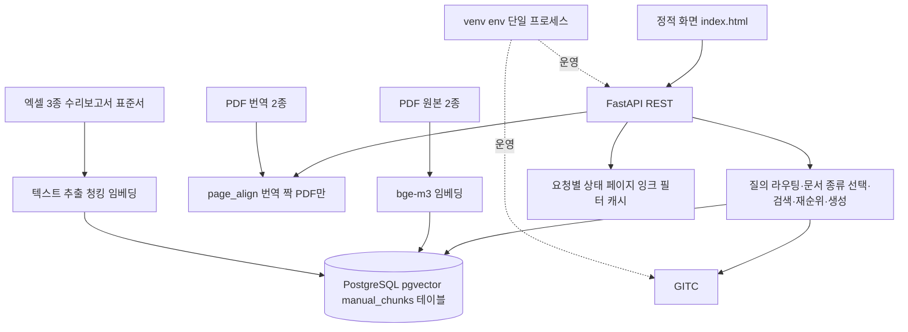
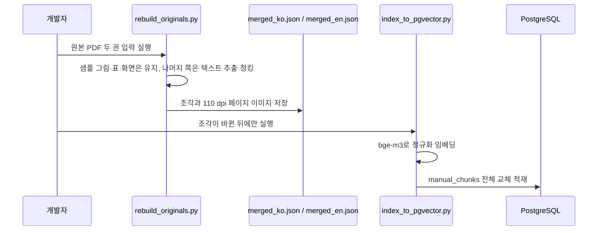
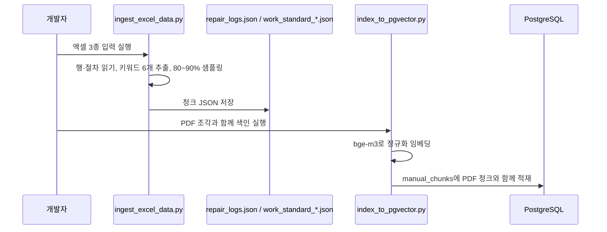
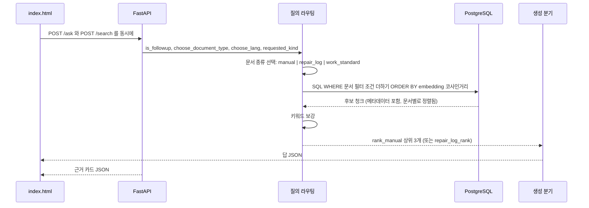
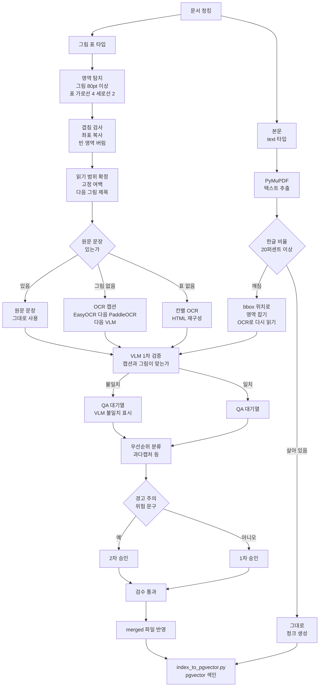
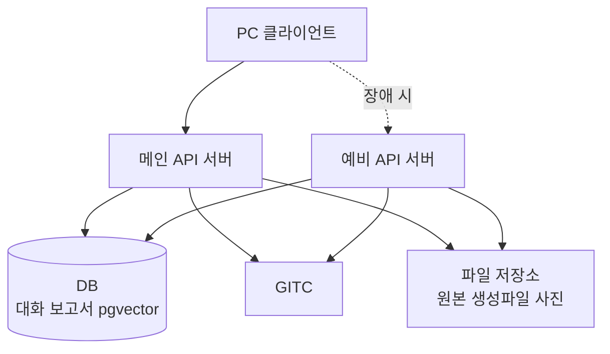
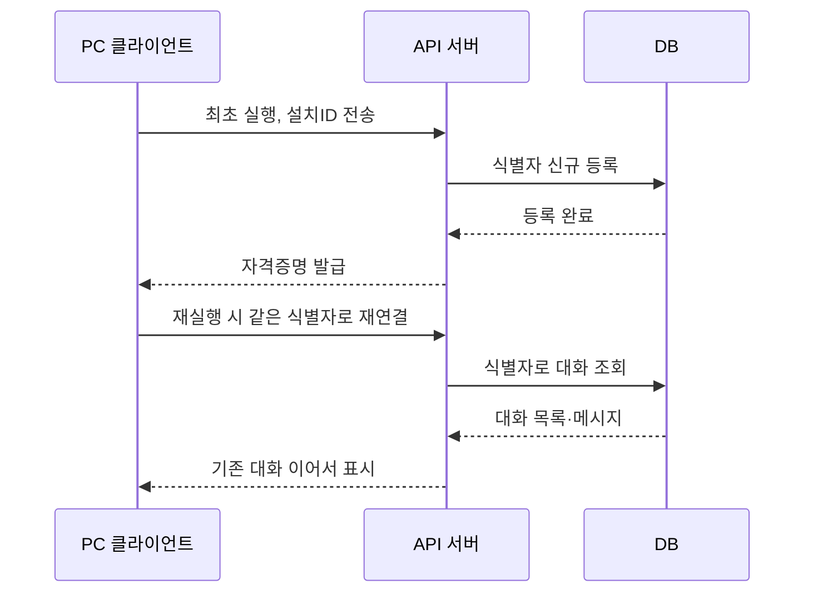
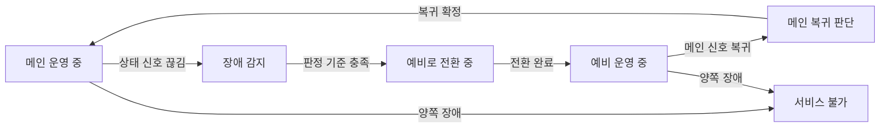
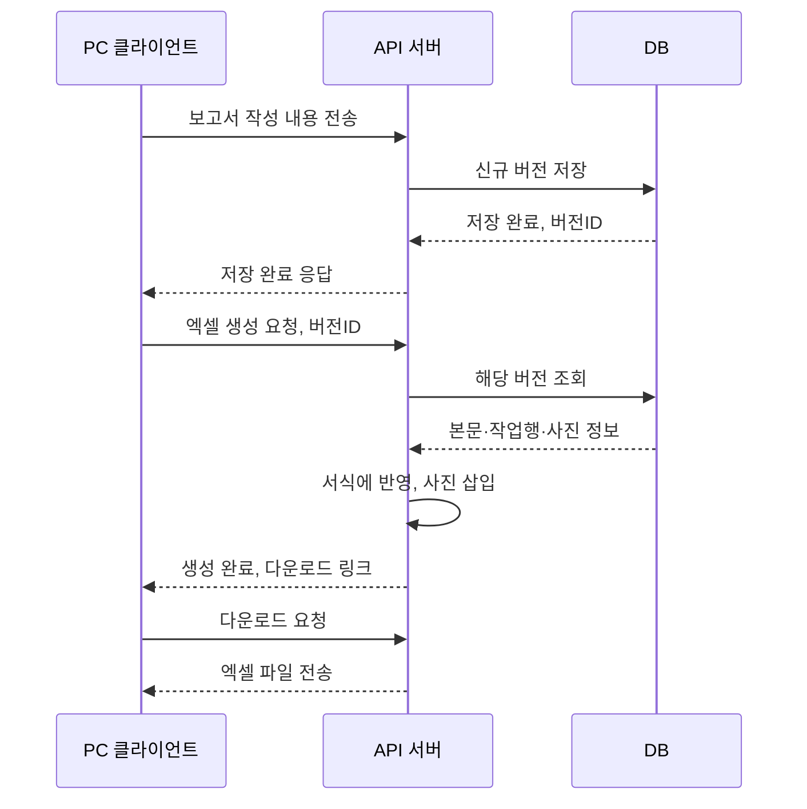
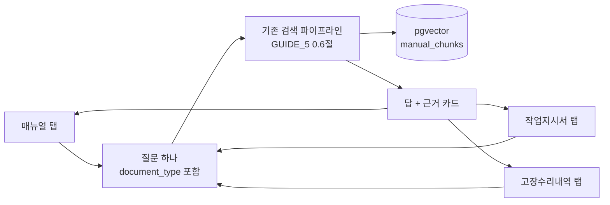

# 삼광 설비 챗봇 — 다이어그램 모음

작성일: 2026-10-12
기준 문서: DEVELOPER_GUIDE_5.md(핵심 아키텍처), DEVELOPER_GUIDE_6.md 3번(그림·표 구현), DEVELOPER_GUIDE_7.md(업무 요청 통합)
상태: 1·2번은 각 문서의 확정된 다이어그램을 그대로 옮긴 것. 3번은 GUIDE_7의 글로만 적힌 전체 프로덕션 요구사항을 그림으로 새로 그린 **초안**이라 구현 전 확인이 필요하다. 4번은 **1차 데모 범위**로, 기존 설계 재사용만으로 바로 구현 가능한 수준까지 정리했다.

## 1. 기존 아키텍처 (GUIDE_5)

### 1.1 구현을 구성하는 계층 구조 (0.2절)



### 1.2 색인 준비 순서 — PDF (0.5절)



### 1.3 색인 준비 순서 — 엑셀 (0.5b절)



### 1.4 질문 한 건의 실행 순서 (0.6절)



## 2. 그림·표 구현 아키텍처 (GUIDE_6 3.5절)

본문은 왼쪽 분기(살아있으면 그대로, 깨지면 bbox+OCR), 그림·표는 오른쪽 분기(bbox 위치 → 원문 또는 OCR·VLM)로 처리된다. 모든 후보는 VLM 1차 검증을 거쳐 QA 대기열로 들어간다.



## 3. 신규 요구사항 아키텍처 (GUIDE_7 기반, 초안)

GUIDE_7에 글로만 적혀 있던 4가지 요구사항을 그림으로 옮긴 것이다. 세부 API 경로·인증 방식은 아직 미정이라, 아래 그림은 **흐름의 뼈대만** 보여준다.

### 3.1 전체 시스템 구조도 (GUIDE_7 4.1·4.9절 기반)



**확인 필요**: DB·파일 저장소를 메인·예비가 공유하는지, 각자 따로 두고 동기화하는지는 GUIDE_7 4.9절에서도 미정으로 남아있다. 위 그림은 "공유 DB" 가정으로 그렸다.

### 3.2 PC별 대화 구분 흐름 (GUIDE_7 4.2절 기반)



**확인 필요**: "식별자"가 설치 ID인지 네이티브 인증서인지는 GUIDE_7 4.2절에서 AI 팀 회신 대기 중인 사항이다. 위 그림은 식별자 종류와 무관하게 성립하는 공통 흐름만 그렸다.

### 3.3 메인/예비 전환 흐름 (GUIDE_7 4.9절 기반)



**확인 필요**: "장애 감지" 판정 기준(시간, 신호 종류)과 "메인 복귀 판단" 기준은 GUIDE_7 4.9절에서 전부 미정이다.

### 3.4 보고서 작성·저장·엑셀생성 흐름 (GUIDE_7 4.6절 기반)



**확인 필요**: "저장"과 "검색(pgvector) 반영"이 같은 요청에서 같이 일어나는지, 별도 색인 스크립트를 다시 돌려야 하는지는 GUIDE_7 6번 절(남은 작업 4번)에서 아직 결정되지 않았다. 위 그림은 저장까지만 그렸고, 검색 반영 단계는 의도적으로 뺐다.

## 4. 1차 데모 범위

3번 절은 메인/예비 이중화·대화 영속 저장·보고서 작성 같은 **전체 프로덕션** 요구사항이다. 1차 데모는 그 전부가 필요하지 않다. 기술 정확도가 우선이고 화면은 깔끔한 수준이면 되는 데모 기준으로 범위를 다시 잡는다. 기존 1~3번 절은 그대로 두고, 데모는 이 절 기준으로만 간다.

### 4.1 데이터 현황

| 구분 | 데이터 | 상태 |
|---|---|---|
| 매뉴얼 — 한글 원본 | `manual_1_ko` (B-64484KO-2 취급설명서) | 준비됨, 검색 대상 |
| 매뉴얼 — 영어 원본 | `manual_1_en` (B-63874EN-2 MANUAL GUIDE i) | 준비됨, 검색 대상 |
| 매뉴얼 — 한글→영어 번역본 | `manual_2_en` | **미준비** — 파일 자체가 없음(GUIDE_5 0.4절엔 "지원 문서"로 설계만 있고 실물 없음) |
| 매뉴얼 — 영어→한글 번역본 | `manual_2_ko` | **미준비** — 위와 동일 |
| 작업지시서 | 작업표준서(SOP) 엑셀 | 회사로부터 수령 완료, 준비됨 |
| 고장수리내역 | 오류·고장 사례 및 조치내역 엑셀 | 회사로부터 수령 완료, 준비됨 |

매뉴얼 4종 중 번역본 2종은 파일이 없어서 데모에 못 넣는다. 다만 이건 원래 설계(GUIDE_5)에서도 번역본은 검색 대상이 아니라 언어 전환 버튼 전용이었으므로, **번역본이 빠져도 매뉴얼 탭(한글·영어 원본 검색)은 정상 동작한다** — 언어 전환 버튼만 데모에서 빠지는 것.

### 4.2 탭 구성 (3개)

| 탭 | `document_type` 값 | 데이터 소스 |
|---|---|---|
| 매뉴얼 | `manual` | `manual_1_ko`, `manual_1_en` |
| 작업지시서 | `work_standard` | 작업표준서(SOP) 엑셀 |
| 고장수리내역 | `repair_log` | 오류·고장 사례 엑셀 |

이 구분은 새로 만드는 게 아니라 GUIDE_5 5.2절의 기존 `document_type` 필드를 그대로 재사용한다.

### 4.3 데모용 API (최소 구성, 기존 라우트 재사용)

메인/예비 이중화·인증·PC별 대화 구분(GUIDE_7 4장)은 데모 범위가 아니다. 1차 데모는 기존 GUIDE_5 11.1절 라우트만으로 충분하다 — 새 API를 만드는 게 아니라 탭마다 `document_type` 값만 다르게 보내면 된다.

```
GET  /                       정적 화면, 탭 3개
POST /ask                    {query, document_type, prior_query}  →  답 JSON
POST /search                 {query, document_type, prior_query}  →  근거 카드 배열
GET  /manuals/{name}.pdf      매뉴얼 원문 서빙 (매뉴얼 탭 전용)
GET  /filters                 작업지시서·고장수리내역 탭 드롭다운 옵션 (GUIDE_5 10.6절)
```

### 4.4 UI 요구사항 (최소)

- 탭 3개(매뉴얼/작업지시서/고장수리내역) 전환만 되면 됨
- 매뉴얼 탭은 한글/영어 책 선택만 있으면 됨 — 언어 전환 버튼은 번역본이 없어서 데모에서 뺌
- 디자인은 깔끔한 수준이면 충분 — 이번 데모의 우선순위는 검색 정확도·근거 표시 같은 기술 쪽이지 화면 꾸미기가 아님

### 4.5 데모 아키텍처



데모는 탭이 3개로 나뉘어 보여도, 뒤에서는 **기존 검색 파이프라인 하나를 `document_type`만 바꿔서 재사용**하는 구조다. 탭별로 서버나 API를 따로 만드는 게 아니다.

## 5. 다음에 할 일

**데모(4번 절)** 는 기존 설계 재사용만으로 가능하다 — 새로 확인할 게 거의 없다. 작업지시서·고장수리내역 엑셀 파일도 이미 회사로부터 수령 완료라 바로 구현 들어갈 수 있다.

**전체 프로덕션(3번 절)** 은 아직 멀었다. "확인 필요" 네 가지가 정해지면 다이어그램을 그만큼 구체화한다. DB 스키마(ERD)와 API 요청·응답 예시는 이 문서가 아니라 GUIDE_7에 별도로 추가하는 걸 권장한다 — 다이어그램은 흐름을, GUIDE_7은 세부 계약을 담당하는 역할 분리를 유지한다.
