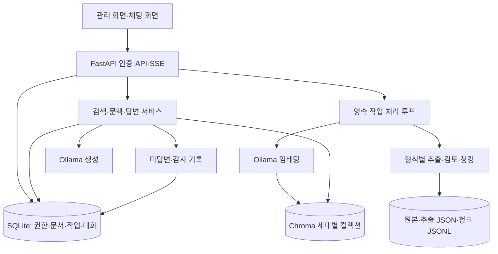
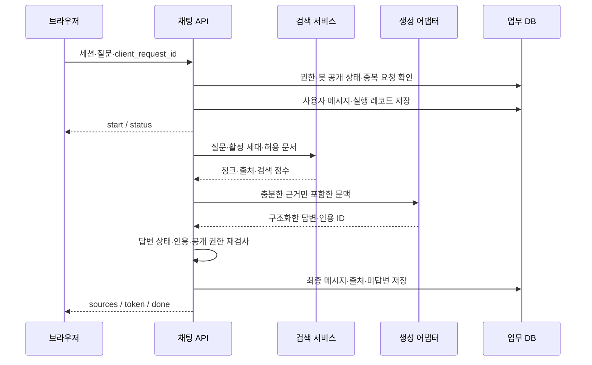

# 01. 시스템 정의와 아키텍처

[문서 첫 페이지](./README.md) · 다음: [개발 환경](./02-development-environment.md)

## 1. 제품 범위

시스템은 “관리자가 승인한 지식에 근거하여 질문에 답하고, 근거를 찾지 못하면 이를 밝혀 운영자가 보완할 수 있는 웹 챗봇”이다. 목표는 문서의 모든 내용을 외워 말하는 것보다 **질문에 맞는 근거를 찾고 그 근거의 범위 안에서 답하는 것**이다.

기본 기능 요구사항은 아래 ID로 구현·인수 결과를 추적한다.

| ID | 필수 기능 | 완료 기준 |
|---|---|---|
| F01 | 관리자 인증, 봇 생성·수정·공개 전환 | 본인 봇만 관리, 기본 비공개 |
| F02 | 파일·Q&A 등록 | 원본과 버전, 작업 ID를 저장 |
| F03 | 추출·정제·청킹·검토 | 위치 참조와 오류를 보존 |
| F04 | 임베딩·검색 인덱스 | 모델 정보·청크 ID·세대 검증 |
| F05 | 검색과 출처 | 봇·삭제·공개 범위 격리 |
| F06 | 답변·미답변·되묻기 | 근거 밖의 내용은 채우지 않음 |
| F07 | 대화와 SSE | 새 대화, 중단, 실패, 재접속 상태 표시 |
| F08 | 지식 갱신·삭제·재색인 | 실패 시 이전 정상 세대 유지 |
| F09 | 미답변함 개선 | Q&A 색인 성공 뒤 해결 처리 |
| F10 | 상태·로그·백업·복원 | 재시작 및 장애 후 상태 확인 |

CRM, 결제, 관광 경로, 자동 웹 수집, 음성, 도구 실행, PLC 코드 생성, 파인튜닝은 기본 범위에 포함하지 않는다. 이를 추가할 때 챗봇 검색·응답 계약을 보존하는 독립 모듈로 구현한다.

## 2. 사용자와 권한

| 주체 | 허용 |
|---|---|
| 운영 관리자 | CLI로 최초 계정 생성, 상태 확인, 백업·복원 |
| 봇 소유자 | 로그인 후 자신의 봇·문서·Q&A·미답변·대화 관리 |
| 공개 방문자 | 공개 봇 설정 조회, 자신의 방문 세션 대화·출처 보기 |
| 비공개 봇 사용자 | 기본판에서는 봇 소유자. 조직 구성원 ACL은 확장 |

기본판에는 셀프 회원가입 API가 없다. 관리자가 CLI로 계정을 만든다. `public_id`는 찾기 어려운 식별자지만 비밀문서의 인증 수단은 아니다. 공개 봇에는 공개 가능한 자료만 적재한다. 소유자 검사와 봇 범위는 매 요청마다 서버가 결정하며, 브라우저가 제출한 `owner_id`를 신뢰하지 않는다.

## 3. 논리 구성

기본판은 FastAPI와 Ollama 두 서비스다. FastAPI가 HTML·정적 파일도 제공하므로 Node·Express·별도 프런트 빌드가 필요하지 않다. Linux 공개 운영에서는 앞단에 Nginx를 둔다.

| 자원 | 주소·실행 단위 | 책임 |
|---|---|---|
| 웹/API | `http://127.0.0.1:8000` | 인증·화면·API·작업 루프 |
| Ollama | `http://127.0.0.1:11434` | `/api/embed`, `/api/chat` |
| 업무 DB | `data/app.sqlite3` | 사실의 기준 저장소 |
| Chroma | `data/chroma/` | 재생성 가능한 검색 자료 |
| 파일 | `data/raw/`, `data/derived/` | 재추출과 출처 복원 |

## 4. 문서 등록의 전체 순서

1. 소유자를 검증하고 업로드를 제한 크기까지 스트리밍 저장한다.
2. 파일 내용 해시·원본명·문서 ID·버전 ID를 기록하고 `ingest` 작업을 생성한다.
3. 작업 루프가 형식 확인, 페이지별 추출, 필요 시 OCR, 정규화, 위치 보존을 수행한다.
4. 추출 품질이 낮으면 `needs_review`에서 멈춘다. 관리자 검토가 끝나기 전 검색에 넣지 않는다.
5. 구조화 자료를 청크로 나누고 스키마·크기·중복·출처를 검사한다.
6. 승인된 새 버전을 봇의 희망 자료 목록에 반영한다. 새 봇 세대 전체를 별도 컬렉션에 구축한다.
7. 임베딩 수·청크 ID 집합·모델 manifest·대표 검색을 확인한다.
8. SQLite 트랜잭션에서 `active_generation_id`를 교체한다. 이 순간부터 새 지식이 조회된다.
9. 작업을 성공으로 종료하고 UI에 반영한다. 이전 세대는 보존 기간 후 정리한다.

색인 중 기존 정상 챗봇은 이전 세대를 사용한다. 처음 만든 봇에는 활성 세대가 없으므로 “자료 준비 중”을 안내한다. 벡터가 일부 들어간 상태를 검색 가능으로 간주하지 않는다.

## 5. 질문 처리의 전체 순서

근거 없음은 모델 호출 없이 종료할 수 있다. 모델 장애에는 `error`를 보낸다. 생성 후 검증을 위해 기본판은 답변을 버퍼링한다. 따라서 `token` 이벤트는 검증된 본문을 나눈 전송 조각이며 실시간 생성 토큰과 같지 않다. 실시간 생성 스트림은 06장의 선택 기능이다.

## 6. 모듈과 책임 경계

| 모듈 | 입력 → 출력 | 금지 사항 |
|---|---|---|
| extractor | 원본 → `ExtractedDocument` | 벡터 DB 쓰기 |
| normalizer | 추출 블록 → 정규화 블록 | 숫자·단위·부정어 임의 변경 |
| chunker | 블록 → `Chunk[]` | 출처 위치 소실 |
| embedder | 텍스트 → 벡터·모델 정보 | 조용한 입력 잘라내기 |
| indexer | 청크 집합 → 검증된 새 세대 | 활성 컬렉션 제자리 덮어쓰기 |
| retriever | 권한 범위·질문 → `Evidence[]` | 타 봇·삭제 문서 포함 |
| answerer | 질문·근거 → `AnswerResult` | 모델 출력으로 파일·명령 실행 |
| chat service | 인증 세션·질문 → 이벤트 | 브라우저 이력을 사실 근거로 신뢰 |
| repositories | 트랜잭션·조회 | 모델 네트워크 호출 중 DB 쓰기 락 유지 |

## 7. 기본 운용 한계와 목표

설계 시작 규모는 단일 호스트, 봇당 10,000청크 이내, 한 번에 생성 1건, 대기 최대 8건이다. 이 수치는 측정된 처리 용량이 아니라 기본 구현·시험의 경계다. 대용량 자료에는 전체 세대 재구축 비용이 커지므로 증분 인덱싱과 서버형 DB로 확장한다.

초기 목표는 첫 상태 이벤트 1초 이내, 검색 p95 2초 이내, 전체 응답 p95 60초 이내, 자료 1건 처리 10분 이내로 잡는다. CPU 개발 환경이 못 맞추면 측정 결과를 기록하고 장치·자료량·목표를 조정한다. 기능 인수와 성능 인수를 별도로 기록한다.

요청 식별자, UTC 시간, 처리 단계, 실행 시간, 모델·인덱스 버전은 모든 장애를 연결할 수 있어야 한다. 로그에는 문서 전문·비밀번호·세션 토큰을 쓰지 않는다.
