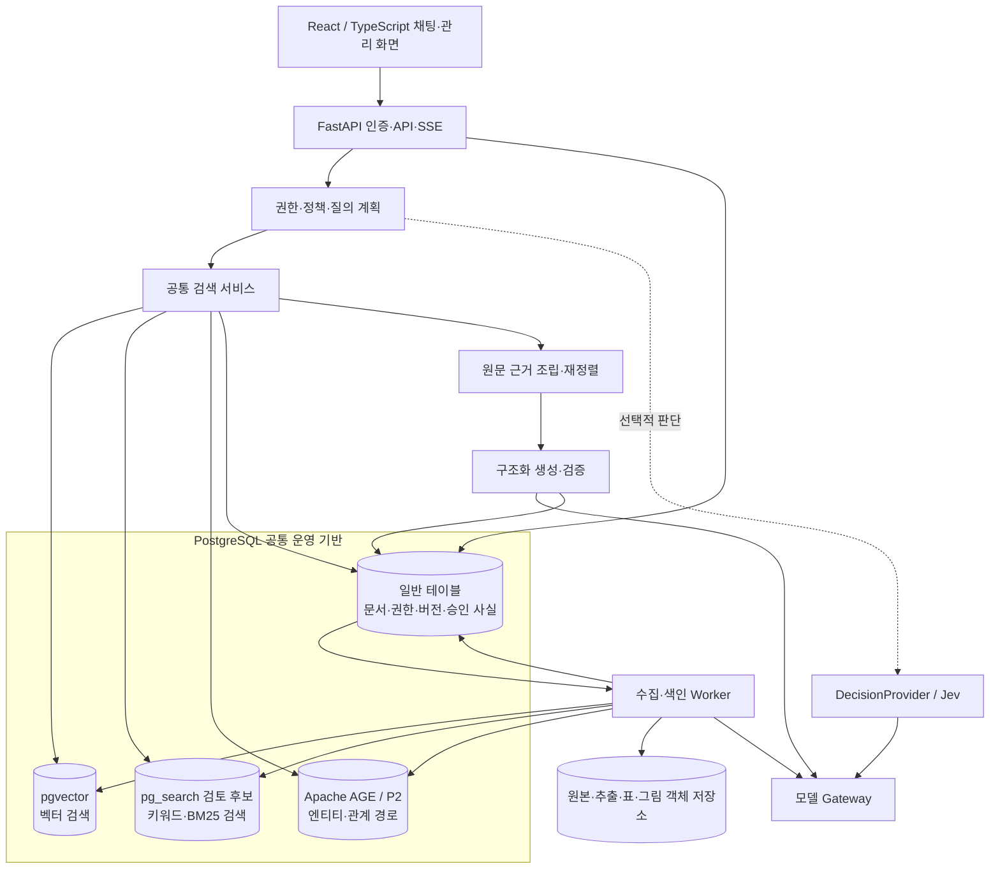
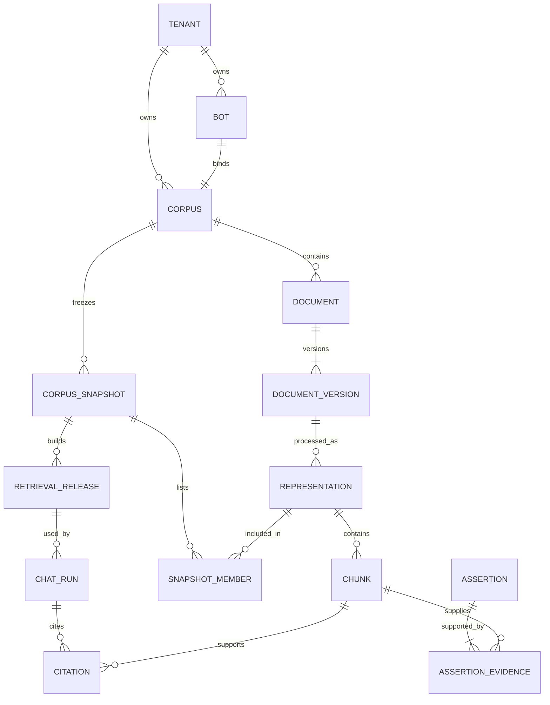
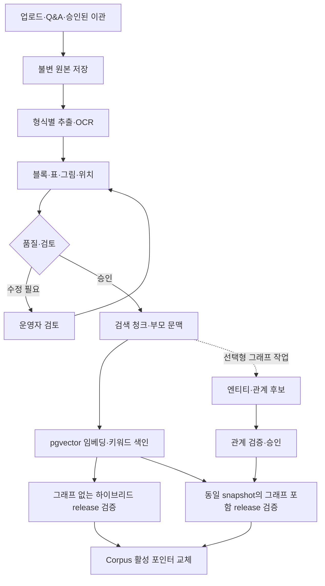
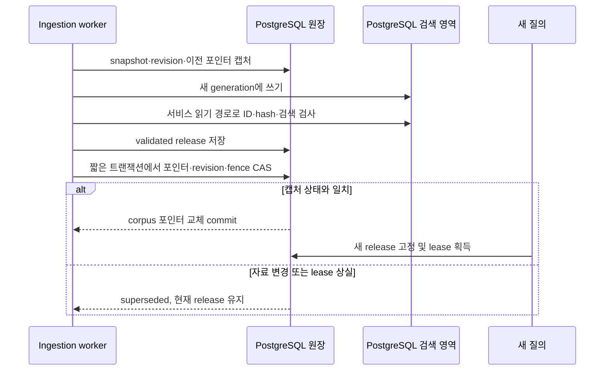
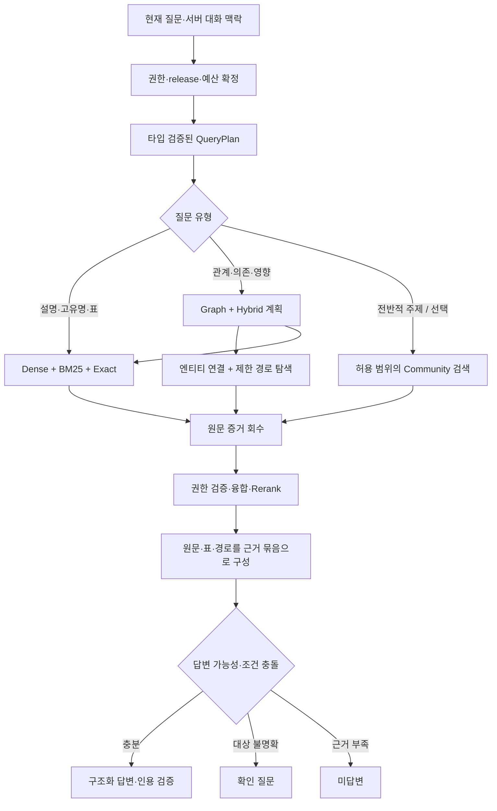
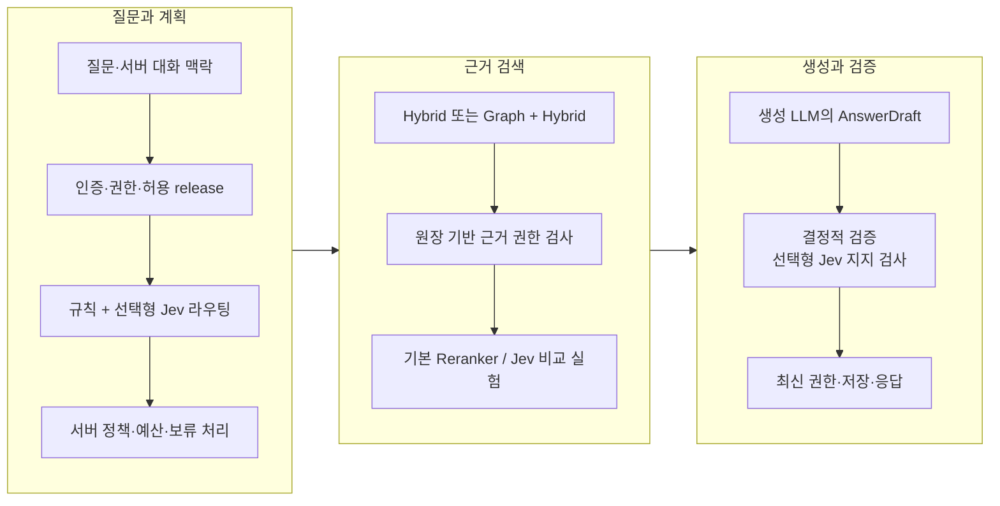
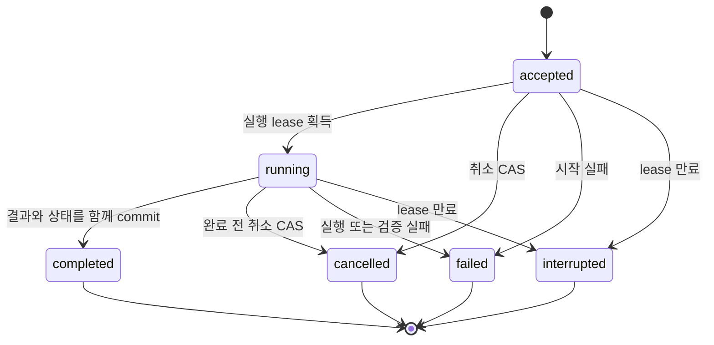

# 신규 챗봇 시스템 설계안

작성일: 2026-09-23 · 개정일: 2026-09-30 · 설계 버전: 0.4 · 단일 통합본 · 가칭: MVBot Next · 상태: 구현 전 설계

**권장 방향은 PostgreSQL을 기반으로 문서 원본의 벡터·키워드·그래프 검색을 결합하는 지식 챗봇이다.** 벡터 검색은 pgvector, 그래프 검색은 Apache AGE를 기본안으로 정하고, BM25 검색은 ParadeDB의 pg_search를 도입 검토 대상으로 둔다. 타입 안전성은 첫 구현부터 적용하고, 그래프 RAG는 관계형 질문에서 효과를 평가하며 단계적으로 도입한다. 그래프가 있어야 일반 문서 검색까지 동작하는 구조로 만들지 않는다.

**이 문서가 신규 시스템의 단일 설계 기준이다.** 기존 01~07 문서의 본문과 검증 기록을 이 파일에 통합했다. 아래 2절에 실제 설계 내용이 모두 포함되며, 원본 가이드 링크는 출처 추적용이다.

기존 네 개발 가이드와 `basic-chatbot` 문서 묶음을 설계 입력으로 사용했다. 이번 작업은 신규 설계 작성이며 기존 앱의 동작·성능을 재검증하거나 신규 서버를 구현한 작업이 아니다. 성능 수치·일정은 제안값이다.

<a id="summary"></a>

## 1. 설계 요약과 적용 범위

### 1.1 핵심 결정

| 영역 | 신규 선택 | 이유 |
|---|---|---|
| 사용자 기능 | 여러 봇, 문서·Q&A, 근거 답변, 미답변 개선 | 김비서의 운영 흐름 계승 |
| 검색 | pgvector 의미 검색 + BM25 후보 평가 + 정확 식별자 검색 + reranker | 의미·한국어 표현·제품 코드·표 행을 함께 검색 |
| 그래프 | 출처가 있는 엔티티·관계, 제한된 다단계 탐색 | 제품→기능→제약 등 여러 근거 연결 |
| 데이터 | PostgreSQL 원장 + 원본 객체 저장소 + 검색용 사본 | 버전·권한·삭제·복구의 기준 통일 |
| 검색 저장소 | PostgreSQL + pgvector, P2 Apache AGE; pg_search는 검토 후보 | 운영 기반을 통일하고 확장별 품질·호환성을 단계적으로 검증 |
| 서버·화면 | Python/FastAPI, React/TypeScript | 기존 Python 자산과 복잡해지는 검토 UI 활용 |
| 타입 계약 | Pydantic → OpenAPI/JSON Schema → 생성 TS 타입 + 런타임 검증 | API·작업·검색·LLM 출력의 구조 불일치 방지 |
| AI 판단 | TypeSafe AI Jev를 선택형 DecisionProvider로 적용 | 검색 라우팅·근거 평가 등 좁은 판단을 확률과 함께 처리 |
| 처리 | 모듈형 서버 + 별도 수집 worker, 모델 서비스 분리 | 초기 구현 부담을 제한하며 작업·자원 격리 |
| 적용 순서 | 타입 계약·권한 → 하이브리드 RAG → 근거형 그래프 → 고급 기능 | 각 단계의 효과와 비용 확인 |

요청한 솔루션의 역할과 적용 상태는 다음과 같이 고정한다.

| 역할 | 추천 솔루션 | 적용 방식 | 결정 상태 |
|---|---|---|---|
| 벡터 검색 | **pgvector** | 문서 청크의 임베딩을 PostgreSQL 테이블에 저장하고 유사도 검색 | 기본안, P1 구현 |
| 그래프 검색 | **Apache AGE** | PostgreSQL 안에 엔티티·관계의 검색용 사본을 저장하고 openCypher로 연결 경로 탐색 | 기본안, P2 품질 gate 후 활성화 |
| 키워드·BM25 검색 | **ParadeDB의 pg_search 검토** | 기존 BM25 요구를 PostgreSQL 내부에서 구현하는 후보로 PoC | 도입 미확정, 한국어·권한·호환성 평가 필요 |
| 문서·권한·버전 관리 | **PostgreSQL 일반 테이블** | 원본 위치, 승인 상태, 문서 버전, 사용자 권한의 기준 데이터 관리 | 필수 기반 |

원본 파일·표·그림은 객체 저장소에 보존하고, PostgreSQL에는 위치·hash·버전과 검색용 표현을 저장한다. 같은 PostgreSQL을 사용해도 확장들의 동시 설치·권한 적용·백업 호환성이 자동으로 보장되는 것은 아니다. 실제 배포 조합은 P0에서 확인한다.

### 1.2 설계 전제

- 한국어 업무 문서·제품 매뉴얼·운영 Q&A가 주 대상이다. CRM·결제·설비 제어는 별도 도메인 모듈로 둔다.
- 사내 비공개 봇과 공개 안내 봇을 모두 지원하되, 검색 가능한 지식 범위는 서버가 결정한다.
- 초기 데이터 규모는 개발용 1만 청크, 출시 전 평가용 총 10만 청크를 가정한다. 실제 고객 수·GPU·동시성이 없으므로 처리량 보증으로 사용하지 않는다.
- 로컬 모델 우선 프로필과 승인된 외부 모델 프로필을 모두 설계한다. 특정 최신 모델을 성능 검증 없이 고정하지 않는다.
- 요청의 **‘타입세이프 jev’는 TypeSafe AI의 Jev(System One model)**로 확인했다. 주어진 상태에 대해 타입이 정해진 질문의 판단 값을 반환하는 모델이며, 코드·API 타입 안전성과 구별하여 [2.4 Jev 판단 계층](#jev)에 반영한다. [공식 소개](https://docs.typesafe.ai/introduction). Ajv는 JSON validator이며 Jev와 다른 구성요소다.

### 1.3 첫 출시와 후속 확장

첫 출시는 문서·Q&A 관리, 원본 위치 인용, 조직·봇 권한, 하이브리드 검색, 검증된 답변, 영속 작업과 미답변 개선까지다. 그래프 단계에서 엔티티·관계 검토와 다단계 근거 검색을 더한다. 전사 자료의 주제 요약을 위한 Microsoft GraphRAG 방식, 멀티모달 검색, 제한된 에이전트 검색은 이후 평가 대상으로 둔다.

Jev 어댑터 경계는 처음부터 설계하고, P1에서 검색 라우팅을 shadow 평가한다. 접근 권한·외부 처리 정책·한국어 품질을 확인한 뒤 해당 판단부터 선택적으로 활성화한다. 답변 작성은 생성 LLM, 자료 검색은 RAG, 최종 권한·수치 계산·실행 허용은 서버 코드가 맡는다.

기존 경량 설계의 원본 보존·멱등·근거·삭제 원칙은 계승한다. SQLite/Chroma 로컬 사용, 단일 API 내부 작업 루프, 문자 기반 청킹, 기존 API 이벤트를 그대로 가져오지는 않는다. 구체적인 대체 범위는 [설계 결정](#decisions-sources)에 기록했다.

### 1.4 용어와 책임 구분

| 용어 | 이 문서에서의 의미 | 기준 위치 |
|---|---|---|
| Vector / Hybrid RAG | 의미 벡터·키워드·정확 명칭으로 원문 근거 회수 | 검색 서비스 |
| Graph RAG | 승인된 관계를 탐색하고 모든 연결의 원문을 함께 회수 | 검색 서비스 + 관계 검토 |
| Jev | 정해진 질문 타입에 대한 선택·평가를 반환하는 선택형 모델 | DecisionProvider |
| 타입 안전성 / Ajv | 코드·전송 데이터·상태가 계약에 맞는지 검사 | Pydantic·TS·Ajv·DB |
| CorpusSnapshot | 승인된 원본 버전과 처리 표현의 고정 목록 | PostgreSQL |
| RetrievalRelease | 동일 snapshot의 검증된 벡터·키워드·선택형 그래프 산출물 묶음 | PostgreSQL의 corpus 활성 포인터 |
| 근거 검증 | 인용 소속·권한·버전·조건·문장 지지를 검사 | 서버 검증 서비스 |

<a id="system-design"></a>

## 2. 전체 시스템 설계

아래 순서로 제품 범위부터 운영·이관까지 이어진다. 각 링크는 **이 문서 안의 본문**으로 이동한다.

| 절 | 주요 내용 |
|---|---|
| [2.1 시스템 목표와 아키텍처](#architecture) | 요구사항·구성요소·스택·불변조건 |
| [2.2 데이터 계약과 문서 수명주기](#data-lifecycle) | 원본·표·그림·관계·릴리스·삭제·작업 |
| [2.3 벡터 RAG와 그래프 RAG](#retrieval) | 하이브리드 검색·온톨로지·다단계 근거·고급 기능 |
| [2.4 TypeSafe AI Jev 의사결정 계층](#jev) | 판단 타입·API 예시·보류·한국어 평가·도입 조건 |
| [2.5 타입 안전성, 답변 계약과 API](#contracts-api) | DTO·답변 검증·HTTP·SSE·상태 전이·화면 |
| [2.6 구축 순서, 평가와 운영](#delivery-operations) | 단계별 구축·평가셋·SLO·보안·복원·이관 |
| [2.7 설계 결정, 근거와 미확정 사항](#decisions-sources) | ADR·기존 자료 추적·공식 근거·남은 결정 |

<a id="architecture"></a>

### 2.1 시스템 목표와 아키텍처

<a id="architecture-1"></a>

#### 2.1.1 기존 문서에서 가져올 것

아래는 입력 가이드가 기술한 내용이다. 이번 작업에서 네 시스템의 코드를 다시 실행·감사한 결과는 아니다.

| 입력 | 계승할 강점 | 신규 설계에서 해결할 한계 |
|---|---|---|
| [LogisticsKorea](../DEVELOPER_GUIDE_1.md), 0·6·10·11절 | 의미/키워드 결합, SSE, 모델 준비·워커 관측 | 메모리 대화·상태, 일괄/온라인 적재 차이, 전달 계층 설정 불일치 |
| [LSE](../DEVELOPER_GUIDE_2.md), 0.4·5·6·8·14절 | 작은 검색 조각→원문 복원, 표 행·그림, exact 검색, IR·검증 | 도메인 규칙 결합, 메모리 작업·태그 캐시, 원본·그림 누락 가능성 |
| [mysbiz](../DEVELOPER_GUIDE_3.md), 0.4·6·7·8·18절 | 폴더·데이터셋 범위, OCR·변환, 제공자 추상화 | 서비스별 검색 계약 차이, 모델 전환의 타 서비스 영향, 실행 시 DDL |
| [김비서](../DEVELOPER_GUIDE_4.md), 0.4·5·6·8절 | 봇 관리, Q&A, 공개 채팅, 미답변→지식 개선 | 원본 미보존, DB/벡터 비원자성, 센티널 기반 응답 판정 |
| [기본 설계](../basic-chatbot/README.md), 03~09장 | 불변 버전, 승인, 인덱스 세대, 삭제 차단, 인용 검증 | 단일 프로세스·1만 청크 가정, 그래프·조직 ACL·고급 검색은 확장 항목 |

핵심 개선점은 모델 교체보다 **지식을 정규화하고 모든 검색 경로가 동일한 권한·버전·근거 계약을 쓰게 만드는 것**이다.

<a id="architecture-2"></a>

#### 2.1.2 제품 기능과 사용자 흐름

| ID | 기능 | 사용자가 확인할 결과 |
|---|---|---|
| N01 | 조직·사용자·봇·역할 관리 | 담당 봇과 허용 자료만 접근 |
| N02 | 문서·Q&A 등록 및 교체 | 원본, 추출 미리보기, 승인, 검색 반영 상태 |
| N03 | 벡터·키워드·정확 명칭 검색 | 원문 위치와 관련 표 행·그림 |
| N04 | 근거형 대화 | 답변·출처, 모호하면 확인 질문, 부족하면 미답변 |
| N05 | 미답변·오답 개선 | 원인 분류→수정→평가→새 지식 반영 |
| N06 | 그래프 관계 검색 | 근거가 확인된 관계 경로와 각 연결의 출처 |
| N07 | 검색 시험·평가 비교 | 검색 방식별 근거 회수·지연·비용 비교 |
| N08 | 변경·복구·감사 | 버전 전환, 실패 복구, 권한 변경 및 삭제 이력 |

운영자는 자료 업로드→추출 검토→검색 미리보기→승인→서비스 반영의 상태를 본다. 사용자는 질문→답변 또는 확인 질문→문장별 출처→원문 위치 확인을 수행한다. 미답변 등록만으로 자료가 학습되는 것이 아니라, 운영자가 보완한 지식을 다시 색인하고 평가해야 한다.

도메인 구분은 `tenant → bot → corpus`로 한다. tenant는 조직, bot은 사용자 접점과 정책, corpus는 봇이 참조하는 자료 집합이다. 1단계는 봇당 corpus 하나로 제한하고, 여러 봇의 지식 공유는 명시적인 corpus binding과 권한 교집합을 구현한 후 활성화한다.

<a id="architecture-3"></a>

#### 2.1.3 목표 아키텍처



API와 worker는 같은 도메인 코드와 계약을 쓰되 프로세스를 분리한다. 처음부터 기능마다 마이크로서비스를 만들지 않는다. 검색 어댑터는 pgvector·AGE·키워드 엔진을 논리적으로 분리하되 초기 배포는 하나의 PostgreSQL 기반으로 구성한다. DB 자원·장애 영향은 공유하므로 어댑터 분리를 물리적 장애 격리로 해석하지 않는다. 모델 gateway는 별도 경계를 가진다. gateway는 제공자 어댑터·자원 할당·사용량 제한을 제공하는 내부 컴포넌트이며 처음에는 단일 서비스로 실행한다.

| 구성 | 책임 | 경계 |
|---|---|---|
| API | 인증·권한, 요청 멱등, 대화·작업 조회, SSE | 문서 변환·대규모 색인 수행 금지 |
| Query service | 질의 계획, 병렬 검색, 근거 조립, 답변 검증 | 원장 밖의 권한 정보만으로 허용하지 않음 |
| Ingestion worker | 추출, OCR 작업 위임, 청킹, 인덱스 세대 구축 | 활성 인덱스 제자리 수정 금지 |
| Graph worker | 엔티티 후보·관계 추출, 검토 반영, 그래프 사본 구축 | 모델 추출 관계를 즉시 사실로 공개하지 않음 |
| Model gateway | 임베딩·rerank·생성·비전 어댑터, deadline·자원 제한 | 사용자 입력으로 endpoint·모델 파일 경로 변경 금지 |
| DecisionProvider | Jev 등으로 라우팅·근거 평가의 판단 값 제공 | 권한 부여·문서 승인·자연어 답변 생성은 수행하지 않음 |
| PostgreSQL 일반 테이블 | 업무 상태, 문서/관계의 기준 데이터, jobs/outbox, 감사 | 모델 호출 중 DB 트랜잭션을 잡아두지 않음 |
| PostgreSQL 검색 영역 | pgvector·AGE, 검토 후 채택할 키워드 인덱스의 재생성 가능한 사본 | 확장 내부 데이터는 권한·승인의 최종 기준 아님 |

<a id="architecture-4"></a>

#### 2.1.4 기술 선택

| 영역 | 기본안 | 대안과 선택 조건 |
|---|---|---|
| Backend | Python + FastAPI + Pydantic + SQLAlchemy/Alembic | Python 패치·라이브러리 버전은 호환 시험 후 잠금 |
| Frontend | React + TypeScript strict + Vite | 작은 단일 봇 PoC는 기존 Jinja2 가능, 본 설계 UI 기준은 React |
| 원장 | PostgreSQL | SQLite는 기존 경량 설계용으로 한정 |
| Vector | pgvector, 청크 임베딩 테이블 + HNSW를 초기 ANN 후보로 평가 | exact 검색으로 recall 기준선 확보; 독립 확장 필요성이 입증되면 Qdrant 재검토 |
| Graph | Apache AGE, 승인된 사실의 조회용 사본 + openCypher | 소규모 PoC는 일반 edge 테이블; AGE가 요구를 충족하지 못하면 Neo4j 별도 ADR |
| Keyword / BM25 | ParadeDB pg_search를 PoC 후보로 검토 | 미채택 시 BM25 대안 ADR 필요; 기본 FTS·pg_trgm은 비교용이며 BM25와 동일하지 않음 |
| 원본 | S3 호환 객체 저장소, 불변 object key | 개발은 FileObjectStore 어댑터, 운영 계약은 동일 |
| 영속 작업 | PostgreSQL jobs + lease + outbox | 처리량 병목 입증 시 전용 큐 도입; Redis는 필수 아님 |
| 모델 | Ollama 제공자 어댑터로 시작 | 배치/동시성 필요 시 별도 추론 서버, 외부 API는 조직별 허용 |
| 판단 모델 | TypeSafe AI Jev의 서버측 선택형 어댑터 | 미허용·장애·저신뢰 시 규칙/기존 검색 유지; [2.4절](#jev) |
| 관측 | 구조화 로그·분산 trace·지표 | 질문·문서 전문 수집은 기본 비활성 |

pgvector는 PostgreSQL 안의 벡터 저장·정확 검색·근사 검색을 지원한다. 초기 ANN 후보는 HNSW이며, 차원·거리 함수·모델 fingerprint와 인덱스 설정을 함께 고정한다. ANN의 필터 선택도에 따라 회수율이 달라지므로 SQL로 옮겼다는 이유만으로 같은 품질을 전제하지 않는다. [pgvector 공식 저장소](https://github.com/pgvector/pgvector).

Apache AGE는 PostgreSQL 확장으로 그래프와 openCypher 질의를 제공한다. 승인된 엔티티·관계의 조회용 투영을 저장하며, Neo4j의 모든 Cypher 기능·프로시저·GraphRAG 라이브러리와 호환된다고 가정하지 않는다. [Apache AGE 공식 저장소](https://github.com/apache/age).

ParadeDB의 pg_search는 PostgreSQL 내부 BM25 검색 후보다. 본 설계의 채택 결정은 아직 없으며 한국어 분석기, 정확 코드 검색, ACL과 LIMIT의 동작, 세대별 색인, 백업·복원 및 pgvector·AGE와의 공동 설치를 검증한 뒤 확정한다. [ParadeDB 공식 소개](https://www.paradedb.com/docs/start/introduction).

P0에서는 PostgreSQL major·각 확장 release·OS/CPU·이미지 digest를 하나의 호환성 표로 잠근다. 각 프로젝트가 PostgreSQL을 지원한다는 사실만으로 공통 지원 버전이 확정되지는 않는다. 관리형 DB는 확장 허용 목록을 확인하며, 지원되지 않으면 자체 운영 PostgreSQL 또는 별도 ADR로 배포 구성을 결정한다. 개발·폐쇄망·운영은 같은 검증 조합을 사용한다.

<a id="architecture-5"></a>

#### 2.1.5 구성 프로필과 규모 전제

| 프로필 | 구성 | 인수 범위 |
|---|---|---|
| 개발 | API, worker, PostgreSQL + pgvector, 키워드 PoC, 로컬 파일 저장, 모델 endpoint | 1만 청크·합성/승인 자료, 기능 검증 |
| 첫 운영 | API·worker, PostgreSQL + pgvector + 인수된 키워드 엔진, 객체 저장소·HTTPS·백업·gateway | 총 10만 청크·10개 봇·동시 질문 5건 조건을 초기 부하 시험점으로 사용 |
| 그래프 | 첫 운영 + Apache AGE·graph worker·검토 UI | 관계형 질문 품질 개선, 권한·삭제·세대 일관성 |
| 확장 | API/worker 복제, PG 용량·분할·검증된 읽기 replica, 모델 풀; 필요 시 검색 DB 분리 | 관측된 병목에 따라 증설; Kubernetes는 필수 아님 |

자료 수·사용량을 검증하지 않은 상태에서 CPU/RAM/GPU를 구매 명세로 확정하지 않는다. 초기 견적은 2.6절의 벡터 용량식과 모델별 실제 메모리 측정으로 산정한다. 채팅·배치 임베딩·OCR의 자원 대기열을 분리하고 채팅 자원을 예약한다. UI의 모델 선택이 다른 봇의 모델 서비스를 종료해서는 안 된다.

<a id="architecture-6"></a>

#### 2.1.6 필수 불변조건

Jev의 적용 범위·제공자 계약은 [2.4절](#jev)을 따른다. DecisionProvider는 판단 결과를 제안하고 정책 서비스가 실행 여부를 결정한다. 외부 서비스 연결이 없는 개발/폐쇄망 프로필에서도 기본 RAG는 동작해야 한다.

1. 모든 근거는 원본 문서 버전과 위치로 돌아갈 수 있다.
2. 한 요청은 하나의 검색 release를 사용한다. 권한·삭제는 요청 당시 값에 고정하지 않고 전송 직전 다시 확인한다.
3. 승인 전 문서·관계는 사용자 검색·요약·대화 캐시에 유입되지 않는다.
4. 그래프·요약·reranker·캐시·출처 API에도 동일한 접근 제한을 적용한다.
5. LLM 출력의 형식 검증과 사실 검증을 구분한다.
6. 장애를 미답변으로 기록하지 않는다. 저장되지 않은 답변에 저장 성공을 표시하지 않는다.
7. 모델·프롬프트·파서·청킹·온톨로지·인덱스 변경은 평가 결과와 함께 추적한다.

<a id="data-lifecycle"></a>

### 2.2 데이터 계약과 문서 수명주기

<a id="data-lifecycle-1"></a>

#### 2.2.1 원본, 사실, 검색 표현

PostgreSQL 일반 테이블의 문서·승인 사실과 객체 저장소가 재구축 기준이다. pgvector 임베딩·키워드 인덱스·AGE 그래프·요약·캐시는 파생 자료다. 같은 DB에 있어도 기준 데이터와 검색용 사본의 책임을 구분한다. 기존 [03 데이터 계약](../basic-chatbot/03-data-contracts.md)의 원본·버전·결정적 ID·tombstone을 계승하되 다음 모델로 확장한다.

업무 ID는 서버가 부여하는 UUID, 시각은 UTC다. 예외인 client_request_id는 클라이언트가 생성하며 멱등 요청 식별에만 쓴다. 청크 ID는 representation ID·순번·텍스트 hash로부터 namespace가 고정된 UUIDv5로 생성해 재시도 시 동일하게 만든다. 일반 테이블의 tenant 소속 관계는 `(tenant_id, id)` 복합 키/FK로 경계를 강제한다. AGE 내부 graph ID·속성에는 이 FK가 자동 적용되지 않으므로 투영 manifest와 서비스 검증으로 같은 경계를 확인한다. 파일명·LLM이 만든 이름을 식별자나 권한으로 쓰지 않는다.

| 엔티티 | 주요 필드·제약 |
|---|---|
| Tenant / Membership | 조직·사용자·role·유효기간·tenant_auth_epoch; owner/admin/editor/viewer |
| Bot | corpus_id, 공개 정책, bot_policy_epoch; P1은 봇과 corpus를 1:1로 바인딩 |
| Corpus | tenant_id, active_release_id, corpus_revision, graph_revision, security_epoch; 활성 release의 유일한 소유자 |
| Document | corpus_id, kind, display_name, desired_version_id, deleted_at, ACL policy |
| DocumentVersion | original_sha256, raw_object_key, version_no, 승인·파서 상태; 원본은 불변 |
| Representation | version_id, parser/chunk/normalizer fingerprint, artifact hash; 재추출·재청킹은 새 representation |
| Block / Asset | representation_id, 종류, 원문 위치, 표 JSON/그림 키, OCR 및 검토 이력 |
| Chunk | representation_id, parent/block 참조, text/embed_text, text hash, location, domain metadata |
| Entity / EntityMention | canonical entity ID, kind, namespace, alias; mention은 원문 span·버전 참조 |
| Assertion / AssertionEvidence | 주어·관계·목적어/값·조건·유효시간·상태; 증거는 승인 원문 span과 연결 |
| CorpusSnapshot / SnapshotMember | 고정한 문서 버전·representation 집합, revision, membership digest |
| RetrievalRelease | snapshot_id, vector_generation_id, lexical_generation_id, lexical_backend, graph_generation_id nullable, graph_revision nullable, assertion 집합 hash, ontology/model/analyzer fingerprints |
| SearchGeneration | kind, snapshot_id, backend/version, 물리 대상 registry, build attempt·fence, 상태, expected/actual digest; 검증 후 불변 |
| ChunkEmbedding | tenant/corpus/chunk/generation ID, embedding, 차원·거리 함수·model fingerprint; 동일 벡터 공간별 테이블/인덱스 |
| LexicalDocument | tenant/corpus/chunk/generation ID, 검색용 본문·코드·필터 필드, analyzer fingerprint; 원문은 Chunk에서 회수 |
| GraphProjectionMap | graph generation·AGE graph 이름·내부 ID와 canonical entity/assertion UUID 대응; 외부 API에는 업무 UUID만 사용 |
| Job / Outbox / ConsumerReceipt | 작업 상태·lease·fencing token·멱등키·payload schema·처리 영수증 |
| ChatRun / Message / Citation | 주체·대화·request 해시·release·모델·status·인용·사용량 |
| DecisionRun | run/job 참조, task_kind, provider/model, state hash, question/criteria/policy 버전, 확률·confidence·선택/보류·fallback·지연·사용량; 원문 전문은 기본 미저장 |
| Inbox / Feedback / AuditEvent | 지식 부족·검색 실패·추출 오류·오답 구분, 수정 대상·감사 이력 |

데이터 관계의 핵심은 다음과 같다. 그림의 Bot–Corpus는 P1의 1:1 범위이며, 다중 봇 공유는 별도 binding과 권한 교집합을 구현한 뒤 확장한다.



DB는 corpus의 활성 release와 snapshot이 같은 tenant/corpus에 속하는지 제약과 트랜잭션으로 확인한다. 봇에 별도 active_release_id를 두지 않는다. 요청은 시작 시 이 포인터를 한 번 읽어 고정하지만 권한은 계속 최신값으로 검사한다.

기존 설계에서는 재청킹도 새 문서 버전으로 처리했다. 신규안은 원본 버전과 처리 표현을 분리한다. 동일 원본에 파서만 바꿔도 `representation_id`가 새로 생기며 어떤 표현으로 답했는지 추적할 수 있다. `desired_version_id`만으로 서비스 상태를 정하지 않고 active release의 membership을 사용한다.

<a id="data-lifecycle-2"></a>

#### 2.2.2 문서 수집과 구조 보존



| 입력 | 출시 정책 | 필수 위치 |
|---|---|---|
| TXT·MD·Q&A | 1단계 | 줄·제목·Q&A 항목 |
| CSV·DOCX | 1단계 | 행/열, 문단·표·행 인덱스 |
| 텍스트 PDF | 1단계 | 물리 페이지와 인쇄 쪽수 분리, 가능하면 bbox |
| 정밀 표·그림·스캔 PDF | 1단계 후반의 별도 인수 항목 | 페이지·bbox·원본 asset, OCR/캡션 생성 방법 |
| XLSX·HWPX | 2단계 이전에 수요별 어댑터 검증 | 시트/셀, 섹션/문단 |
| HWP·DOC | 격리 변환기의 실제 지원 확인 후 | 원본과 변환본 연결, 변환 위치 대응 |

업로드 제한은 배포 프로필로 관리한다. 아래 일반 프로필은 기존 안전 상한을 계승한 시작값이고 대용량은 실자료·자원으로 별도 인수한다. 202는 접수 완료이며 검색 가능 상태를 뜻하지 않는다.

| 검사 | 일반 프로필의 시작값·동작 | 대용량 프로필 |
|---|---|---|
| 요청·파일·페이지 | 1요청 1파일, 20MiB, 최대 200페이지 | 100MiB·1,000페이지를 평가 후보로 사용 |
| 실제 형식 | 확장자·MIME·파서 구조를 함께 검사, 암호 PDF는 encrypted_document | 동일 검사 유지 |
| 업로드·경로 | Content-Length와 무관하게 누적 바이트 제한, 서버 경로·SHA-256, 사용자 경로 사용 금지 | 페이지 배치·중단 재개 적용 |
| DOCX/HWPX/XLSX ZIP | 항목 10,000개, 해제 200MiB, 압축률 100배 상한; 경로 이탈·암호 ZIP 거부 | 실측 후 별도 설정, 제한 해제 금지 |
| XML·외부 접근 | 외부 엔티티·네트워크 요청 차단, 파서 allowlist | 동일 검사 유지 |
| 파서 실행 | 일반 추출 120초·전체 작업 600초; 종료 가능한 격리 프로세스 | 페이지/단계별 checkpoint와 별도 작업 deadline |
| 메모리·이미지 | 프로세스 메모리·한 변·전체 픽셀 상한을 설정하고 초과 시 중단 | P0 장치 시험에서 수치를 고정한 뒤 활성화 |
| 실패 계약 | 413 크기, 415 형식, 422 입력·암호·추출 불가; 접수 후 실패는 job 오류 | 불완전 산출물은 활성화하지 않음 |

허용 형식이라도 외부 변환기의 실제 지원·라이선스·위치 복원 품질을 검증해야 한다. 프록시 본문 제한은 앱 한도에 multipart 여유를 더해 설정한다.

전처리는 숫자·음수·단위·부정어·제품 식별자를 보존한다. 한국어 별칭/띄어쓰기 보정은 검색용 표현에만 적용한다. 표는 `table_id, row_id, columns, cells, header_path, unit, footnotes`를 보존하고 검색용으로 헤더+해당 행을 만든다. 병합 셀 값의 상속은 실제 span 정보가 있을 때만 수행한다. 그림은 원본 asset·주변 문단·캡션을 연결한다. 생성 캡션은 원문과 구별하고 검토 상태를 가진다.

청킹은 임베딩 모델 tokenizer 기준 350~600토큰, 일반 본문 overlap 약 60토큰을 초기 탐색 범위로 둔다. 최종 설정은 평가 후 고정한다. 표 행·코드·Q&A는 구조 경계를 우선한다. 원문 표·그림·부모 절은 작게 검색한 조각에서 다시 조립하되 모든 확장 근거도 권한·release membership을 확인한다.

<a id="data-lifecycle-3"></a>

#### 2.2.3 그래프 사실 계약

엔티티 이름과 관계 문자열만 저장하면 버전·조건·출처를 잃는다. 다음 필드를 갖는 Assertion을 PostgreSQL 일반 테이블의 기준 사실로 두고 Apache AGE로 투영한다.

| 필드 | 의미 |
|---|---|
| subject_entity_id / predicate / object_entity_id 또는 literal_value | 관계의 방향과 값; 목적 엔티티/리터럴 중 하나 |
| polarity | positive/negative; 명시적 부정과 관계 미발견을 구별 |
| qualifiers | 적용 제품·revision·조건·단위·예외 |
| valid_from / valid_to | 내용이 적용되는 시간; 모르면 null, 문서 업로드일로 대체하지 않음 |
| recorded_at / superseded_at | 시스템에 기록·대체된 시간 |
| extraction_method / model_fingerprint / ontology_version | 추출 경로와 재현 정보 |
| review_status | proposed/approved/rejected/retracted |
| evidence_refs | version·representation·block·span·chunk 참조 |

같은 주어·관계·목적어라도 조건·유효시간이 다르면 별도 assertion이다. 두 문서의 상충하는 사실은 둘 다 출처와 함께 보존하고 조회 시 적용 버전을 결정한다. 모델의 confidence는 후보 검토 우선순위에만 쓰며 사실 확률로 표시하지 않는다.

한 assertion을 여러 출처가 독립적으로 지지하면 접근 가능한 유효 출처가 하나 이상 있어야 검색 가능하다. 반면 두 근거를 함께 사용해야 성립하는 파생 결론은 support group의 모든 전제가 필요하다. `support_mode=any|all`과 group을 기록하여 권한이 다른 근거의 결합으로 비공개 사실을 유추하지 않게 한다.

<a id="data-lifecycle-4"></a>

#### 2.2.4 인덱스 세대와 원자적 공개

벡터·키워드·그래프가 같은 PostgreSQL에 있어도 임베딩 호출과 대규모 색인 전체를 하나의 장기 트랜잭션으로 묶지 않는다. `RetrievalRelease`는 동일 corpus snapshot의 검증된 검색 산출물을 연결한다. **공개 시점의 원자성은 검증된 release를 가리키는 PostgreSQL 포인터의 짧은 트랜잭션 교체로 보장하도록 설계한다.**

1. 승인된 원본 버전·representation 목록과 corpus_revision을 캡처해 불변 snapshot을 만든다.
2. 벡터·키워드 generation을 각각 구축한다. P1의 pgvector는 corpus·generation과 임베딩 공간별 staging 테이블/파티션 및 HNSW 인덱스를 사용한다. pg_search 후보는 같은 snapshot의 LexicalDocument와 전용 BM25 인덱스를 구축하는 방식을 PoC로 검증한다. 다른 generation의 문서가 BM25 통계에 섞이지 않는 물리 구성과 읽기 계약을 확인하기 전에는 활성화하지 않는다.
3. 그래프 포함 release는 같은 snapshot의 승인 assertion 집합과 graph_revision으로 AGE graph generation을 만든다. P2 초기에는 corpus·generation별 논리 graph와 GraphProjectionMap을 사용한다. tenant/corpus/generation·canonical UUID를 속성에 기록하고 내부 graph ID를 업무 ID로 사용하지 않는다.
4. 각 검색 영역의 expected/actual ID 집합·hash·차원·fingerprint·원문 연결과 대표 검색을 검사한다. 키워드 backend·analyzer·통계 범위와 그래프 assertion 집합도 확인한다. 건수뿐 아니라 서비스 읽기 경로에서 검색 가능 상태를 확인한다.
5. 각 generation을 불변 ready 상태로 닫고 release를 validated로 만든다. PG 트랜잭션에서 기존 active_release_id·corpus_revision·작업 fencing token과 각 generation의 상태를 CAS 검사한다. 그래프 포함 release는 graph_revision도 검사한 뒤 active 포인터를 교체한다. stale 빌드는 superseded로 끝낸다.
6. 이전 release는 retired로 보존한다. 요청 lease·최대 deadline·보존기간이 종료된 뒤 미참조 generation의 테이블/파티션·검색 인덱스·AGE graph를 정리한다. graph 없는 release와 공유 중인 vector/lexical generation을 먼저 삭제하지 않는다.

활성화 절차는 검색 영역의 구축과 분리되어 있다. 아래 PostgreSQL 원장과 검색 영역은 같은 DB의 논리적 역할을 나눠 표시한 것이다.



| 변경 종류 | corpus_revision | graph_revision | 접근 제어 값 |
|---|---|---|---|
| 승인 원본/representation 선택 | 증가 | 기존 그래프 재사용 여부를 snapshot으로 검증 | 즉시 철회가 아니라면 유지 |
| 관계 승인·엔티티 merge/split | 유지 | 증가 | 잘못된 기존 사실을 철회하면 corpus security_epoch도 증가 |
| 문서 삭제·긴급 비공개 | 삭제이면 증가 | 필요 시 증가 | corpus security_epoch 증가, 원장 즉시 차단 |
| 문서 ACL·관계 철회 | membership 변경 시 증가 | 관계 철회 시 증가 | corpus security_epoch 증가 |
| 조직 멤버십·역할 변경 | 유지 | 유지 | tenant_auth_epoch 증가 |
| 봇 공개 정책 변경 | 유지 | 유지 | bot_policy_epoch 증가 |

문서 승인 버전·representation 선택·삭제는 corpus_revision을 증가시킨다. 관계 승인·철회·엔티티 병합/분리는 graph_revision을 증가시킨다. 관계 철회·삭제처럼 즉시 차단해야 하는 변경은 security_epoch도 증가시키고 조회 시 원장에서 막는다. 단순 후보 생성은 공개 지식 revision을 변경하지 않는다.

그래프가 늦게 완성되면 해당 snapshot의 그래프 없는 하이브리드 release를 먼저 활성화할 수 있다. 이후 같은 문서 snapshot과 캡처한 graph_revision의 그래프를 포함한 새 release를 만든다. 그 사이 corpus가 바뀌면 옛 그래프를 최신 벡터에 붙이지 않는다. 선택은 최신 snapshot의 그래프 재구축 또는 그래프 비활성화다. 그래프 승인 내용만 바뀌면 문서 snapshot은 재사용하고 graph generation과 release를 새로 만든다.

P1의 전체 generation 방식은 초기 출시 규모에서 시작한다. 새·이전 세대를 함께 보존하는 디스크, 테이블/파티션·HNSW·BM25 인덱스·AGE graph 수와 DDL 락 시간을 측정한다. 증분 segment·공유 인덱스로 전환하려면 snapshot membership, BM25 통계 범위, ACL 필터, 회수율과 GC의 동등성을 먼저 검증한다.

물리 테이블·인덱스·AGE graph 이름은 서버가 생성한 registry의 식별자만 사용한다. 사용자 입력을 SQL 식별자에 연결하지 않는다. 아직 검증하지 않은 pg_search 파티션 지원이나 AGE의 cross-graph 탐색을 전제하지 않고, PoC 결과에 따라 물리 구성을 확정한다.

캐시된 임베딩은 tenant + text hash + embedding fingerprint로 재사용해 전체 generation 재구축의 추론 비용을 줄인다. 그래프는 변경 문서의 후보 추출을 재사용하되 공개용 사본은 release에 맞춰 만든다. 전역 community summary는 입력이 바뀌면 별도로 무효화한다.

<a id="data-lifecycle-5"></a>

#### 2.2.5 삭제·권한 변경

삭제는 PG tombstone·corpus_revision·security_epoch 증가와 정리 outbox를 같은 트랜잭션에서 먼저 commit한다. 이것이 접근 차단의 기준 시점이다. 이후 벡터·그래프·객체의 물리 정리를 비동기로 진행한다.

검색은 세 단계로 제한한다. 먼저 PG가 현재 주체의 허용 document/version 집합을 정하고 이를 dense·lexical·exact·graph 쿼리에 적용한다. 반환 ID와 graph edge의 증거를 PG에서 재확인한 뒤 reranker·LLM에 전달한다. 마지막으로 답변·출처 전송 직전에 최신 epoch와 근거를 다시 검사한다. 권한 검증 DB가 불가하면 fail closed한다.

P1은 허용 문서/version 집합과의 SQL 조인·필터를 사용한다. 확장별로 필터가 실행되는 시점과 top-k/LIMIT 전후 결과를 검증한다. 큰 권한 집합은 권한 테이블 조인·ACL cohort·제한된 분할 검색을 평가한다. 필터를 제거하는 우회는 없다. 그래프는 권한 없는 중간 edge·node·alias를 traversal 중 제거해야 하며 최종 결과만 필터링해서는 안 된다.

권한 취소가 발생하면 해당 근거를 사용한 진행 중 생성·대기 전송을 중단한다. 전송 도중 epoch 변경도 확인하되 이미 이용자가 받은 바이트를 회수할 수 있다고 주장하지 않는다. AuthScope의 security_fingerprint는 tenant_auth_epoch·bot_policy_epoch·corpus security_epoch·멤버십/권한 집합을 포함한다. 문서·봇·조직 중 어느 수준의 권한이 바뀌어도 캐시를 재사용할 수 없도록 한다. 캐시 키에는 tenant, bot, corpus, 주체의 권한 fingerprint, security_fingerprint, release_id, 질문, 모델·prompt 버전을 포함한다. 캐시 조회 후에도 권한을 재확인한다.

과거 대화 본문·인용에도 권한 필터를 적용한다. 읽을 수 없어진 근거에 의존한 메시지는 본문을 숨기고 ‘접근할 수 없는 자료를 사용한 답변’으로 표시한다. 개인정보 삭제는 원본·파생본·인용문 사본·캐시·로그·백업 만료 계획을 하나의 삭제 작업으로 추적한다. 백업 복원 시 삭제 ledger와 권한 변경 이력을 먼저 재적용한다.

<a id="data-lifecycle-6"></a>

#### 2.2.6 영속 작업과 실패 복구

상태는 `queued → running → succeeded|needs_review|failed|cancelled|superseded`다. 단계는 extracting/chunking/embedding/graph_extracting/validating/activating으로 따로 기록한다. 문서 수집 작업의 성공은 목표 release 활성화까지, 관계 후보 추출 작업의 성공은 검토 대기 산출물 저장까지처럼 job kind별 완료 조건을 명시한다.

PG의 짧은 트랜잭션에서 작업을 lease로 선점한다. 외부 호출 중 락을 유지하지 않는다. 작업 재시도는 at-least-once이며 `(job_kind, target, revision, policy_fingerprint)` 멱등키와 증가하는 fencing token으로 중복 활성화를 방지한다. outbox는 상태 변경과 같은 DB 트랜잭션에 저장하고 소비 영수증으로 중복 전달을 처리한다. 초기 worker는 jobs를 직접 소비할 수 있고 outbox는 캐시 무효화·후속 단계 알림에 사용한다.

시도별 generation을 분리하고 DB 쓰기 배치마다 lease·fence·building 상태를 검사한다. 쓰기 종료·ready 전환과 배치 쓰기가 경쟁하지 않도록 잠금/상태 전이를 원자적으로 처리한다. lease를 잃은 worker는 공개 포인터뿐 아니라 검증 완료 generation도 수정할 수 없어야 한다. 객체 저장소에는 불변 키로 쓰고 고아 산출물을 회수한다. 네트워크 일시 실패는 제한 재시도, schema/입력 오류는 즉시 실패, 승인 대기는 타임아웃 실패와 분리한다.

<a id="retrieval"></a>

### 2.3 벡터 RAG와 그래프 RAG

<a id="retrieval-1"></a>

#### 2.3.1 검색 방식의 역할

| 방식 | 적합한 질문 | 약점 | 적용 |
|---|---|---|---|
| Dense vector RAG | 표현이 다른 설명·사용법 질문 | 식별자·정확 수치·복잡한 관계 누락 | 첫 출시 필수 |
| BM25 + exact | 제품명·오류 코드·함수명·고유명 | 동의어·간접 표현의 의미 대응 부족 | 첫 출시 필수 |
| 구조형 검색 | 표 행·함수 인자·버전·모델별 조건 | 정확한 구조 추출·카탈로그 필요 | 매뉴얼 프로필 필수 |
| 지식 그래프 기반 RAG | 여러 문서의 엔티티·관계·제약 연결 | 추출/병합 오류, 검토·갱신 비용 | 2단계 |
| Community summary 기반 GraphRAG | 전체 corpus의 공통 주제·큰 흐름 | 요약 정보 손실, 권한 분리·재생성 비용 | 3단계 선택 |

‘그래프 RAG’는 Apache AGE를 설치하는 것만을 뜻하지 않는다. 엔티티·관계의 근거 추출, 조회와 문맥 조립까지 포함하는 설계다. Microsoft GraphRAG는 community report를 이용하는 global search와 엔티티 주변의 local search 등 별도 접근을 제공한다. 본 시스템의 2단계는 **출처를 가진 도메인 지식 그래프 검색**이며 Microsoft GraphRAG 전체 파이프라인 도입과 구별한다. [공식 Query 개요](https://microsoft.github.io/graphrag/query/overview/).

<a id="retrieval-2"></a>

#### 2.3.2 질의 계획과 라우팅



라우터는 우선 코드·제품·버전 패턴과 관계 질문 규칙으로 동작한다. 필요할 때만 작은 모델에 분류·검색어 재작성 초안을 요청한다. 서버가 허용 경로·hop·후속 검색 횟수·모델 예산을 최종 결정한다. 분류 실패 시 하이브리드 검색을 사용하되 관계 질문의 근거가 충분하다고 자동 판정하지 않는다.

분류 판단의 선택형 제공자로 [TypeSafe AI Jev](#jev)를 둔다. Jev는 정의한 경로 중 선택하는 역할이며, 검색어 재작성처럼 새 문자열이 필요한 작업은 기존 생성 모델 또는 코드가 맡는다. 저신뢰·미허용·장애 시 서버의 규칙 기반 fallback을 사용하고, Jev 결과만으로 근거 부족을 확정하지 않는다.

| 질문 예시 | 계획 | 답변 조건 |
|---|---|---|
| ‘이 제품은 무엇인가요?’ | hybrid | 관련 정의와 적용 대상 확인 |
| ‘E-104 코드의 의미는?’ | exact + lexical + dense | 정확 코드와 제품·문서 버전 확인 |
| ‘모델 A의 기능이 모델 B에서도 되나요?’ | entity 비교 + 표 + graph | 두 모델의 지원/비지원 조건을 각각 확인 |
| ‘이 기능을 바꾸면 어떤 설정을 확인해야 하나요?’ | graph + hybrid | 실제 명시된 관계와 각 조건·출처 확보 |
| ‘모든 매뉴얼에서 공통으로 강조하는 주제는?’ | global 선택 또는 범위 축소 | 허용 자료 범위·요약 시점·대상 명시 |
| ‘그럼 그건요?’ | 이력으로 대상 복원, 불명확하면 clarification | 이전 답변을 사실 근거로 재사용하지 않음 |

위 제품·코드는 흐름 설명용 가상 예다. 실제 문서에 해당 사실이 있다고 주장하지 않는다.

<a id="retrieval-3"></a>

#### 2.3.3 벡터·키워드 하이브리드 검색

1. 질문 원문을 보존하고 검색용 질문만 별도로 만든다. 명칭·코드·날짜·부정어를 재작성 과정에서 바꾸지 않는다.
2. release에 기록된 모델·prefix·정규화로 query embedding을 만든다. 문서/질의 encoder의 prefix가 다른 모델은 그 차이도 fingerprint에 포함한다.
3. 동일한 권한·corpus·snapshot·제품/버전 조건과 release의 각 generation으로 pgvector 상위 40개, 인수된 BM25 엔진 상위 40개를 조회한다. 식별자가 있으면 PG의 승인 카탈로그·정규화 alias에서 최대 20개 후보를 보강한다.
4. chunk ID로 후보를 합치고 방법별 순위·원점수·exact 일치를 보존한다. RRF로 1차 정렬한다.
5. 원장으로 출처·승인·삭제·membership을 확인한 후보 중 최대 40개를 cross encoder에 보낸다. 민감 원문을 외부 reranker에 보내려면 해당 조직의 외부 처리 정책이 허용해야 한다.
6. 상위 6~10개 근거를 선택하되 같은 문서 조각의 중복을 줄인다. 관계형 질문은 경로의 필수 근거가 모두 남는지 확인한다.
7. 관련 부모 절·표 헤더·각주·그림을 추가한다. 이 자료에도 인용 ID를 부여하고 전체 token 예산을 다시 계산한다.

초기 RRF는 `score(d) = Σ 1 / (60 + rank_i(d))`, 순위는 1부터 시작한다. 서로 척도가 다른 cosine·BM25·그래프 confidence를 단순 합산하지 않는다. 그래프 검색 결과는 원문 chunk로 연결한 후보 순위와 path group을 함께 제공한다. exact는 강한 후보 신호이지만 제품 버전이 다르면 정답 근거가 아니다.

숫자는 실험 시작값이며 2.6절의 비교 평가로 조정한다. Q&A 가산점도 무조건 최신 공식 문서보다 우선하게 설정하지 않는다. 근거 우선순위는 승인 상태→적용 제품/버전/시점→문서 권위 정책→검색 관련성 순으로 적용한다.

##### pgvector 필터와 한국어 BM25 도입 계약

pgvector ANN은 필터로 후보가 줄어드는 경우를 별도로 시험한다. 채택 버전에서 지원하는 iterative scan, 검색 예산 조정, corpus/권한 범위 분할, 작은 허용 집합의 exact 검색을 비교하여 Recall@20을 확보한다. top-k가 부족하다는 이유로 ACL을 제거하지 않는다. [pgvector 필터·iterative scan 문서](https://github.com/pgvector/pgvector#filtering).

한국어 형태소 분석·띄어쓰기·동의어와 제품 식별자 보존을 함께 평가한다. `A-100`, `E_104`, 함수명은 원형 exact 필드를 유지한다. pg_search의 채택 버전에 실제로 제공되는 analyzer를 확인하고, 부족하면 문서·질의에 동일한 버전의 외부 전처리를 적용해 PoC한다. 저장소 선택만으로 한국어 품질을 보장하지 않는다.

| 검토 항목 | pg_search PoC의 인수 조건 |
|---|---|
| BM25 구현 | 엔진의 BM25 인덱스·점수 계약 사용; 별도 sparse vector 생성·IDF 중복 적용 없음 |
| 세대·통계 | 같은 승인 snapshot의 문서만 통계에 포함, 구축 중 세대와 활성 세대의 격리·재현성 확인 |
| 한국어·식별자 | 형태소·별칭·부정어·숫자·하이픈 코드 평가; analyzer와 전처리 fingerprint 고정 |
| 권한·삭제 | 허용 집합 필터와 top-k/LIMIT 조합, tenant 격리, 삭제/철회 직후 차단 검증 |
| 운영 호환성 | pgvector·AGE 공동 설치, 색인 완료 가시성, 동시 갱신, 장애·백업·복원·업그레이드 시험 |
| 품질·비용 | 동일 snapshot에서 dense 기준선 및 대안 키워드 검색과 정확도·지연·용량 비교 |

`lexical_backend`와 `lexical_generation_id`는 서버가 활성 release에서 정하며 클라이언트가 바꾸지 못한다. pg_search 미채택 상태에서는 개발 비교용 PostgreSQL FTS를 별도 프로필로 사용할 수 있지만, `ts_rank/ts_rank_cd`는 본 설계의 BM25 구현으로 표기하지 않는다. `pg_trgm`은 오타·유사 문자열 보조 후보이며 한국어 형태소 검색이나 BM25의 대체 판정 기준이 아니다. [PostgreSQL FTS 순위 문서](https://www.postgresql.org/docs/current/textsearch-controls.html), [pg_trgm 공식 문서](https://www.postgresql.org/docs/current/pgtrgm.html).

**첫 출시의 BM25 요구는 유지한다.** pg_search가 인수 조건을 충족하면 ADR에 채택을 기록하고, 실패하면 별도 BM25 대안을 결정하거나 범위 변경을 기록한 뒤 출시 gate를 다시 평가한다. 기본 FTS로 바꾸고 BM25 완료로 간주하지 않는다. 검색 진단의 token·점수는 승인된 개발자에게만 노출한다.

<a id="retrieval-4"></a>

#### 2.3.4 도메인 온톨로지

처음에는 공통 구조와 매뉴얼용 관계 10개 이내로 시작한다. 무제한 관계명 생성을 허용하지 않는다.

| 주어 타입 | 관계 | 목적 타입/값 | 의미 |
|---|---|---|---|
| ProductModel | HAS_FEATURE | Feature | 해당 모델에 기능이 있음 |
| Feature | REQUIRES | Feature 또는 Setting | 명시된 필요 조건 |
| Procedure | APPLIES_TO | ProductModel | 절차의 적용 대상 |
| ErrorCode | DESCRIBED_BY | Procedure 또는 Section | 코드의 설명·확인 절차 |
| Function | HAS_PARAMETER | Parameter | 함수 인자 정의 |
| Parameter | HAS_CONSTRAINT | Constraint | 범위·형식·단위·예외 |
| DocumentVersion | SUPERSEDES | DocumentVersion | 문서의 명시적 대체 관계 |
| Section | REFERENCES | Section | 문서의 참조 관계 |

부정은 단순히 edge를 없애서 표현하지 않는다. Assertion의 polarity와 qualifiers로 ‘지원하지 않음’, ‘옵션 설치 시 지원’을 구별한다. REFERENCES는 관련 자료 탐색 신호이며 REQUIRES나 원인 관계로 승격하지 않는다. 요구 사항의 전이성은 관계별 규칙과 명시된 조건이 있어야 허용한다.

<a id="retrieval-5"></a>

#### 2.3.5 그래프 구축

1. 목차·표·카탈로그의 확정 구조를 결정적으로 먼저 추출한다.
2. LLM에는 승인 청크와 제한된 schema를 주고 entity mention·assertion 후보·정확한 원문 span을 받는다.
3. 관계의 주어/목적 타입, 값·단위·유효시간, 인용 span의 실제 존재를 검사한다. 원문에 없는 관계는 후보에서 제외한다.
4. tenant + 도메인 namespace + 제품·버전 문맥으로 canonical entity를 매핑한다. 이름이 같은 다른 모델·부품·함수는 합치지 않는다.
5. alias와 fuzzy match는 후보만 제시한다. 고위험 관계·엔티티 병합은 검토를 거치고, 병합 취소 및 split 이력을 보존한다.
6. 결정적 구조 관계는 검증 규칙 통과 시 자동 승인 가능하다. 의미·인과·조건 추론 관계는 초기에는 모두 사람 검토 후 승인한다.
7. 승인된 assertions와 해당 snapshot의 증거만 Apache AGE에 투영한다. 카탈로그·원문·graph ID mapping manifest를 남긴다.

일반 LLM이 만든 그래프는 검증된 업무 지식 자체가 아니다. 추출 precision, entity resolution 오류, 근거 누락률을 별도로 측정한다. AGE는 승인된 사실을 탐색하는 엔진이며 추출·병합·근거 검증은 애플리케이션 파이프라인이 책임진다. 노드에는 canonical entity UUID를, 관계 또는 assertion 노드에는 assertion UUID와 증거 참조를 보존한다.

<a id="retrieval-6"></a>

#### 2.3.6 그래프 질의와 근거 조립

엔티티 연결은 exact ID/alias→문맥 제한된 후보 검색→필요 시 사용자 확인 순이다. seed 최대 3개, 최대 2 hop, seed별 확장 edge 30개, 전체 후보 node 100개를 초기 예산으로 둔다. 숫자는 재현 가능한 QueryPlan에 기록하고, 제한으로 잘린 결과를 ‘전체 목록’이라고 답하지 않는다.

서버가 검증한 typed plan을 AGE 어댑터의 allowlist된 openCypher template로 컴파일한다. graph 이름은 release registry에서만 선택하고, 값은 채택 버전의 SQL→agtype→cypher 파라미터 바인딩 계약에 맞춰 전달한다. 사용자 입력을 SQL/openCypher 코드에 삽입하지 않는다. 읽기 전용 조회 역할·statement timeout과 연결 초기화 규칙을 적용하고, 지원 문법·바인딩·실행 계획을 실제 AGE 버전에서 시험한다.

각 hop의 확장과 LIMIT 전에 tenant/corpus/generation 및 현재 허용 증거 집합을 검사한다. 노드·alias도 접근 가능한 출처로 확인하며 최종 결과 필터만으로 대체하지 않는다. 기본 hop 예산은 2이므로 어댑터에서 단계별 탐색과 PG 증거 검증을 결합할 수 있다. 이 조건을 만족하지 못하면 해당 AGE 경로를 활성화하지 않고 검증된 일반 테이블 edge 탐색 또는 근거가 충분한 hybrid로 제한한다. 관계 방향·최대 hop은 template에 고정하며 자유 Text-to-Cypher는 기본 경로에서 제외한다.

그래프 path는 답변 근거를 찾는 경로다. 각 edge에서 source chunk를 회수하고 실제 원문·조건을 다시 읽는다. 최종 Evidence에는 path ID, assertion IDs, 필수 evidence ID 묶음을 포함한다. 재정렬이나 token 절감 때문에 path 일부 근거가 빠지면 그 경로로 결론을 만들지 않는다.

가상 예: ‘모델 A에 F 기능을 쓰기 위한 설정은?’에서 `A → HAS_FEATURE → F`, `F → REQUIRES → S`를 찾으면 두 원문과 ‘해당 revision에서만 적용’ 조건을 함께 제시한다. 관계 중 하나가 승인되지 않았거나 접근 불가이면 설정을 추정하지 않는다. 장비 제어·실행으로 이어지는 자동 동작은 이 검색 기능의 범위가 아니다.

<a id="retrieval-7"></a>

#### 2.3.7 전역 GraphRAG와 요약

전역 주제 질의가 실제로 반복되고 작은 원문 근거만으로는 답변 범위를 확보하기 어려울 때만 community detection·report 생성 PoC를 진행한다. Microsoft GraphRAG의 indexing은 엔티티·관계 추출과 community 요약 등을 구성하는 별도 pipeline이다. [공식 Indexing 개요](https://microsoft.github.io/graphrag/index/overview/).

일반 공개 봇에서는 공개 자료만의 요약을 만든다. 사내에서는 동일한 가시성 cohort의 자료만 묶어 요약한다. 여러 ACL의 문서로 만든 요약에서 출처 링크만 숨기는 방식은 허용하지 않는다. 요약에 `source_assertion_ids`, support groups, snapshot, security epoch, 생성 모델을 기록한다. 입력 자료의 삭제·권한·내용 변경 시 요약 전체를 먼저 비활성화하고 다시 생성한다.

요약을 검색 후보로 활용하더라도 상세 사실은 원문으로 확인한다. 원문까지 추적되지 않는 요약은 사실성 인수 기준에서 탈락한다. 고빈도 실시간 갱신 자료에는 요약 구축 비용과 지연을 측정해 적용 여부를 결정한다.

<a id="retrieval-8"></a>

#### 2.3.8 장애·저신뢰·제한 처리

| 상황 | 처리 |
|---|---|
| 그래프 비활성/구축 대기 | 일반 질문은 hybrid; 관계형 질문은 원문이 충분할 때만 답변 |
| AGE 질의/그래프 세대만 사용 불가 | PG 원장·다른 검색이 정상이고 hybrid 근거가 충분하면 degraded; 아니면 dependency 오류 |
| pg_search 등 키워드 경로만 사용 불가 | 사전 인수된 질문 유형만 dense+exact로 제한, BM25 정상 동작으로 표시하지 않음 |
| PostgreSQL 전체 장애 | 원장·권한·검색이 함께 영향받으므로 fail closed; 별도 엔진처럼 우회 가능하다고 가정하지 않음 |
| 정상 그래프 조회에서 경로 없음 | 자료 부족으로 unanswered 또는 대상 clarification; 존재하지 않는다는 단정 금지 |
| 엔티티 후보 여러 개 | 제품·버전 확인 질문 |
| 문서의 조건 충돌 | 시점·버전 확인 후 답변, 미해결이면 clarification |
| Reranker 장애 | 허용된 단순 질문은 RRF 결과 사용·degraded 기록, 품질 기준 밖이면 오류 |
| 벡터 장애 | lexical-only가 해당 질문 유형에서 사전 인수된 경우만 사용 |
| 최대 탐색·token 예산 도달 | 실제 검토한 범위 명시, 더 좁은 질문 제안 |

장애 여부는 사용자가 볼 필요가 있는 제한과 운영 진단으로 나누어 표시한다. 시스템 실패를 ‘자료에 없다’고 설명하지 않는다.

<a id="retrieval-9"></a>

#### 2.3.9 이후 검토할 미래 기능

Jev의 passage 평가·인용 검증·엔티티 정렬은 각각 별도 실험으로 적용한다. reranker 전체를 일괄 대체하거나 관계를 자동 승인하지 않으며, 구체적인 범위와 비교 기준은 [2.4절](#jev)에 둔다.

| 기능 | 도입 조건 | 유지할 계약 |
|---|---|---|
| 멀티모달 RAG | 그림·도면 질문의 실패가 반복 | 원본 영역 인용·비전 결과 검토·이미지 권한 |
| Late interaction / multi-vector | reranker 이후에도 정답 근거 누락 | 저장/지연 증가 대비 holdout 개선 |
| Agentic retrieval | 고정 경로로 해결하기 어려운 복합 질문 | 최대 2회 후속 검색, 누적 예산, typed tool, 읽기 전용 |
| Temporal RAG | 버전·시점 비교 수요 | valid time과 기록 time 분리, 현재 권한 검사 |
| 증분 GraphRAG | 전체 재구축 비용이 병목 | 영향 범위 추적·요약 무효화·삭제 회귀 |
| 도메인 코드 생성 | LSE 유형 요구가 별도 확정 | typed IR·정적 검증·검토, 실제 장비 실행과 분리 |

모든 기능을 첫 출시의 필수 의존성으로 만들지 않는다. 어떤 방식이 더 정확한지는 실제 자료·질문 분포에 따라 평가한다.

<a id="jev"></a>

### 2.4 TypeSafe AI Jev 의사결정 계층

<a id="jev-1"></a>

#### 2.4.1 확인된 기술과 설계 결론

사용자가 제시한 Jev는 **TypeSafe AI의 System One model**이다. 공식 문서는 입력 상태와 타입이 지정된 질문에서 구조화된 판단을 반환하는 모델로 소개한다. 자유로운 답변 문장을 생성하는 역할은 제공하지 않는다. [TypeSafe 공식 소개](https://docs.typesafe.ai/introduction).

MVBot Next에는 `DecisionProvider`라는 선택형 판단 계층으로 도입한다. Jev는 검색 전략·후보 관련성처럼 좁은 판단을 담당하고, 벡터/그래프 RAG가 자료를 찾으며, 생성 LLM이 사용자 답변을 작성한다. 실제 실행 허용·권한·예산은 서버 코드가 결정한다. 기존 Pydantic·TS·DB 제약은 그대로 유지한다.

첫 적용 대상은 **검색 라우팅**이다. RAG 후보 평가·인용 지지 여부·엔티티 정렬은 이후 각각 검증한다. 네 기능을 한꺼번에 바꾸면 품질 변화의 원인을 추적하기 어렵다.

<a id="jev-2"></a>

#### 2.4.2 제공자가 정의한 판단 타입

| Primitive | 공식 응답의 핵심 | MVBot에서의 사용 제안 |
|---|---|---|
| Choice | 선택값·선택지별 probabilities·confidence | hybrid/graph_hybrid/clarification/other 중 경로 선택 |
| Score | 기준별 probabilities·가중 score·confidence | 문단의 질문 관련성, 원문과 claim의 지지 정도 |
| Noul | yes에 해당하는 확률 값 `noul` | 특정 조건이 누락되었는지, 명시적 충돌이 있는지 |

Choice는 주어진 선택지 중 선택하고 Score는 정의한 순서 척도를 평가한다. Score의 평균값은 정수가 아닐 수 있다. Noul은 별도의 confidence 필드를 반환하지 않는다. 임의 JSON Schema의 모든 구조를 자유 생성하는 API로 취급하지 않는다. [공식 API](https://docs.typesafe.ai/api), [Primitives](https://docs.typesafe.ai/primitives).

Choice/Score의 confidence는 응답 확률 분포에서 계산한 통계다. `confidence=0.9`를 개별 판단이 90% 정답이라는 값으로 표시하거나, Choice의 최대 확률과 같은 필드로 취급하지 않는다. Noul의 0.5 부근은 yes/no 판단이 불확실한 신호이며 도메인 데이터로 판정 경계를 정한다. [공식 Confidence 설명](https://docs.typesafe.ai/confidence).

<a id="jev-3"></a>

#### 2.4.3 RAG 파이프라인에서의 위치



| 적용 지점 | state와 질문 | 결과 사용 | 맡기지 않을 것 |
|---|---|---|---|
| 질의 라우팅 | 질문·최소 대화 맥락·사용 가능한 기능 | 서버가 허용한 검색 경로 선택 | tenant/corpus/ACL 선택 |
| RAG 후보 평가 | 질문·권한 확인한 passage·적용 조건 | 재정렬 또는 검토 플래그 | 검증 전 근거 영구 제거 |
| 인용 지지 검사 | claim·인용 원문·표 헤더/각주·조건 | supported/contradicted/insufficient 판정 보조 | 인용 ID·권한·단위 검사 생략 |
| Entity alignment | 사전 검색한 두 후보의 명칭·모델·버전·속성 | 동일/다름/불명확 후보와 검토 우선순위 | 자동 merge·관계 승인 |
| 미답변 분석 | 마스킹 질문·실패 단계·검색 진단 | 원인 분류와 운영자 큐 정렬 | 자동 답변을 승인 지식으로 등록 |

RAG passage 분류, 인용 검사, 지식 그래프 entity alignment에는 공식 cookbook도 있다. 해당 예제의 존재는 한국어 매뉴얼에서 품질이 검증되었다는 뜻은 아니다. [Passage 분류](https://docs.typesafe.ai/cookbooks/classifying_rag_passages), [인용 검사](https://docs.typesafe.ai/cookbooks/citation_check), [Entity alignment](https://docs.typesafe.ai/cookbooks/entity_alignment).

Jev에 graph 전체를 보내 다단계 관계 추론을 맡기지 않는다. graph engine이 bounded path를 찾고 코드는 조건·버전을 검사한다. Jev는 특정 후보 쌍이나 특정 edge의 원문 지지 여부처럼 한 번에 하나의 제한된 의미 판단을 보조한다.

<a id="jev-4"></a>

#### 2.4.4 서버 어댑터와 요청 예시

`DecisionProvider.evaluate(DecisionRequest) → DecisionResult`를 애플리케이션 경계로 둔다. provider 선택은 tenant 정책과 배포 설정이 결정한다. API key는 서버의 비밀 저장소에 두고 브라우저에서 직접 호출하지 않는다.

공식 endpoint는 `POST https://api.typesafe.ai/v1/systemone`이며 `state`, `model`, `questions`를 전달한다. 다음은 문서용 가상 질의의 요청 예시다. 실제 호출 결과나 검증된 프롬프트가 아니다. [공식 API 계약](https://docs.typesafe.ai/api).

```json
{
  "model": "jev-1.13.0",
  "state": {
    "question": "모델 A에서 기능 F를 사용하려면 어떤 설정이 필요한가요?",
    "conversation_context": [],
    "available_routes": ["hybrid", "graph_hybrid", "clarification", "other"]
  },
  "questions": {
    "retrieval_route": {
      "type": "choice",
      "instructions": "state.question을 해결하기 위한 주된 검색 경로를 고르세요. 관계를 추적해야 하면 graph_hybrid, 정의나 명칭 조회면 hybrid를 선택하세요. 답변에 필수인 대상이 불명확하면 clarification, 어느 항목에도 맞지 않으면 other를 선택하세요. 문서 내용이나 정답을 추측하지 마세요.",
      "criteria": {
        "hybrid": "설명·고유명·표의 직접 조회",
        "graph_hybrid": "기능 의존성·관계·여러 근거 연결",
        "clarification": "검색 대상을 특정하는 필수 정보가 불명확함",
        "other": "현재 분류로 처리하기 어렵거나 판단 근거가 부족함"
      }
    }
  }
}
```

`questions`의 key는 응답 매핑용이다. 공식 문서상 그 key는 모델 추론에 전달되지 않으므로 지시 내용을 key에만 담지 말고 instructions/criteria에 명시한다. 동일 요청의 질문들은 같은 state에 대해 독립 평가되므로 질문 B가 질문 A의 결과를 사용한다고 가정하지 않는다. 의존성이 있는 판단은 코드를 거쳐 다음 호출로 나눈다. [API 질문 ID](https://docs.typesafe.ai/api), [독립 질문 평가](https://docs.typesafe.ai/introduction).

서버는 요청/응답 question ID 집합, type 일치, 선택값의 허용 목록, 유한한 수치, 확률 범위·합계 허용 오차를 검사한다. 검사 실패는 provider protocol error이며 저신뢰 판단과 구분한다. 원격 응답이 타입 안전하다는 제품 설명이 전송 오류·잘못된 모델 버전·업무 오류까지 없애지는 않는다.

DecisionResult에는 provider, 반환 model ID, task_kind, question/criteria 버전, state hash, 원 확률·confidence, accepted/abstained/unavailable/invalid_response 상태, policy_version, fallback 이유, latency·usage를 보존한다. 확률 없는 규칙 결과에 가짜 확률을 넣지 않는다. fallback 제공자의 출력은 별도 출처·보정 정책으로 기록한다.

<a id="jev-5"></a>

#### 2.4.5 확률, 보류와 fallback 정책

아래는 신규 시스템의 정책 설계다. 공식 문서의 예제 임계값을 그대로 운영값으로 채택하지 않는다.

| 상황 | 코드의 행동 |
|---|---|
| 검증된 route 정책 기준 충족 | 현재 release가 지원하는 경로만 실행 |
| 분포가 모호하거나 other | 기본 hybrid로 검색하고 기존 근거 판정 유지 |
| clarification 선택 | 서버 슬롯 검사와 함께 필요한 확인 질문 작성; 모델 선택만으로 불필요한 확인을 남발하지 않음 |
| graph_hybrid 선택, graph 없음 | [2.3.8 장애 처리](#retrieval-8)의 graph unavailable 정책 적용 |
| relevance 판정 불확실 | 후보를 보존하고 기존 reranker를 사용 |
| claim 지지 불충분/충돌 | 원문 재확인, 남은 예산 안의 교정 또는 clarification/unanswered |
| entity alignment 불확실 | 병합하지 않고 검토 큐에 남김 |
| 권한·삭제·인용 ID 검사 실패 | Jev 확률에 관계없이 차단 |

route별 오분류 비용을 따로 측정하고 개발셋에서 threshold를 정한 뒤 holdout에서는 고정한다. Choice의 max probability, 1·2위 차이, confidence를 후보 신호로 평가하되 서로 독립 확률로 곱하지 않는다. 여러 판단의 확률을 곱해 ‘전체 답변 정확도’를 만들지 않는다.

계정 미설정·외부 처리 불허·timeout·429·529·회로 차단 상태에서는 `unavailable`을 기록하고 검증된 기본 경로를 사용한다. SDK와 gateway가 각각 재시도하여 횟수가 증폭되지 않게 재시도 책임을 한곳에 둔다. 기존 45초 총 deadline 안에서 라우팅 1초, 선택형 평가 각 2초를 초기 timeout 후보로 측정한다. 이 시간은 공급자가 보장한 SLO가 아니다.

의미 판단의 거절과 서비스 장애를 구분한다. 인용 검사처럼 명시적으로 필수화한 배포 정책의 검증기가 장애이면 기존 검증기를 사용하거나 오류로 종료하고 검증 성공으로 기록하지 않는다. 선택형 평가를 끌 때는 결과에 해당 검사가 수행되지 않았음을 운영 기록으로 남긴다.

<a id="jev-6"></a>

#### 2.4.6 그래프·전처리 적용 경계

엔티티 후보는 exact/alias/검색으로 먼저 제한한다. Jev가 보는 state는 같은 tenant·허용 자료의 후보 속성만 포함한다. 이름이 같아도 모델·revision·namespace가 다르면 별개 후보로 유지한다. entity alignment는 승인자의 근거 비교를 돕는 기능이며 원장·graph_revision·감사 기록을 우회하지 않는다.

새 관계명·노드 이름·캡션·청크 요약은 생성 작업이므로 Jev에 맡기지 않는다. 이미 추출한 후보 관계가 원문에 명시되었는지를 평가하는 것은 가능하지만, 조건·부정·단위 검증과 2.2절의 사람 검토를 유지한다.

표의 수치 계산·날짜 비교·단위 환산·ID 비교는 코드가 처리한다. OCR·그림 인식은 별도 파서/비전 모델이 수행하고 Jev에는 승인된 텍스트·구조만 전달한다. 공식 한계 문서는 수치 정밀도·간접 참조·큰 불필요 state·공격 입력 등의 취약점을 안내한다. [Jev 1.13 한계](https://docs.typesafe.ai/model-jaggedness/jev-1.13).

<a id="jev-7"></a>

#### 2.4.7 배포·한국어·비용 전제

2026-09-23에 확인한 공식 Models 문서는 `jev-1.13.0`, 텍스트 입력, 영어가 가장 좋은 언어라는 조건을 제시한다. 운영은 변하는 alias 대신 평가한 버전을 고정하고 반환 model ID도 확인한다. 요청 예시의 버전은 당시 확인값이며 장래의 접근 가능성을 보장하지 않는다. [공식 Models](https://docs.typesafe.ai/models).

공식 입력 한도는 전체 state+모든 질문과 state+가장 긴 질문에 별도로 적용된다. 어댑터가 채택 모델의 실제 제한을 검사하고, 그림 파일이나 전체 매뉴얼을 그대로 전송하지 않는다. 긴 state는 관련 내용만 추려 질문의 대상을 명확히 한다. 한국어·영문 코드 혼합, 부정어, 표 헤더·각주, 제품 동명이인을 별도 평가군으로 둔다.

현재 설계는 공식 hosted API 연동을 기준으로 한다. 온프레미스 제공·가중치 공개를 확인한 것으로 가정하지 않는다. 폐쇄망·외부 전송 불허 tenant는 Jev 비활성 상태를 지원한다. 외부 전송 허용도, 보존 조건, 계약을 구현 시 확인하며 ‘학습에 사용하지 않음’과 ‘요청 로그를 보존하지 않음’을 같은 조건으로 취급하지 않는다.

공급자가 발표한 속도·비용 비교는 공급자 측 benchmark이며 본 서비스의 한국어 RAG 실측으로 사용하지 않는다. 성공적으로 처리한 질의당 총비용에는 Jev뿐 아니라 재시도·fallback·기존 모델·검증 호출도 포함한다. [TypeSafe 출시 발표의 평가 조건](https://typesafe.ai/blog/introducing-system-one-models-and-jev).

<a id="jev-8"></a>

#### 2.4.8 도입 실험과 합격 기준

| 단계 | 실험 | 사용자 응답 영향 |
|---|---|---|
| J0 | adapter·계약·실패/미허용 fallback, 합성 fixture | 없음 |
| J1 | 규칙/기존 분류기와 Jev 라우팅 shadow 비교 | 없음; 허용된 자료만 평가 |
| J2 | 통과한 route의 제한 활성화 | feature flag로 즉시 기존 경로 복귀 |
| J3 | passage rerank, 인용 검증을 각각 A/B 평가 | 기능별로 독립 활성화 |
| J4 | 그래프 후보 entity alignment 검토 지원 | 승인·병합은 기존 절차 유지 |

shadow 실행도 외부 자료 전송과 비용이 발생하므로 tenant 정책·예산을 먼저 적용한다. 운영 요청의 shadow 결과는 이번 요청의 공개 여부를 바꾸지 않고 나중에 집계한다.

기존 200개 RAG 평가셋에 decision 정답과 허용 route 집합을 추가한다. 정답 경로가 여러 개인 질문은 단일 label로 과도하게 단순화하지 않는다. 클래스별 표본이 부족하면 threshold 확정 전에 확장한다. 각 실험은 다른 검색·생성 조건을 고정한다.

측정 항목은 route macro-F1/혼동행렬, 불필요 clarification 비율, 정답 근거 recall, 최종 답변 정확률, 지연 p95, fallback 포함 비용, 보류 비율, 자동 처리 구간의 오류율이다. 확률에는 Brier score·reliability diagram을 적용하고 confidence는 정확도와의 관계를 따로 본다. 언어·질문 유형·context 길이별로 분리해 집계한다.

초기 gate 제안: 기존 대비 최종 답변 정확률 하락 1%p 이내, Recall@20 하락 1%p 이내, 권한·삭제 회귀 0건, 그리고 판단 단계 p95 또는 전체 질의 비용 중 하나가 20% 이상 개선되어야 한다. 표본 불확실성이 크면 추가 평가한다. 인용 검사 PoC는 false acceptance와 false rejection을 따로 보고하며, 엔티티 정렬의 잘못된 merge는 자동화하지 않는다. 이 수치는 요구에 맞춰 확정할 목표이며 현재 성능 결과가 아니다.

<a id="jev-9"></a>

#### 2.4.9 적용 경계 요약

타입 계약·규칙 기반 라우팅·DecisionRun 기록을 함께 적용한다. 첫 RAG 출시는 Jev 미연결 상태에서도 가능하며 P1에서 shadow 평가, P2에서 그래프 검토 지원을 진행한다.

기술명에 대한 미확정 항목은 해소했다. 남은 것은 실제 API 접근, 데이터 처리 조건, 한국어 업무 적합성, 운영 threshold와 배포 활성화 여부다. 이번 변경은 설계 문서에만 적용했고 SDK 설치·API 호출·데이터 전송은 수행하지 않았다.

<a id="contracts-api"></a>

### 2.5 타입 안전성, 답변 계약과 API

<a id="contracts-api-1"></a>

#### 2.5.1 타입 안전성의 적용 범위

타입 안전성은 프런트엔드에 TypeScript를 쓰는 것보다 넓다. API·문서 파서·큐 메시지·검색 계획·그래프 관계·모델 출력·DB 상태 전이까지 타입과 의미 제약을 연결한다. **형식상 유효한 답변도 사실과 다를 수 있으므로 근거 검증은 별도다.**

사용자가 지칭한 TypeSafe AI **Jev**는 별도의 판단 모델이다. 이 장의 코드·전송 타입 안전성을 유지하면서 [2.4절](#jev)의 DecisionProvider로 결합한다. Jev의 구조화 출력도 네트워크 응답·범위·질문 ID 매핑·권한·업무 규칙을 서버에서 검증한다.

| 계층 | 계약·검사 | 잡아낼 오류 |
|---|---|---|
| Python 서비스 | 타입 명시·정적 검사 strict, typed Protocol | 임의 dict 필드·반환 타입 불일치 |
| API/작업 payload | Pydantic, strict 필드, 추가 필드 금지 | 잘못된 enum·누락·예상 밖 입력 |
| TypeScript | strict·null 검사·noUncheckedIndexedAccess | 누락 값 접근·상태별 처리 누락 |
| 브라우저 수신 | 생성 JSON Schema + Ajv 런타임 검증 | JSON을 TS로 강제 cast한 잘못된 응답 |
| DB | FK·UNIQUE·CHECK·CAS·트랜잭션 | 다른 tenant 참조·중복 작업·상태 역행 |
| LLM | schema 생성 요청 + 서버 재검증 | 없는 인용·임의 상태·잘린 JSON |
| Graph | 주어/관계/목적 타입·단위·조건·출처 | 존재하지 않는 관계 종류·잘못된 연결 |

Pydantic strict mode는 불필요한 타입 변환을 제한하지만 JSON의 날짜·UUID와 Python 객체 입력은 동작이 다를 수 있다. HTTP 경계의 허용 표현을 명시하고 도메인 객체로 변환한 뒤 strict 검증한다. 환경 변수는 문자열이므로 Settings의 명시적 파싱 정책을 별도로 둔다. [공식 Strict mode](https://docs.pydantic.dev/latest/concepts/strict_mode/).

TypeScript의 strict 옵션은 정적 검사다. 서버에서 받은 JSON의 유효성은 런타임 검증기로 확인한다. [TypeScript strict](https://www.typescriptlang.org/tsconfig/strict.html), [Ajv TypeScript 사용](https://ajv.js.org/guide/typescript.html).

<a id="contracts-api-2"></a>

#### 2.5.2 계약의 단일 기준

```text
Python contracts/의 Pydantic 모델
  ├─ FastAPI OpenAPI → HTTP 클라이언트·요청/응답 TypeScript 타입
  ├─ JSON Schema → DTO/SSE 런타임 validator·문서 예제 검사
  ├─ 제공자별 schema 변환 → LLM 구조화 출력 요청
  └─ DB 매핑·도메인 validator → 저장·상태·권한 제약
```

Pydantic은 JSON Schema 생성 기능을 제공한다. 생성 schema의 draft, nullable·union·날짜 표현을 고정하고 제공자/브라우저 호환 테스트를 둔다. [공식 JSON Schema 문서](https://docs.pydantic.dev/latest/concepts/json_schema/).

OpenAPI와 JSON Schema를 사람이 각각 수정하지 않는다. 생성 파일은 재생성 후 diff가 없어야 한다. Ajv는 선택한 draft를 지원하는 인스턴스로 컴파일하고 `format`·union 지원을 검증한다. 제공자가 받지 못하는 schema keyword는 변환기에 명시하며, 서버의 원본 validator는 약화하지 않는다. JSON Schema로 표현되지 않는 인용 소속·권한·상태 전이는 서비스 validator와 DB 제약으로 강제한다.

`schema_version`은 payload 호환 버전이고, `release_id`는 검색 자료 버전이다. API의 `/v1`은 프로토콜 major다. 새 필드의 추가도 `additionalProperties=false` 클라이언트와 충돌할 수 있으므로 서버·UI를 함께 배포하거나 버전별 decoder를 제공한다. 지원하지 않는 core event version은 조용히 성공 처리하지 않는다.

<a id="contracts-api-3"></a>

#### 2.5.3 핵심 DTO

| DTO | 생산자 → 소비자 | 필수 불변조건 |
|---|---|---|
| AuthScope | 인증 서비스 → 검색·원장 | tenant/bot/principal/허용 corpus는 서버가 결정 |
| QueryPlan | 라우터 → 검색 실행기 | mode enum·hop·deadline·횟수 상한, 임의 쿼리 코드 없음 |
| DecisionRequest / DecisionResult | 서버 ↔ DecisionProvider | task별 state/criteria, provider/model, 확률·confidence의 구별, 선택/보류, 정책 버전 |
| ExtractedDocument | 파서 → 청킹/검토 | 원본 hash·위치·블록 종류·누락 정보 |
| Chunk | 청킹 → 임베딩/검색 | representation·source span·token budget |
| GraphAssertionDraft | 추출 모델 → 검토 | 관계 enum·타입·증거 span·조건 |
| EvidenceBundle | 검색 → 생성 | 허용 원문, 요청 내 citation ID, path support group |
| AnswerDraft | 모델 → 검증 서비스 | answered/unanswered/clarification, claims·evidence_refs |
| AnswerResult | 서버 → API/UI | 검증된 본문·출처·status·저장 여부 |
| ChatEvent | 서버 → UI | event type·run ID·schema version·sequence |

tenant ID와 document ID처럼 표현은 같아도 의미가 다른 ID는 Python NewType/도메인 래퍼와 TS branded type으로 구별한다. 이것이 권한 검사를 대체하지는 않는다. 돈·정밀 수치는 부동소수점 대신 decimal 문자열, 단위는 허용 enum과 원문 단위로 보존한다. 시간은 timezone 포함 UTC, 알 수 없는 값은 null이고 0으로 위장하지 않는다.

##### 내부 QueryPlan 예시

다음 값과 ID는 계약 설명용 예시다. 공개 API가 사용자의 plan을 그대로 실행하지 않는다.

```json
{
  "schema_version": "1",
  "mode": "graph_hybrid",
  "retrieval_query": "모델 A에서 기능 F에 필요한 설정",
  "entity_mentions": ["모델 A", "기능 F"],
  "relation_types": ["HAS_FEATURE", "REQUIRES"],
  "max_hops": 2,
  "max_followup_searches": 0,
  "dense_k": 40,
  "lexical_k": 40,
  "rerank_k": 40,
  "remaining_budget_ms": 35000
}
```

remaining_budget_ms는 요청 접수 시 만든 45초 monotonic deadline에서 이미 사용한 시간을 뺀 예시 값이다. 실행기는 경과 시간을 계속 차감하며 QueryPlan 생성·재시도 시 deadline을 다시 시작하지 않는다. LLM이 plan을 제안할 때 예산 값은 받지 않거나 서버 설정으로 덮어쓴다. `mode`만 유효하다고 실행하지 말고 현재 release의 graph 유무·주체 권한·질문 목적도 확인한다. plan에 SQL/Cypher/파일 경로/URL/tenant override 필드를 두지 않는다.

<a id="contracts-api-4"></a>

#### 2.5.4 구조화 답변과 검증

모델은 다음과 같은 답변 초안만 생성한다. URL·원본 경로·run ID·저장 상태는 서버가 만든다. 문장별 claim을 렌더링하면서 인용을 붙여 본문과 citations가 어긋나는 일을 줄인다.

```json
{
  "status": "answered",
  "claims": [
    {
      "text": "모델 A에서 기능 F를 쓰려면 설정 S가 필요합니다.",
      "evidence_refs": ["S1", "S2"],
      "path_refs": ["P1"]
    }
  ],
  "limitations": [],
  "clarification_question": null
}
```

모든 ID는 이번 요청의 EvidenceBundle 안에 있어야 한다. claims 배열의 text는 최대 길이 제한과 위험 HTML 검사를 통과해야 한다. `answered`는 최소 한 claim과 각 사실 claim의 출처를 요구한다. `unanswered`는 claims=[]·clarification_question=null이고 서버 고정 안내를 쓴다. `clarification`은 비어 있지 않은 확인 질문을 요구하며 충돌 근거를 서버가 별도 연결한다. 판별 union과 서비스 검증기로 이 조합을 강제한다.

검증 순서는 JSON/schema→ID 소속→그래프 support group 완전성→적용 제품/버전/시점→핵심 숫자·단위·부정·조건→현재 권한→저장이다. 숫자가 원문에 있다는 검사만으로 의미를 보장하지 않는다. 조건이 복잡한 답변은 별도 verifier를 보조로 사용하되 같은 모델의 자기 확인을 최종 품질 보증으로 삼지 않는다.

형식·인용 오류는 동일 근거·남은 예산 안에서 최대 1회 교정한다. 다시 실패하면 `invalid_model_output` 오류다. 누락 인용을 임의로 채워 정상 처리하지 않는다. 실제 근거가 불충분하면 unanswered/clarification을 반환하고, 파서·검색·모델 장애는 error로 구분한다.

검색 문서는 비신뢰 입력이다. 문서의 역할 변경·명령·URL 실행 지시를 시스템 지침으로 승격하지 않는다. 답변 모델은 기본적으로 도구 권한이 없으며 HTML은 sanitize한다. 도구 확장 시에도 읽기 검색과 상태 변경 기능의 권한을 분리한다.

<a id="contracts-api-5"></a>

#### 2.5.5 실행 상태와 API

`ChatRun.state`는 accepted/running/completed/failed/cancelled/interrupted다. `AnswerResult.status`는 answered/unanswered/clarification/error다. `completed + unanswered`는 정상 조합이다. 오류를 제외한 결과는 최종 검증·DB commit 뒤 전달한다.

본 설계의 신규 API는 기존 기본판과 같은 `/api/v1` namespace를 새 애플리케이션에서 사용한다. 경로가 같아도 wire 호환을 보장하지 않는다. 기존 client를 이관할 때 별도 호환 adapter 또는 새 배포 URL을 제공한다.

| 메서드·경로 | 역할 | 권한 |
|---|---|---|
| POST /api/v1/auth/login, GET /api/v1/auth/me, POST /api/v1/auth/logout | 로그인·세션 조회·취소 | 로그인/Origin/CSRF 정책 |
| GET /api/v1/bots, GET /api/v1/bots/{bot_id} | 접근 가능한 봇 목록·상세 | 조직 멤버십·봇 접근 |
| POST `/api/v1/bots` | 봇 생성 | 조직 editor 이상 |
| PATCH /api/v1/bots/{bot_id}, DELETE /api/v1/bots/{bot_id} | 설정 편집·즉시 접근 차단 후 삭제 작업 | 봇 관리; 공개 정책은 admin 이상 |
| GET /api/v1/bots/{bot_id}/documents, GET /api/v1/documents/{document_id} | 문서·원본/활성/대기 버전·representation 조회 | corpus 편집 또는 검토 |
| POST /api/v1/jobs/{job_id}/retry | 재시도 가능 실패에서 새 작업 생성 | 원작업 대상의 편집 권한 |
| POST `/api/v1/bots/{bot_id}/documents` | 업로드→202 문서·작업 ID | 해당 corpus 편집 |
| POST `/api/v1/bots/{bot_id}/qa` | Q&A 새 버전→202 | 해당 corpus 편집 |
| POST `/api/v1/documents/{document_id}/versions` | 원본 교체→202 | 해당 문서 편집 |
| POST `/api/v1/representations/{id}/approve` | 추출 검토 승인→후속 작업 | 검토 권한 |
| DELETE `/api/v1/documents/{document_id}` | 즉시 tombstone→정리 작업 | 해당 문서 삭제 |
| GET `/api/v1/jobs/{job_id}` | 단계·상태·오류·후속 작업 | 소속·역할 확인 |
| POST `/api/v1/bots/{bot_id}/retrieve` | 생성 없는 검색 진단 | 해당 봇 editor 이상 |
| POST `/api/v1/bots/{bot_id}/conversations` | 대화 생성 | 봇 접근 |
| POST `/api/v1/bots/{bot_id}/chat/stream` | 질문·SSE | 자신의 대화·봇 접근 |
| POST `/api/v1/bots/{bot_id}/chat` | 동일 서비스의 최종 JSON | 동일 |
| GET `/api/v1/runs/{run_id}` | 상태·저장 결과 | 자신의 대화 또는 명시된 감사 권한 |
| POST `/api/v1/runs/{run_id}/cancel` | 실행 취소 | 자신의 실행 |
| GET `/api/v1/runs/{run_id}/sources/{evidence_id}` | 허용 원문 위치·인용 | run 접근 + 최신 문서 ACL |
| GET `/api/v1/bots/{bot_id}/graph/review` | 관계 후보 검토 | corpus 검토 권한 |
| POST `/api/v1/assertions/{id}/review` | 승인·거절·철회 | corpus 검토 권한·감사 |
| POST `/api/v1/bots/{bot_id}/releases` | snapshot 검색 빌드→202 | corpus 편집 |
| GET /api/v1/bots/{bot_id}/inbox | 미답변·오답 목록과 원인 | corpus 편집, 질문 열람 정책 |
| POST `/api/v1/bots/{bot_id}/inbox/{id}/answer` | Q&A 등록→색인 후 해결 | corpus 편집 |
| POST /api/v1/bots/{bot_id}/inbox/{id}/ignore | 이유와 함께 종료 | corpus 편집 |
| POST /api/v1/runs/{run_id}/feedback | 평가·오답 신고 | 자신의 대화 |
| GET /api/v1/conversations/{id}, DELETE /api/v1/conversations/{id} | 기록 조회·보존 정책에 따른 삭제 | 자신의 대화 또는 명시된 감사 권한 |
| GET /health/live, GET /health/ready | 프로세스 생존·capability별 준비 | live 최소 공개, ready 운영자 전용 |

출처 API는 arbitrary document URL이 아닌 해당 run에서 실제 쓴 evidence ID를 받는다. 운영자라고 모든 사내 대화 전문을 볼 수 있는 것은 아니다. 감사 역할·보존 정책을 별도로 설정한다.

공개용은 `/api/v1/public/bots/{public_id}` 아래 설정·sessions·conversations·chat·runs API를 별도로 제공한다. 익명 방문자는 서버 발급 봇별 방문 세션을 가지며 public ACL 문서만 검색한다. 쿠키는 HttpOnly/Secure, 변경 요청은 CSRF·Origin 검사를 적용한다. QR은 공개 URL 표현일 뿐 접근 권한을 추가하지 않는다.

질문 요청은 conversation_id, client_request_id, question만 받는다. 서버에서 tenant·모델·검색 옵션을 정한다. `(conversation_id, client_request_id)` 유일성과 body hash로 동일 요청 재시도를 처리한다. 완료 요청 재조회도 현재 권한을 검사하며, 같은 키·다른 body는 409다. 실행 중인 동일 요청은 409 request_in_progress와 run 조회 위치를 반환한다. 완료·실패·취소된 요청은 같은 키로 새 모델 호출을 만들지 않고 저장된 상태를 반환하며, 사용자가 새 실행을 선택할 때 새 client_request_id를 발급한다.

**공통 HTTP 계약**

| 항목 | 신규 계약 |
|---|---|
| 경로·표현 | 업무 API /api/v1, UTF-8 JSON, snake_case, UTC ISO 8601; 파일만 multipart |
| 인증 | 조직 멤버십과 봇/corpus 접근을 서버에서 결합; 요청의 tenant·owner·모델 URL은 권한 근거가 아님 |
| 브라우저 세션 | 서버 발급 난수 토큰, DB에는 토큰 검증용 해시, HttpOnly·Secure·SameSite=Lax 쿠키 |
| 세션 수명 | 관리 12시간·방문 24시간을 시작값으로 사용; 로그아웃·계정 비활성화·키 회전 시 취소 |
| CSRF·Origin | 쿠키 기반 변경 요청은 X-CSRF-Token과 정확한 Origin 검사; 로그인/방문 세션 발급도 Origin 검사 |
| 요청 식별 | 서버 request_id를 응답·X-Request-ID에 기록; client_request_id와 구별 |
| 목록 | items와 next_cursor, limit 기본 20·최대 100; 권한 필터 후 (created_at,id) 기반 불투명 cursor |
| 입력 상한 | 채팅 question·Q&A question 1~2,000자, Q&A answer 1~20,000자; 공백 제거 후 빈 값 거부 |
| 동시 변경 | 승인·정책 편집에는 expected_revision을 요구; 현재 revision과 다르면 409, 재조회 후 재시도 |
| 오류 응답 | 공통 envelope, field_errors 선택 제공; 스택·SQL·경로·키 미노출 |

공개 API는 /api/v1/public/bots/{public_id} 하위에서 GET 설정, POST sessions, POST conversations, POST chat/stream 및 chat, GET runs/{run_id}, POST runs/{run_id}/cancel, GET runs/{run_id}/sources/{evidence_id}를 제공한다. public_id로 서버가 bot을 해석하며, 방문 세션의 봇 바인딩과 대화 소유권을 매번 검사한다. 유효 세션은 재사용하고 세션 발급만으로 비공개 corpus 접근을 허용하지 않는다.

```json
{
  "error": {
    "code": "index_not_ready",
    "message": "자료를 준비하고 있습니다. 잠시 후 다시 시도해 주세요.",
    "retryable": true
  },
  "request_id": "b2cc70dd-a6dc-427e-b6b5-91c9e0dfdf86"
}
```

| HTTP | 의미 |
|---|---|
| 400 / 401 / 403 | 잘못된 동작·cursor / 인증 필요 / Origin·CSRF 또는 허용 범위 내 금지 작업 |
| 404 | 없거나 현재 주체에게 존재를 공개하지 않는 리소스 |
| 409 | 같은 키의 다른 본문·진행 중 중복·revision 충돌 |
| 413 / 415 / 422 | 크기 / 형식 / 입력 계약 위반·처리 불가 |
| 429 | 요청률·대기열 한도, Retry-After 포함 |
| 502 / 503 / 504 | 제공자 응답 오류 / 의존성·인덱스 미준비 / 전체 deadline 초과 |
| 500 | 미분류 내부 오류, request_id로 추적 |

SSE 시작 전에는 HTTP 오류, 시작 후에는 아래 error/done 계약을 사용한다. 이 표와 DTO가 신규 OpenAPI의 생성 기준이다.

<a id="contracts-api-6"></a>

#### 2.5.6 SSE와 연결 중단

기본 프로필은 검증·저장 후 본문을 전달한다. 빠른 진행 이벤트와 검증되지 않은 답변 공개를 혼동하지 않는다.

```text
event: start
data: {"schema_version":"1","seq":1,"run_id":"run-example","state":"running"}

event: status
data: {"schema_version":"1","seq":2,"run_id":"run-example","stage":"retrieving"}

event: answer
data: {"schema_version":"1","seq":3,"run_id":"run-example","status":"unanswered","answer":"등록된 자료에서 답을 확인하지 못했습니다.","sources":[],"persisted":true}

event: done
data: {"schema_version":"1","seq":4,"run_id":"run-example","status":"unanswered","persisted":true}

```

예시 ID는 설명용이다. 실행에서는 UUID를 사용한다. `answer`는 위 JSON 결과를 한 번 전달한다. 기존 `token` 이벤트와 다르므로 client를 함께 변경한다. 큰 결과를 조각내는 프로필은 별도 버전으로 정의한다.

실패 시 `error` 다음 `done(status=error)`를 한 번씩 보낸다. 최종 answer 저장이 없으면 persisted=false다. seq는 실행 연결 내 순서·중복 감지용이며 이벤트 replay 지원을 뜻하지 않는다. fetch 스트림은 UTF-8·CRLF·프레임 분할을 처리하고, done 없는 EOF는 run 조회로 확인한다. 15초 heartbeat는 상태와 무관한 주석으로 보낼 수 있다.

취소와 완료의 경계는 모델 생성 종료가 아니라 **최종 결과 DB commit**이다. 연결이 먼저 끊기거나 cancel API가 호출되면 서버가 취소를 요청한다. 최종 결과 저장과 취소는 같은 ChatRun에 대한 CAS/트랜잭션으로 경쟁하며 한쪽만 확정한다. 브라우저가 끊어진 연결로 취소 메시지를 반드시 보낼 수 있다고 가정하지 않는다.

| 현재 상태 | 사건 | 저장·전달 결과 |
|---|---|---|
| accepted/running | 취소 CAS가 먼저 성공 | cancelled, 최종 답변 저장·전송 금지, 모델 작업 취소 요청 |
| running | 검증·최신 ACL 확인 후 완료 트랜잭션이 먼저 성공 | 메시지·인용·completed를 함께 commit |
| completed | 늦은 취소·연결 단절 | completed 유지, 현재 ACL을 통과하면 GET run에서 조회 |
| accepted/running | 제공자·검증·저장 실패 | failed; final answer 미저장, 오류 원인 기록 |
| accepted/running | 프로세스 상실 후 lease 만료 | interrupted; 성공 처리·자동 생성 재개 금지 |
| failed/cancelled/interrupted | 같은 요청 키 재시도 | 기존 종료 상태 반환, 새 실행은 새 키 필요 |



완료 commit 직후라도 전송 직전에 권한을 다시 검사한다. 그 사이 ACL이 취소되면 본문을 보내지 않고 delivery_blocked를 기록한다. run의 completed 상태를 되돌리지 않으며 스트림은 error/done(status=error, persisted=true)로 끝낸다. persisted는 최종 답변이 DB에 저장됐다는 뜻이며 현재 열람 가능함을 뜻하지 않는다. 이후 GET도 본문을 숨긴다. DB 저장 자체가 실패했다면 persisted=false다.

모델 제공자가 취소를 즉시 반영하지 못하면 자원 회수 지연을 관측한다. terminal 상태는 역행시키지 않고, 진행 중 lease 갱신·정리 책임을 서버가 가진다.

실시간 초안 스트리밍은 이후 선택 기능이다. draft·replace·partial·검증 실패 UI를 먼저 정의해야 하며, 기본 검증 후 전달 모드의 안전한 출처 공개 계약과 구분한다.

<a id="contracts-api-7"></a>

#### 2.5.7 관리 화면

| 화면 | 주요 기능 |
|---|---|
| 봇·권한 | 공개 여부, 조직 역할, corpus ACL, 모델 처리 정책 |
| 지식 | 원본/서비스 버전/대기 버전, 추출 품질, 표·그림 미리보기, 승인·삭제 |
| 검색 실험 | vector/hybrid/graph 비교, 실제 근거와 단계별 시간 |
| 그래프 검토 | entity alias/merge/split, 관계·조건·원문 병렬 표시, 승인·철회 |
| 미답변·피드백 | 자료 부족·검색 누락·오답·추출 오류별 수정 경로 |
| 릴리스·평가 | 활성 자료, 지연된 그래프 상태, holdout 결과, 전환·롤백 기록 |

사용자 화면은 엔진명·내부 점수보다 근거, 적용 대상·버전, 확인할 사항을 먼저 보여준다. 관계 경로 시각화는 출처를 이해하는 보조 기능이다. 접근 불가능한 node 이름·개수·연결 정보를 화면에 보내지 않는다.

<a id="contracts-api-8"></a>

#### 2.5.8 타입 안전한 도메인 IR 확장

LSE의 ScriptIR·검증 흐름은 코드 생성 수요가 확정될 때 재사용할 설계 자산이다. `조건 → 타입이 있는 값·주소·함수 → 동작 → 제약`을 표현하고, 미확정 슬롯을 unknown 상태로 보존한다. 함수·인자·단위는 버전 있는 카탈로그에서 검증하고 결정적 emitter로 코드를 만든다.

주소나 태그를 추측해 장비 적용이 가능한 코드로 표시하지 않는다. IR 검증·정적 검사 통과와 실제 설비 실행 검증은 별개다. 일반 RAG 응답과 코드 산출물은 API result kind와 인수 기준을 분리한다. Jev는 필요할 때 검증된 함수·후보 중 선택을 보조할 수 있으나 IR 전체나 코드를 생성하는 역할은 맡지 않는다.

<a id="delivery-operations"></a>

### 2.6 구축 순서, 평가와 운영

<a id="delivery-operations-1"></a>

#### 2.6.1 단계별 구축

현재 이 문서의 서비스·테스트·명령은 구현되어 있지 않다. 아래는 개발 backlog와 완료 기준이다.

| 단계 | 작업 | 완료 조건 |
|---|---|---|
| P0 기준 확정 | 도메인·자료·권한·장치·질문셋, PostgreSQL·pgvector·AGE·pg_search 후보 호환성 표 | 실제 원본·시험 환경, 공동 설치·권한·복원 PoC 및 미확정 항목 기록 |
| P1a 기반 | PostgreSQL schema, 인증·ACL, FastAPI/TS 계약 생성, jobs/lease | 타입·계약·tenant 격리·재시작 회귀 통과 |
| P1b 문서 | 원본 저장, 형식별 추출, 검토, 청킹, 표·위치 | 원본 hash·위치 연결, 부분 실패·재처리 검증 |
| P1c 검색 | pgvector, lexical 어댑터·pg_search PoC, exact, reranker, release | BM25 채택 ADR·한국어/ACL 평가, ID 집합·fingerprint, 실패 시 구 release 유지 |
| P1d 챗봇 | 구조화 답변, 인용, SSE/JSON, 미답변·관리 UI | 정상·거절·확인·장애·취소·재시도 구분 |
| P1e 운영 | HTTPS, 공유 모델 한도, 관측, 부하·백업·복원 | 하이브리드 RAG 첫 출시 gate 통과 |
| P1 선택 실험 | Jev DecisionProvider, 질의 라우팅 shadow 평가 | 2.4절 한국어 품질·보류·비용 기준 충족 시 제한 활성화 |
| P2 그래프 | 온톨로지, entity resolution, 관계 검토, Apache AGE, graph_hybrid | 관계형 질문의 측정 가능한 개선, 누출·버전 혼합 0 |
| P3 선택 확장 | community GraphRAG·멀티모달·증분·제한 agent | 기능별 비용·품질 gate 통과한 것만 활성화 |

P0~P1은 backend 1명·frontend/플랫폼 1명·상시 참여 가능한 도메인 검토자를 가정하면 약 6~8주, P2는 추가 3~4주를 초기 추정으로 둔다. OCR 자료 상태·인프라·보안 요건에 따라 재산정한다. 1인 개발이나 신규 변환기 구현이 필요하면 이 일정을 그대로 약속하지 않는다. P3는 기간 고정 없이 실험별로 산정한다.

<a id="delivery-operations-2"></a>

#### 2.6.2 프로젝트 책임 구조

다음은 작성할 코드의 권장 구조이며 현재 파일이 존재한다는 뜻이 아니다.

```text
apps/
  api/                 # FastAPI, 인증·REST·SSE
  worker/              # 수집·그래프·release 작업 실행
  web/                 # React/TS, 생성된 계약 소비
packages/
  contracts/           # Pydantic 원본·schema 생성
  domain/              # 문서·권한·release·상태 전이
  ingestion/           # extractor·OCR·chunker
  retrieval/           # planner·dense/lexical/exact/graph·evidence
  answering/           # prompting·draft 검증·rendering
  decisions/           # 판단 DTO·정책·Jev adapter·fallback
  adapters/            # PG·pgvector·AGE·lexical(pg_search 후보)·object store·model provider
generated/
  openapi/             # 생성 명세
  schemas/             # DTO·event JSON Schema
  sdk/                 # TypeScript client/type/validator
migrations/
eval/                  # 승인된 golden set·label·평가 설정
tests/                 # 단위·계약·통합·권한·복구
deploy/                # 개발 compose·운영 구성
reports/               # 환경·품질·복원 증거, 민감 자료 제외
```

서비스가 저장소 SDK를 직접 여기저기 호출하지 않게 어댑터를 둔다. LangChain 등 프레임워크는 채택하더라도 QueryPlan·Evidence·AnswerResult의 기준을 소유하지 않게 한다. 모델과 DB를 바꿀 때 제품 계약을 유지할 수 있어야 한다.

<a id="delivery-operations-3"></a>

#### 2.6.3 평가셋

디버깅용 30개로 시작하고 출시 판단용 최소 200개를 도메인 검토자가 만든다. 아래는 초기 권장 분포이며 실제 자료와 질문 빈도를 반영해 조정한다.

| 유형 | 수 | 평가할 실패 |
|---|---:|---|
| 일반 설명·바꿔 묻기 | 50 | 의미 검색 누락·불필요한 거절 |
| 식별자·함수·오류 코드 | 30 | 비슷한 이름·코드 혼동 |
| 표·수치·단위·부정 | 30 | 표 헤더/각주 손실·단위 오류 |
| 다단계 관계·제품 비교 | 30 | 근거 누락·잘못된 entity merge·관계 전이 |
| 버전·시점·문서 충돌 | 20 | 옛 버전 혼합·적용 조건 오판 |
| 무근거·대상 모호 | 20 | 환각·무조건 거절·확인 질문 실패 |
| 권한·삭제·주입·연결 실패 | 20 | 정보 누출·잘못된 성공 처리 |
| 합계 | 200 | 각 유형별 분리 보고 |

개발/검증/holdout은 원본 문서군·질문 의도별로 분리한다. 같은 사실의 바꿔 묻기가 튜닝과 holdout에 나뉘어 성능을 부풀리지 않게 한다. 각 사례에 expected_status, 원문 version·span, 필수/금지 사실, 적용 대상, 허용 근거, 필요한 graph path를 라벨링한다. 청크 ID만을 정답으로 삼지 않아 청킹 교체에도 원문 기준 비교가 가능하게 한다.

처음 공개된 자료의 정확성은 도메인 담당자가 확인한다. 모델 자동 채점은 보조이며 표·수치·제약·관계 판단은 사람 검토를 포함한다. 평가셋 200개 통과가 전체 서비스의 무오류 보증은 아니다.

<a id="delivery-operations-4"></a>

#### 2.6.4 실험과 도입 gate

Jev 실험은 [2.4절](#jev)의 별도 gate를 적용한다. 최초에는 사용자 응답 경로를 바꾸지 않는 shadow 평가로 시작하고, 라우팅·rerank·인용 검증·entity alignment를 한 번에 바꾸지 않는다.

같은 corpus snapshot·ACL·생성 모델·prompt·문맥 token 예산을 사용한다. 반복 시험의 seed·모델 digest·하드웨어·부하·캐시 상태·실패 건수를 기록한다.

| 실험 | 구성 | 목적 |
|---|---|---|
| A | Dense only | 벡터 기준선 |
| B0 | Dense + PostgreSQL 기본 FTS + exact + rerank | 개발 비교용, BM25 실험 B와 구분 |
| B | pgvector + 인수된 BM25 엔진 + exact + rerank | pg_search 채택 여부와 첫 출시 하이브리드 효과 평가 |
| C | B + 승인 그래프 | 관계 검색의 추가 효과 |
| D | B + community/global | 전체 주제 질문의 효과, 해당 질문군만 |

| 지표 | 정의 | 초기 합격 목표 |
|---|---|---|
| Evidence Recall@20 | fusion·rerank 후 최종 문맥 축소 전 상위 20에서 회수한 정답 원문 근거 비율 | 답변 가능 질문 평균 ≥0.90 |
| MRR@20 / nDCG@10 | 첫 정답 순위 / 관련도 순위 품질 | A→B와 B→C 유형별 보고 |
| 관계 증거 완전성 | 필요한 모든 edge의 원문이 최종 문맥에 있는 질문 비율 | P2 관계형 ≥0.90 |
| 답변 정확률 | 필수 사실·조건 충족, 금지 사실 없음 | 답변 가능 질문 ≥0.90 |
| 인용 ID 유효성 | 전달한 근거만 인용한 응답 | 100% |
| 인용 지지율 | 원문이 해당 사실 문장을 지지하는 비율 | 사람 평가 ≥0.95 |
| 무근거 거절률 / 정상 답변율 | 부족한 질문 거절 / 충분한 질문 답변 | 각각 ≥0.90 |
| 권한·삭제·버전 혼합 | 금지 근거·본문·graph·summary·cache 노출 | 시험 사례에서 0건, 실패 시 출시 차단 |
| Graph assertion precision | 승인 관계 표본 중 원문·조건과 일치 | 초기 ≥0.95, 수치·제약은 전수 검토 |
| 형식·상태 위반 | 유효하지 않은 JSON·불가능 상태가 외부에 노출 | 0건 |

Recall@20은 최종 6~10개 문맥 선택 이전에 측정한다. 최종 문맥의 근거 누락은 별도 context recall·관계 증거 완전성으로 보고한다. 정답 근거가 없는 질문은 recall 평균에서 제외하고 거절/확인 질문 지표에 포함한다. 인용 지지율은 사실 claim–근거 쌍으로 채점하며, 무응답을 고득점으로 집계하지 않는다. 실패·timeout 건수도 분모와 함께 별도 보고한다.

P2 정식 도입은 C가 B보다 관계형 질문 정확률을 **최소 5%p 개선**하고 일반 질문의 하락이 2%p 이내이며 지연·비용 예산을 지킬 때를 초기 기준으로 한다. 관계형 30개는 오차가 크므로 차이가 작으면 표본을 늘리고 paired bootstrap 신뢰구간을 확인한다. 한두 질문 개선만으로 전면 활성화하지 않는다. 개선이 없으면 그래프를 검색 기본 경로에서 제외하고 카탈로그/검토 기능으로 유지할 수 있다.

<a id="delivery-operations-5"></a>

#### 2.6.5 지연·용량·비용

다음은 총 10만 청크·동시 질문 5건·모델 warm 상태의 첫 운영 프로필에서 검증할 제안 목표다. 장치 미정이므로 현재 달성한 성능이 아니다. CPU 개발 프로필은 동일 SLO를 요구하지 않는다.

| 항목 | 초기 목표/상한 |
|---|---|
| 접수 상태 이벤트 | p95 1초 이내 |
| Hybrid 검색+rerank | p95 2초 이내 |
| Graph 포함 검색+rerank | p95 4초 이내 |
| 검증·저장 완료 답변 | p95 20초 이내 |
| 전체 실행 hard deadline | 45초; queue/검색/교정 생성 모두 포함 |
| 대기열 | 조직별 제한·공유 모델 admission, 10초 초과 대기 거절 |
| 답변 문맥 | 초기 6,000 evidence token, 모델 전체 context 예산과 별도 검증 |
| 후속 검색·출력 교정 | 기본 0회/최대 1회; agent 프로필만 후속 검색 최대 2회 |

온라인 단계는 요청 접수에서 시작한 하나의 monotonic deadline을 공유한다. 아래는 최악 경로 45초를 나누는 예시다. p95 목표 20초와 hard 상한 45초는 서로 다른 기준이다.

| 예산 구간 | 예시 최대 배분 | 포함 작업 |
|---|---|---|
| 초기 처리 | 2초 | 인증·접수·라우팅; Jev 라우팅은 이 안에서 최대 1초 |
| 모델·실행 대기 | 누적 10초 | 모든 gateway 대기 합계, 재진입 시 다시 10초 부여하지 않음 |
| 검색 | 6초 | embedding·hybrid/graph·rerank, 선택형 passage 판단 |
| 답변 완성 | 남은 27초 | 생성·최대 1회 교정·선택형 Jev 인용 검사·최신 ACL·DB 저장 |
| 전체 | 45초 | 위 모든 단계·재시도·호출 오버헤드 포함 |

각 제공자 호출 timeout은 해당 구간과 전체 잔여시간 중 작은 값으로 제한한다. 선택형 판단 각 2초도 소속 구간에서 차감하며 독립적으로 예산을 추가하지 않는다. 대기가 다른 단계와 겹치면 이중 차감하지 않고 wall-clock deadline을 최종 기준으로 쓴다. 큰 OCR/색인 작업은 온라인 deadline과 별도 비동기 예산을 가진다.

Dense 원시 저장량은 `청크 수 × 차원 × bytes_per_dimension`이다. 예를 들어 10만 청크·1024차원·float32는 409,600,000 bytes, 약 0.41GB다. HNSW·BM25 인덱스·AGE 투영·테이블/메타데이터·WAL·원본·replica·신구 generation은 추가이므로 이 숫자를 총 디스크 요구량으로 사용하지 않는다.

비용은 온라인 질의와 오프라인 구축을 나눠 측정한다. 온라인은 embedding + rerank + 선택형 Jev 판단 + generation + 검증 + 재시도, 오프라인은 파싱/OCR + embedding + entity/관계 추출 + 사람 검토 + 요약 재생성이다. API 요금은 채택 시 가격표로 계산하고 로컬은 GPU 시간·메모리·전력·운영 시간을 기록한다. 조직별 token/일·금액/일·배치 작업 예산을 두며 초과하면 작업을 대기·차단하고 다른 제공자로 몰래 전환하지 않는다.

<a id="delivery-operations-6"></a>

#### 2.6.6 테스트와 CI

타입·계약 생성 검사, 단위·DB migration·저장소 통합 시험, 브라우저 종단 간, 실제 모델 품질 평가를 분리한다. fake 모델의 성공은 실제 RAG 정확도와 구분한다.

필수 회귀 시나리오:

1. pgvector 적재/인덱스 생성, 키워드 색인 또는 AGE 구축 중 실패해도 미완성 release가 활성화되지 않는다. 그래프 없는 하이브리드 release는 독립 검증 후에만 활성화한다.
2. 오래된 worker가 lease를 잃은 뒤 완료해도 최신 release와 검증 완료 generation을 수정하지 못한다.
3. 문서 삭제·ACL 취소 후 dense/lexical/exact/graph/summary/cache/과거 대화 모두에서 내용이 차단된다.
4. graph의 비공개 중간 node·alias·edge가 공개 경로의 힌트로 나오지 않는다.
5. graph 구축 도중 새 문서/관계 승인이 생기면 corpus_revision/graph_revision을 각각 확인하고 stale graph를 새 release에 연결하지 않는다.
6. 동일 이름의 다른 제품, 조건부·부정 관계, 잘못된 entity merge의 분리·철회가 반영된다.
7. 같은 request ID의 동시 요청은 모델·메시지를 중복 생성하지 않는다.
8. 없는 인용·잘못된 enum·unknown field·잘린 JSON은 성공 응답으로 전달되지 않는다.
9. SSE 한글 바이트 분할·CRLF·done 없는 EOF·취소·DB 저장 실패를 구분한다. 완료 commit/취소 CAS 경쟁과 commit 직후 ACL 취소도 시험한다.
10. 실제 모델·저장소를 재시작하고 원장·원본에서 검색 release를 복원한다.

계약 변경 때 이전 버전 client fixture를 사용해 호환성 여부를 확인한다. 제공자 schema, pgvector의 ACL 필터별 ANN recall, pg_search 후보의 한국어·삭제·인덱스 가시성, AGE openCypher 실행 계획·hop별 권한 필터를 실제 조합에서 통합 시험한다. 라이브러리 버전·컨테이너 digest·모델 revision·tokenizer hash를 잠그고 import 시 자동 다운로드·DDL을 하지 않는다.

<a id="delivery-operations-7"></a>

#### 2.6.7 운영·보안·관측

PostgreSQL RLS를 tenant 경계의 추가 방어로 적용한다. 일반 앱 계정은 table owner·superuser·BYPASSRLS 역할을 쓰지 않는다. 연결 pool에서 tenant context는 트랜잭션 범위로 설정·해제하고 재사용 누출을 시험한다. 일반 테이블의 RLS가 AGE의 graph schema나 pg_search 내부 검색 경로까지 자동으로 같은 권한을 강제한다고 가정하지 않는다. 각 확장의 필터·실행 역할·우회 경로를 시험하고 객체 저장소를 포함한 서비스 검사도 유지한다. [PostgreSQL 공식 Row Security](https://www.postgresql.org/docs/current/ddl-rowsecurity.html).

초기 속도 제한은 로그인 IP당 분당 5회, 공개 채팅 IP당 분당 20회·봇/방문 세션당 10초 1회, 업로드 사용자당 분당 5회를 평가 시작값으로 둔다. 다중 API에서도 공유 rate-limit 저장소 또는 gateway가 한도를 강제하고 NAT·실사용량으로 조정한다. 답변은 텍스트 또는 허용 목록 기반 Markdown으로 렌더링하고 HTML·스크립트를 실행하지 않는다. CSP·세션·CSRF·소유권 검사는 각각 유지한다.

API·worker·검색 DB·모델은 내부 네트워크에 두고 공개 포트는 HTTPS 프록시로 한정한다. 업로드 파서는 격리·자원 제한을 적용한다. 외부 모델 처리 여부는 tenant 정책으로 결정하고 필요 시 민감정보를 마스킹한 승인 표현만 보낸다. 원본 문서를 디버그 trace에 자동 첨부하지 않는다.

gateway의 생성·임베딩·OCR·rerank 슬롯은 모든 API/worker가 공유한다. 여러 API의 프로세스 내부 semaphore만으로 전역 제한을 주장하지 않는다. 초기에는 단일 gateway가 각 모델 endpoint의 자원을 소유하고 복제 시 공유 admission/lease를 구현한다. tenant별 공정 대기와 배치 저우선순위를 둔다.

trace는 request_id/run_id/job_id, tenant/corpus, release, 단계별 시간, model/prompt/ontology fingerprint, 검색 경로, 허용 근거 ID, token·비용, 검증·fallback 이유를 연결한다. 사용자 질문 전문은 최소 수집·보존 정책을 적용한다. 벡터 점수를 정답 확률로 표시하지 않는다.

PostgreSQL에는 원장·jobs·벡터·키워드·그래프 부하가 함께 들어온다. API와 배치의 연결 pool·동시 작업 수·statement timeout·메모리 예산을 분리하고 색인 구축은 저우선순위로 제한한다. CPU/RAM·I/O·WAL 증가·autovacuum·DDL 락·replication lag를 관측하며, 읽기 replica를 쓰면 release와 최신 권한의 가시성 계약부터 검증한다. 조정 후에도 온라인 SLO가 충족되지 않으면 검색 영역의 물리 분리를 ADR로 결정한다.

알람은 dependency 오류율, p95, queue age, ingestion lag, graph lag, orphan/missing ID, invalid citation, 권한 차단, GPU OOM, 저장 공간·비용 한도를 본다. `/health/live`와 `/health/ready`를 분리하고 AGE 또는 키워드의 국소 장애는 capability별 준비 상태로 표시한다. PostgreSQL 전체 장애는 원장·권한·검색의 공통 장애로 다룬다.

<a id="delivery-operations-8"></a>

#### 2.6.8 백업·복원·롤백

첫 운영의 제안 목표는 원장 RPO 1시간·RTO 4시간이다. 검색 인덱스 재생성 시간은 별도로 실측한다. 전체 재생성으로 RTO를 넘으면 인덱스 snapshot도 백업해야 한다.

PG의 일관된 백업/PITR 기준 시점과 객체 version/hash manifest를 연결한다. backup 대상은 원본·승인 표현·관계 승인 기록·active/retired release manifest·모델/환경 잠금·삭제 ledger다. pgvector 테이블·인덱스, AGE graph schema·catalog, 채택된 키워드 확장의 데이터를 백업 범위에 명시한다. 같은 DB에 있다는 이유로 모든 확장의 물리 백업·논리 dump/restore·PITR 지원과 업그레이드 호환성을 가정하지 않는다. 확장 버전별 복원 시험으로 인덱스 재생성이 필요한 항목을 기록한다.

삭제·권한 취소 ledger는 원장 백업과 함께 과거로 돌아가지 않도록 별도 내구성 저장소에 단조 증가 sequence와 적용 watermark를 보존한다. 복원 시점 이후의 삭제·취소를 재적용할 최신 ledger가 없으면 트래픽 전환을 차단한다. 즉시 접근 차단은 PG commit으로 적용하되 ledger 복제 완료 여부를 별도 추적하고 복구 승인 조건에 포함한다.

복원은 새 격리 환경에서 진행한다. 채택한 PG·확장 버전/바이너리·설정 준비→PG 복원→현재 삭제/권한 이력 재적용→객체 hash·manifest 검사→matching 검색 snapshot 사용 또는 재구축→권한·출처·대표 질의 검증→트래픽 전환 순이다. 검증되지 않은 검색 snapshot은 active로 열지 않는다. 그래프 복원이 늦으면 검증된 그래프 없는 하이브리드 release로 제한 운영할 수 있다.

인덱스 롤백도 현재 ACL·삭제를 적용한다. schema 변경은 expand/contract migration으로 구버전 앱 공존 기간을 확보하고 파괴적 변경 전 백업·복원 시험을 한다. 앱 이미지만 되돌려 모든 데이터 변경이 복구된다고 가정하지 않는다.

<a id="delivery-operations-9"></a>

#### 2.6.9 기존 자료 이관

기존 앱을 합쳐 가동하지 않고 자료와 필요한 의미를 이관한다. 우선 원본·Q&A·출처·권한을 매핑하고 새로운 pipeline으로 인덱스를 재생성한다. 기존 임베딩의 모델·차원·전처리 fingerprint를 입증할 수 없으면 그대로 재사용하지 않는다.

| 원본 계열 | 이관 방법 | 주의 |
|---|---|---|
| LogisticsKorea | 확보한 원본 PDF/CSV와 출처 매핑 | pickle·기존 vector를 유일한 원본으로 삼지 않음 |
| LSE | 구조화 청크·표 행·함수/태그 카탈로그를 import adapter로 변환 | 실제 원본 PDF·그림 누락을 명시, 제품/개발 corpus 분리 |
| mysbiz | 폴더·자료·공개 범위→tenant/bot/corpus 매핑 | CRM/결제 자료를 자동으로 검색 corpus에 포함하지 않음 |
| 김비서 | Q&A·지식 텍스트·봇 설정 이관 | 원본 없는 passage는 imported_text, 페이지를 추정하지 않음 |

이관은 read-only export→검역/스키마 검사→신규 ID 매핑→비공개 색인→구/신 답변 비교→제한된 전환→rollback 가능 기간 유지 순이다. 기존 docs의 내장 ZIP·Base64는 설계 참고 자산이며 사용자 지식으로 자동 색인하거나 코드를 실행하지 않는다.

실제 앱 구현을 시작할 때는 P0 결과와 이번 설계의 미확정 항목을 `PROJECT_DECISIONS.md`에 확정하고, 각 단계마다 수행한 검사와 미완료 항목을 기록한다.

<a id="decisions-sources"></a>

### 2.7 설계 결정, 근거와 미확정 사항

<a id="decisions-sources-1"></a>

#### 2.7.1 설계 결정 기록

| ID | 결정 | 대안·비용 | 재검토 조건 |
|---|---|---|---|
| ADR-01 | Python/FastAPI + React/TS | Jinja2보다 빌드·계약 생성 비용 증가 | 단일 봇 데모만 필요하면 기존 경량 프로필 |
| ADR-02 | PostgreSQL을 원장으로 사용 | SQLite보다 운영 구성 증가 | 다중 사용자·worker 목표가 취소되는 경우 |
| ADR-03 | pgvector를 벡터 검색 기본안으로 사용 | PostgreSQL 자원 경합·필터별 ANN 평가 필요 | 독립 확장 필요성이 실측되면 Qdrant 등 별도 ADR |
| ADR-04 | Apache AGE를 P2 그래프 기본안으로 사용 | 승인/온톨로지·openCypher 지원·ACL 검증 필요 | 품질 gate 실패 시 비활성; AGE 제약이 원인이면 Neo4j 등 대안 평가 |
| ADR-05 | 승인 Assertion은 PG 일반 테이블, AGE는 검색용 사본 | 같은 DB 안에서도 투영·revision·출처 검증 필요 | 재구축·감사 계약을 보존하는 대안이 입증될 때 |
| ADR-06 | 하나의 release로 벡터·키워드·그래프 snapshot 일치 | 그래프 완성 대기 또는 그래프 없는 하이브리드 release 필요 | 증분 segment 방식의 동등한 일관성 검증 후 |
| ADR-07 | 원본 version과 representation 분리 | ID·스키마 증가 | 파서 변경·평가 재현에 필요하므로 기본 유지 |
| ADR-08 | 단일 계약에서 타입/validator 생성 | 생성 도구·호환성 테스트 필요 | 언어·전달 계층 변경 때도 원칙 유지 |
| ADR-09 | 검증·저장 후 답변 전달 | 실제 토큰 스트리밍보다 본문 시작이 늦음 | partial/replace 계약과 리스크를 별도 인수한 프로필 |
| ADR-10 | 모듈형 서버 + 분리 worker + PG queue | 전용 workflow/queue보다 직접 구현 필요 | backlog·처리량·재시도 복잡도가 측정상 병목일 때 |
| ADR-11 | Global GraphRAG·agent 기능 선택 도입 | 최신 기능을 처음부터 전면 적용하지 않음 | 실제 질문군에서 정확도·비용 개선이 확인될 때 |
| ADR-12 | TypeSafe AI Jev를 선택형 DecisionProvider로 적용 | 외부 API·한국어 품질·확률 정책 검증 필요 | 2.4절 실험으로 기능별 활성화; 기본 RAG와 생성 LLM 유지 |
| ADR-13 | BM25 구현 후보로 ParadeDB pg_search 검토 | 한국어·ACL·세대·호환성·운영 PoC 필요, 현재 도입 미확정 | 통과 시 채택 기록; 실패 시 BM25 대안 또는 범위 변경 ADR |

0.4에서는 사용자가 지정한 PostgreSQL 중심 구성으로 ADR-03~06을 갱신하고 ADR-13을 추가했다. 그 밖의 결정은 사용자 자료에서 추론한 신규 제안이다. 기존 구현이 이미 이 구조였다는 뜻이 아니다.

<a id="decisions-sources-2"></a>

#### 2.7.2 기존 설계와의 관계

| 기존 기준 | 신규 기준 | 영향 |
|---|---|---|
| 단일 API worker 내부 작업 루프 | API와 영속 ingestion worker 분리 | lease·멱등·전역 모델 슬롯 필요 |
| SQLite + local Chroma | PostgreSQL + pgvector, P2 AGE, pg_search 검토 | 저장소 SDK·마이그레이션·백업 변경 |
| 봇별 전체 collection 세대 | corpus snapshot + multi-index release | 그래프와 벡터의 동일 시점 보장 |
| 1,000자 청킹 | 모델 tokenizer + 구조 기반 청킹 | 청킹/임베딩 평가와 재색인 |
| dense + 간단한 keyword 점수 | BM25 후보 평가·exact·RRF·reranker | 한국어 analyzer·통계 버전 관리 |
| 순수 JS·Jinja2 | React/TS·생성 client·runtime validator | 빌드와 schema CI 필요 |
| `sources/token/done` 이벤트 | `start/status/answer/error/done` | 기본 프로필의 wire 계약 변경 |
| 원본 또는 청킹 변경→새 version | 원본 version + 파생 representation | 출처·평가의 재현 단위 세분화 |
| 소유자·공개 봇 중심 | tenant/role/document ACL | 모든 검색·그래프·캐시·대화에 권한 적용 |

`basic-chatbot`은 유효한 경량 설계로 그대로 보존한다. 신규 확장형 구현에서는 이 통합 문서의 명시적 변경이 우선하고, 충돌 없는 원본 보존·보안·인용 원칙만 계승한다. 기존 문서의 설치 명령을 신규 스택에 그대로 실행하지 않는다.

<a id="decisions-sources-3"></a>

#### 2.7.3 요구사항과 출처 추적

| 신규 요구 | 입력 근거 | 반영 위치 |
|---|---|---|
| N01 조직·봇 권한 | [김비서 0.7·10절](../DEVELOPER_GUIDE_4.md), [기본 01장](../basic-chatbot/01-system-definition.md) | [2.1](#architecture) · [2.2](#data-lifecycle) · [2.5](#contracts-api) · [2.6](#delivery-operations) |
| N02 원본·추출·검토 | [mysbiz 0.5·7절](../DEVELOPER_GUIDE_3.md), [기본 04장](../basic-chatbot/04-document-pipeline.md) | [2.2](#data-lifecycle) |
| N03 하이브리드·표·명칭 | [LogisticsKorea 6절](../DEVELOPER_GUIDE_1.md), [LSE 0.4·6절](../DEVELOPER_GUIDE_2.md), [기본 05장](../basic-chatbot/05-index-and-retrieval.md) | [2.3](#retrieval) |
| N04 근거·대화·출처 | [기본 06장](../basic-chatbot/06-answer-and-conversation.md), [07장](../basic-chatbot/07-api-and-ui.md) | [2.5](#contracts-api) |
| N05 미답변 개선 | [김비서 3.2·5.3절](../DEVELOPER_GUIDE_4.md), [기본 06장](../basic-chatbot/06-answer-and-conversation.md) | [2.1](#architecture) · [2.5](#contracts-api) · [2.6](#delivery-operations) |
| N06 그래프 RAG | 사용자 신규 요구 + LSE 구조화 매뉴얼에서 착안 | [2.2](#data-lifecycle) · [2.3](#retrieval); 신규 제안 |
| N07 검색 시험·평가 | 사용자 신규 요구, [LSE 8~9절](../DEVELOPER_GUIDE_2.md), [기본 08장](../basic-chatbot/08-build-and-acceptance.md) | [2.5](#contracts-api) · [2.6](#delivery-operations) |
| N08 운영·복구 | [기본 03장](../basic-chatbot/03-data-contracts.md), [09장](../basic-chatbot/09-operations.md) | [2.2](#data-lifecycle) · [2.6](#delivery-operations) |
| 공통 타입 계약 | 사용자 신규 요구, LSE의 IR 검증 흐름 | [2.5](#contracts-api) |
| 선택형 Jev 판단 | 사용자 제공 Eigent 글·TypeSafe 공식 계약 | [2.4](#jev) |

<a id="decisions-sources-4"></a>

#### 2.7.4 확인한 공식 기술 자료

조회일: 기존 자료 2026-09-23, PostgreSQL 중심 구성 관련 공식 자료 추가 확인 2026-09-30. 아래는 기능·계약 확인용이며 실제 제품 조합의 설치·성능 검증은 아니다. 라이브 문서는 변경될 수 있으므로 구현 때 채택 버전과 revision을 잠근다.

| 자료 | 확인 용도 |
|---|---|
| [Qdrant Hybrid Queries](https://qdrant.tech/documentation/search/hybrid-queries/) | 이전 기본안·향후 독립 검색 대안의 복수 표현 결합 |
| [Qdrant Filtering](https://qdrant.tech/documentation/search/filtering/) | 외부 검색 대안의 payload 필터 참고 |
| [Qdrant Multitenancy](https://qdrant.tech/documentation/manage-data/multitenancy/) | 외부 검색 대안의 tenant·collection 비용 참고 |
| [Microsoft GraphRAG Query](https://microsoft.github.io/graphrag/query/overview/) | local/global/DRIFT/basic 검색의 구별 |
| [Microsoft GraphRAG Indexing](https://microsoft.github.io/graphrag/index/overview/) | entity·relationship·community 처리 파이프라인 |
| [Neo4j GraphRAG Python](https://neo4j.com/docs/neo4j-graphrag-python/current/) | AGE 대안 평가 시 참고; 기본 의존성 아님 |
| [Pydantic strict mode](https://docs.pydantic.dev/latest/concepts/strict_mode/) | 명시적 타입 검증과 JSON 입력 차이 |
| [Pydantic JSON Schema](https://docs.pydantic.dev/latest/concepts/json_schema/) | 모델에서 schema 파생 |
| [TypeScript strict](https://www.typescriptlang.org/tsconfig/strict.html) | 프런트 정적 타입 검사 |
| [Ajv와 TypeScript](https://ajv.js.org/guide/typescript.html) | 런타임 JSON 검증과 타입 연결 |
| [PostgreSQL Row Security](https://www.postgresql.org/docs/current/ddl-rowsecurity.html) | RLS와 우회 역할의 주의점 |
| [pgvector 공식 저장소](https://github.com/pgvector/pgvector) | 기본 벡터 엔진, ANN·필터·iterative scan·차원 제약 |
| [Apache AGE 공식 저장소](https://github.com/apache/age) | PostgreSQL 그래프 확장·openCypher·설치 및 지원 버전 확인 |
| [ParadeDB 공식 소개](https://www.paradedb.com/docs/start/introduction) / [pg_search 저장소](https://github.com/paradedb/paradedb) | BM25 후보의 기능·설치·release·라이선스 확인 |
| [PostgreSQL FTS 순위](https://www.postgresql.org/docs/current/textsearch-controls.html) | 기본 FTS 순위와 BM25 구분 |
| [PostgreSQL pg_trgm](https://www.postgresql.org/docs/current/pgtrgm.html) | 유사 문자열·오타 보조 검색의 범위 |
| [TypeSafe AI Jev 소개](https://docs.typesafe.ai/introduction) | state와 typed questions에 대한 판단 모델의 역할 |
| [TypeSafe API](https://docs.typesafe.ai/api) | Choice/Score/Noul, 요청·응답·오류 계약 |
| [TypeSafe Confidence](https://docs.typesafe.ai/confidence) | 확률 분포와 confidence의 구별 |
| [TypeSafe Models](https://docs.typesafe.ai/models) | 모델 버전·입력·언어·제공 방식 |
| [Jev 1.13 한계](https://docs.typesafe.ai/model-jaggedness/jev-1.13) | 수치·조건·긴 상태·공격 입력의 평가 필요성 |

사용자 제공 글은 [Eigent 한국어 URL](https://www.eigent.ai/ko/blog/typesafe-ai-jev-system-one-models)이다. 해당 locale URL은 조회 도구에서 열리지 않아 [동일 글의 영어 페이지](https://www.eigent.ai/blog/typesafe-ai-jev-system-one-models)를 읽고 기술 계약은 TypeSafe 공식 문서로 확인했다. 의미 미확정 사항을 해소했으며 적용 상세는 [2.4절](#jev)에 추가했다.

라이선스·지원 배포판·기능 에디션·호환 버전은 P0에서 선택한 실제 패키지·모델별로 기록한다. 특정 상용 기능이나 배포판이 무료로 제공된다고 전제하지 않는다.

<a id="decisions-sources-5"></a>

#### 2.7.5 구현 전에 확정할 사항

| 항목 | 현재 설계의 기본 전제 | 결정 결과가 바꾸는 것 |
|---|---|---|
| PostgreSQL 확장 조합 | pgvector·AGE 기본안, 공동 호환 버전 미확정 | PG major·OS/CPU·설치 권한·확장 release·업그레이드·복원 절차 |
| BM25 엔진 | pg_search 도입 검토, 미확정 | 한국어 analyzer·ACL·세대별 통계·색인 방식·비용·채택 ADR |
| Jev 실제 도입 | 기술 의미 확인 완료, 선택형 provider 설계 | 계정 접근·외부 데이터 처리 조건·한국어 평가·예산·운영 임계값 |
| 최초 업무 | 한국어 문서/매뉴얼/Q&A | 온톨로지·청킹·평가 질문 |
| 실제 운영 원본 | 문서에 언급된 자료와 운영 자산은 별개 | 이관 가능성·출처 정확성 |
| 사용자·규모 | 10개 봇·총 10만 청크·동시 질문 5건은 평가 가정 | CPU/GPU·DB·검색 분할·SLO |
| 배포 | 내부 서비스·로컬 모델 우선 | 네트워크·모델 gateway·장비 |
| 외부 API | tenant별 허용된 경우에만 | 데이터 처리 정책·비용·제공자 선택 |
| 공개 범위 | 기본 비공개, 명시적 public 지식 | ACL·익명 세션·요약 cohort |
| 품질 검토자 | 도메인 담당자 필요 | OCR·관계 검토와 golden set 확정 |
| 비용·복구 목표 | 2.6절의 초기 제안값 | 예산 제한·백업·검색 snapshot |

위 값이 아직 없더라도 계약·도메인 모델·합성 fixture·권한 기반은 개발할 수 있다. 실제 고객 자료 공개·성능 확약·그래프 온톨로지 최종 확정에는 해당 결정이 필요하다.

<a id="decisions-sources-6"></a>

#### 2.7.6 개발 착수 지시문

```text
docs/next-chatbot/README.md 단일 통합 문서를 신규 시스템의 설계 기준으로 사용한다.
기존 DEVELOPER_GUIDE와 basic-chatbot은 출처와 경량 설계이며 스택을 혼합하지 않는다.
P0에서 PostgreSQL·pgvector·Apache AGE 및 pg_search 후보의 호환성과 권한·복원을 검증한다.
pgvector는 벡터 기본안, AGE는 P2 그래프 기본안이다. pg_search는 PoC 후 ADR로 채택 여부를 정한다.
기본 FTS·pg_trgm을 BM25 구현으로 간주하지 않는다. 원본은 객체 저장소에 보존한다.
P0의 결정 결과를 먼저 기록하고 P1a~P1e를 단계별로 구현한다.
타입 계약·권한·원본·release·멱등성을 기능 구현과 함께 완성한다.
검색 전후와 출력 직전에 권한을 검증하고 LLM 구조 검증을 사실성 보증으로 취급하지 않는다.
GraphRAG는 P2 평가 gate를 통과한 질문 유형부터 활성화한다.
Jev는 TypeSafe AI 판단 모델이다. 2.4절에 따라 선택형 DecisionProvider와 shadow 평가를 구현한다.
Jev에 답변 생성·권한 부여·문서 승인·임의 관계 생성을 맡기지 않는다.
문서 예제, fake 테스트, 실제 모델 평가, 배포·복원 검증을 구분해서 결과를 기록한다.
```

<a id="validation"></a>

## 3. 검토 및 검증 기록

### 3.1 통합 범위

기존 개별 설계 7종의 모든 본문 절을 위 2절에 옮겼다. API·QueryPlan·AnswerDraft·Jev·SSE 예제, 표, 공식 자료 링크와 미확정 사항도 함께 포함했다. 개별 파일은 이 문서의 해당 절을 안내하는 링크만 유지한다.

| 이전 파일 | 통합 위치 | 보존한 내용 |
|---|---|---|
| 01-architecture.md | [2.1절](#architecture) | 본문 6개 절 전체 |
| 02-data-lifecycle.md | [2.2절](#data-lifecycle) | 본문 6개 절 전체 |
| 03-retrieval-and-graph.md | [2.3절](#retrieval) | 본문 9개 절 전체 |
| 07-jev-decision-layer.md | [2.4절](#jev) | 본문 9개 절 전체 |
| 04-type-safety-and-api.md | [2.5절](#contracts-api) | 본문 8개 절 전체 |
| 05-delivery-and-operations.md | [2.6절](#delivery-operations) | 본문 9개 절 전체 |
| 06-decisions-and-sources.md | [2.7절](#decisions-sources) | 본문 6개 절 전체 |
| VALIDATION.md | [3절](#validation) | 수행 범위·이전 점검 이력·미검증 사항 |

### 3.2 면밀 검토 후 명확히 한 계약

| 검토 항목 | 통합본의 정리 |
|---|---|
| 활성 검색 자료의 소유자 | Corpus만 active_release_id를 소유, Bot은 corpus 바인딩·사용 정책 담당 |
| 자료 일관성·최신 권한 | 요청 release는 고정, tenant/bot/corpus 권한 변경은 security_fingerprint로 즉시 반영 |
| 그래프 출시 순서 | 그래프 없는 하이브리드 release를 먼저 검증·활성화하고 동일 snapshot의 그래프 release를 나중에 추가 |
| 삭제·재구축 경쟁 | tombstone·corpus revision·security epoch·outbox를 함께 commit, stale 빌드 차단 |
| 취소와 완료 | 최종 답변 commit과 취소 CAS가 경쟁; 완료 후 단절·ACL 취소를 별도 처리 |
| Jev 판단 상태 | accepted/abstained/unavailable/invalid_response를 분리, 확률과 confidence를 구별 |
| 온라인 시간 예산 | Jev·모델 대기·교정·저장까지 하나의 45초 deadline 안에 포함 |
| 평가 분모 | Recall@20의 측정 위치, 최종 문맥 회수, 무근거 질문과 오류 집계를 구별 |
| 백업 복원 | 백업 이후 삭제·권한 취소 ledger까지 재적용한 후 트래픽 허용 |
| 문서 자립성 | 종전 외부 장으로 위임했던 업로드·HTTP·세션·오류·상한을 본문에 명시 |

### 3.3 검증 결과와 이력

**이전 0.3 통합본 검사 결과(당시 기록):** 신규 문서와 안내 파일 9개, 상위 docs/README.md를 포함한 총 10개 파일을 검사했다. 표·코드·예제·다이어그램 수는 통합 README 기준이며, 내부 링크는 10개 파일 전체 기준이다.

| 점검 | 결과 |
|---|---|
| 내용 통합 | 기존 7개 설계의 본문 53개 절 모두 포함, 기존 본문의 외부 출처 링크 43건 보존 |
| 내부 링크·앵커 | 링크 81개, 통합본의 명시적 앵커 63개; 대상 누락·중복 앵커 0 |
| 표 | 44개, Markdown 파싱 및 행별 열 수 검사 통과 |
| 코드 블록 | 15개, 닫히지 않은 펜스 0 |
| JSON 예제 / SSE data | 각 4개, JSON.parse 구문 검사 통과 |
| Mermaid | 7개, Mermaid 11.4.1 문법 검사·로컬 브라우저 렌더링 통과 |
| 시각 검토 | 7개 다이어그램 확인; 수집 흐름도의 작은 글자·Jev 그룹 제목 표시 문제 수정 후 재확인 |
| 문자 인코딩 | UTF-8 대체 문자 0 |

렌더러만 공개 배포처에서 내려받았고, 렌더링 중 네트워크 요청은 차단했다. 문서 내용은 로컬에서 처리했다. Markdown 뷰어별 글꼴·Mermaid 버전에 따른 표시 차이까지 보장하는 검사는 아니다.

**이전 0.2 점검 이력:** 당시 신규 9개 문서와 상위 README 총 10개에서 내부 파일 링크 65개, 코드 블록 11개, JSON 예제 3개, SSE data JSON 4개, Mermaid 4개를 정적으로 확인했다. 파일 누락·열린 펜스·UTF-8 대체 문자는 0개였고 Mermaid 렌더링은 검사하지 않았다. 이 수치는 이전 묶음의 기록이며 현재 통합본의 집계가 아니다.

초기 설계에서는 docs/README.md, basic-chatbot의 10개 본문·README·검증 기록과 개발 가이드 4종의 시스템 개요·데이터·검색·API·운영·한계를 비교했다. LSE는 설계 관련 절 중심으로 검토했으며 대용량 Base64 내장 ZIP을 복원하거나 실행하지 않았다. 이번 통합에서는 7개 설계 본문 전체를 다시 대조하고, 기본 문서의 업로드·API 공통 계약을 확인하여 필요한 내용만 명시적으로 계승했다.

0.2 Jev 보완에서는 사용자 제공 Eigent 글의 영어 페이지와 TypeSafe 공식 소개·API·모델·Confidence·한계·RAG cookbook을 확인했다. 질문 ID가 추론 지시가 아니라는 계약, 같은 호출 내 질문의 독립성, Choice/Score confidence와 Noul의 차이, 한국어 평가와 fallback을 설계에 반영했다. 공식 기술 자료의 조회일·링크는 [2.7.4](#decisions-sources-4)에 보존했다. 이번 통합을 외부 문서 전체의 재조회나 지속 가용성 검사로 해석하지 않는다.

### 3.4 아직 검증하지 않은 범위

이 산출물은 구현 전 Markdown 설계다. 신규 앱·schema 생성기·DB migration·검색 인덱스·모델은 구현하거나 설치하지 않았다. JSON 구문 검사는 실제 API schema 적합성·모델 동작·검색 품질 보증이 아니다.

실제 OCR, 한국어 검색 정확도, 그래프 추출, Jev SDK/API 호출, GPU 메모리·지연·비용, 브라우저 종단 간, 운영 배포·백업 복원은 미검증이다. 제안 수치와 일정은 실측이 아니며, 기존 가이드의 코드 확인 기록을 이번에 새로 수행한 코드 감사로 해석하지 않는다. 사용자 자료를 외부 모델로 전송하지 않았다.

### 3.5 PostgreSQL 중심 구성 개정 기록

2026-09-30, 설계 0.4에서 사용자 지정 구성으로 기본안을 변경했다. pgvector는 벡터 검색, Apache AGE는 P2 그래프 검색, 일반 테이블은 원본 위치·승인·버전·권한의 기준을 맡는다. pg_search는 BM25 도입 검토 후보로 남겨 채택 상태와 품질 gate를 구분했다.

| 변경 영역 | 반영 내용 |
|---|---|
| 구성·다이어그램 | PostgreSQL 공통 기반 안에서 일반 테이블·벡터·키워드 후보·AGE의 책임 표시 |
| 데이터·공개 | 벡터/키워드/그래프 generation과 release 계약, AGE ID 매핑, 불변 세대·fence |
| 검색·권한 | pgvector 필터별 recall, BM25 PoC, openCypher 허용 template·hop별 근거 검사 |
| 구축·운영 | P0 공동 호환성·복원 검증, P1 BM25 채택 gate, P2 AGE, 공통 DB 자원·장애 관리 |
| 결정·근거 | ADR-03~06 개정·ADR-13 추가, 신규 기본안과 외부 확장 대안 구분 |

이 개정은 문서 설계 변경이다. 실제 확장 설치·조합 호환성·한국어 품질·성능·백업 복원은 P0~P2에서 검증할 과제로 남아 있다.

**0.4 문서 검사 결과:** 총 10개 문서에서 내부 링크 81개와 통합본 앵커 63개를 검사해 누락·중복 0건을 확인했다. 기존 세부 절 53개를 유지했으며 표 47개·코드 블록 15개, JSON 예제 4개·SSE data JSON 4개의 구문 검사를 통과했다. Mermaid 7개는 로컬 Mermaid 11.4.1로 문법 검사와 브라우저 렌더링을 통과했고, 변경한 아키텍처·수집·release 다이어그램 3개는 이미지로도 확인했다. 열린 코드 펜스·UTF-8 대체 문자는 0개다. 이 결과는 문서 구조와 표시 검사이며 실제 DB 통합 시험 결과가 아니다.
